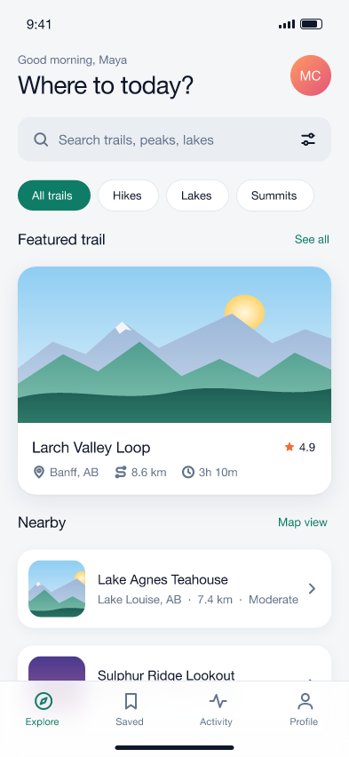
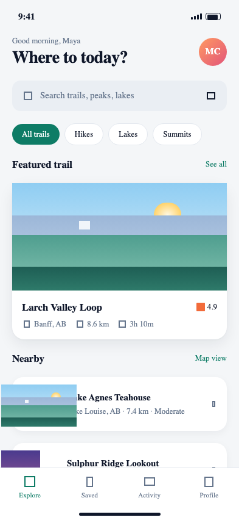

# ADR 0004: Code export uses FigCraft's own code generation; no React + Tailwind job (Story 7.2)

- **Status:** Accepted (2026-11-24)
- **Story:** 7.2 (decides 7.3)
- **Samples:** [`0004-export-code/`](0004-export-code/), all generated from FigCraft's
  `examples/ridgeline-app.figcraft` (frame "Home — Light", 393×852, 68 layers) with the headless
  `figcraft-cli` 0.18.1, the same release the app pins. Script: [`code.json`](0004-export-code/code.json)
  (`figcraft-cli run --in ridgeline-app.figcraft code.json`).

## Context

Before Story 1.2 the product promised "export to React + Tailwind". What existed was:

- deterministic exports in `packages/handoff` and `services/export.ts`: standalone HTML and a ZIP
  from the HTML renderer, plus a **handoff bundle** (`handoff.json`: node JSON, resolved tokens,
  reference HTML, intent notes) meant to be fed to a coding agent;
- a `codegen` job kind (`{target: 'react-tailwind'}`, `export:llm`, the generation model tier),
  **contracted but never implemented**: no prompt and no runner code. React + Tailwind never
  shipped.

Story 1.2 removed all of it with the HTML model. FigCraft now holds the design, and its Dev Mode
generates code itself. 7.3 (an Agent SDK job that reads node JSON and writes a project that builds
in the sandbox) should be built only if FigCraft's output isn't good enough.

## What FigCraft generates

All of these are editor commands, so the app reaches them through `packages/bridge` the same way
7.1 reaches `file.export`. They are deterministic, instant, use no model, and a Viewer can run them.

| Command                                               | Output                                                                                                                                                                                                                                                                                                                                                 |
| ----------------------------------------------------- | ------------------------------------------------------------------------------------------------------------------------------------------------------------------------------------------------------------------------------------------------------------------------------------------------------------------------------------------------------ |
| `inspect.code {language}`                             | `css` (one layer's declarations), `html`, `react`, `vue`, `leptos` (the layer tree, class names + a CSS file), **`tailwind`** (React + Tailwind v4 utilities, instances inlined with their overrides, bound variables as theme utilities, optional `mobile` frame → mobile-first `lg:` classes), `swiftui`, `compose`, `flutter`, `arkui`; `unit: rem` |
| `variable.export {format: 'tailwind' \| 'css' \| …}`  | the theme the `tailwind` utilities read (`@theme` block, other modes as `[data-theme="Dark"]`)                                                                                                                                                                                                                                                         |
| `inspect.componentCode`                               | a component's definition with typed props from its variants and properties, plus usage for an instance                                                                                                                                                                                                                                                 |
| `codeConnect.set` / `export` / `import`               | link a component to the team's real component (`importPath`, `name`, `template`); generated code then imports and calls it. Exported as `figcraft.connect.json`, and `figcraft-cli connect` publishes a repo's mappings to a file                                                                                                                      |
| `inspect.assets` + `file.exportLayers {assets: true}` | the icons (SVG) and images (PNG) to hand over with the code                                                                                                                                                                                                                                                                                            |

Samples: [`frame.tailwind.jsx`](0004-export-code/frame.tailwind.jsx) with
[`theme.tailwind.css`](0004-export-code/theme.tailwind.css), [`frame.jsx`](0004-export-code/frame.jsx)
(React + CSS), [`frame.swift`](0004-export-code/frame.swift); for one instance,
[`chip.jsx`](0004-export-code/chip.jsx) (component definition),
[`chip.tailwind.jsx`](0004-export-code/chip.tailwind.jsx) and, after `codeConnect.set`,
[`chip.connected.jsx`](0004-export-code/chip.connected.jsx):

```jsx
// chip.tailwind.jsx
export function Chip() {
  return (
    <div className="relative flex flex-row gap-[6px] py-2 px-4 items-center rounded-full bg-brand">
      <p className="text-onbrand font-['Inter'] text-[13px] font-medium leading-[1.4]">
        All trails
      </p>
    </div>
  );
}

// chip.connected.jsx (Code Connect: Chip → @/components/chip)
import { Chip } from '@/components/chip';

<Chip selected="On" />;
```

## Fidelity check

[`render.mjs`](0004-export-code/render.mjs) builds `frame.tailwind.jsx` with React 19 and
Tailwind 4.3 (theme from `variable.export`), with no hand edits, renders it in Chromium at 1×, and
diffs it against the editor's own PNG of the frame (`file.export`). It compiled and rendered first
time.

| Editor (`file.export`)                              | Generated React + Tailwind                              |
| --------------------------------------------------- | ------------------------------------------------------- |
|  |  |

**9.2 % of pixels differ** by more than 48/255 in any channel. Layout, spacing, colours, radii,
shadows, gradients, text and the instance overrides (chip labels, "Hikes", "Lakes") all match.
The differences, in order of size:

1. **Vector shapes are dropped.** Icons and the mountains become empty or bordered boxes. They are
   available as SVG through `inspect.assets` / `file.exportLayers {assets: true}`, but the code
   doesn't reference them.
2. **Clipping is lost.** The list thumbnails (a 64 px frame with clip content) have no
   `overflow-hidden`, so the landscape spills out.
3. **A frame's explicit variable mode is lost.** "Home — Dark" emits the same light utilities with
   no `data-theme="Dark"`: 81.7 % of pixels differ until it is wrapped in `data-theme="Dark"`, then 9.2 %.
4. **Fonts:** `font-['Inter']` with no font loading; Inter wasn't installed here, so both sides
   fell back (the browser to a serif). Not a code-generation problem, but a handoff should say so.

Other modes: `react`/`vue`/`html` keep instances as components (`<Chip />`, `<TrailCard />`) and
need each component's `inspect.componentCode` to build; a component with no text property loses
per-instance text there (all four chips print the main component's label). Every mode emits
`div`/`p` only: no `button`, `nav`, `img` or alt text.

## Options

1. **Build 7.3 now:** an Agent SDK job (generation tier, Editor role, Vercel Sandbox) that reads
   node JSON and writes a project that builds. Covers semantics, assets and a buildable project.
   Costs model tokens per run, minutes per run, the sandbox and job plumbing, and a model that can
   drift from the design; it would still start from FigCraft's node JSON and code.
2. **Use FigCraft's generated code as the code export** and fix its gaps in the fork. Instant,
   free, deterministic, available to Viewers, and matches Dev Mode exactly.
3. Both: FigCraft output, plus an optional LLM pass that turns it into a project.

## Decision

**Option 2. 7.3 is not needed now.** FigCraft's `tailwind` output is already the React + Tailwind
export we promised, it builds without edits and matches the design closely; the gaps above are
deterministic fixes in the generator, not reasons for a model. Code Connect covers the case an LLM
was best at (use the team's real components).

Follow-ups:

- **Copy code in the app** (small, Epic 7): add a "Code" tab to the 7.1 Export menu: `inspect.code`
  for the selection in `tailwind`, `react`, `css` and `swiftui`/`compose`; copy or download it with
  `variable.export {format: 'tailwind'}` and the `file.exportLayers {assets: true}` ZIP. Same
  bridge path and permission as 7.1 (`export:deterministic`).
- **Fork lane (Epic 2):** in the generator, emit `overflow-hidden` for clipped frames, reference
  exported SVG assets (or inline them) instead of empty boxes, and carry a frame's explicit
  variable mode as `data-theme`. Offer them upstream.
- **Revisit 7.3** only if users ask for a whole buildable project or semantic markup (buttons,
  landmarks, alt text) that generator fixes can't give. If we do, it starts from this output, not
  from raw node JSON.
- 7.4 (push to Figma) is unaffected.

## Consequences

- The `codegen` job kind and the `export:llm` permission have no user for now; leave them until a
  job needs them (Epic 4 may reuse `export:llm`), and drop them in the 8.x clean-up otherwise.
- Code quality now depends on FigCraft's generator, so fork syncs must re-run
  [`render.mjs`](0004-export-code/render.mjs) on the example file and compare the diff figure.
- Viewers get code export with no model cost, matching what the editor's own Dev Mode shows.
