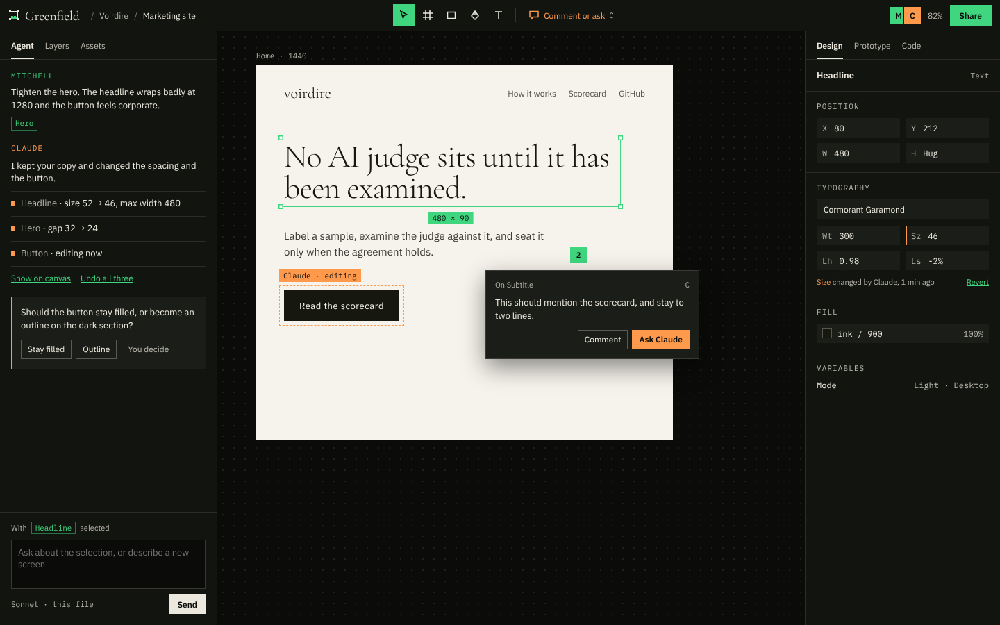
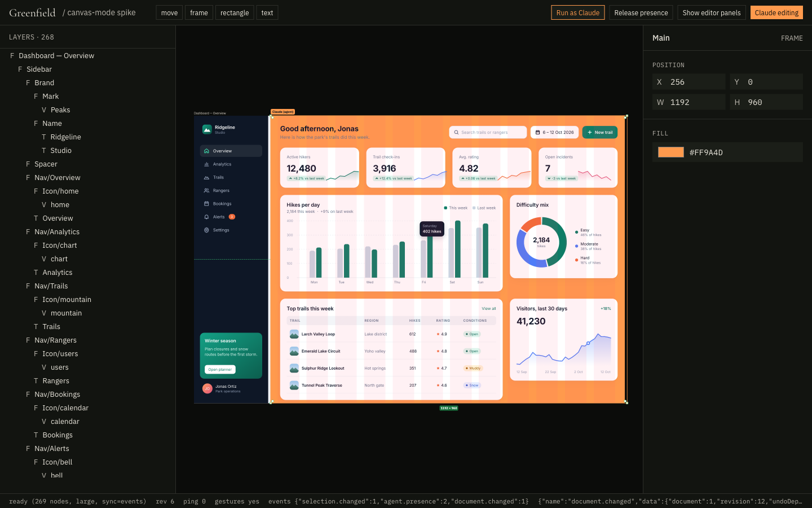
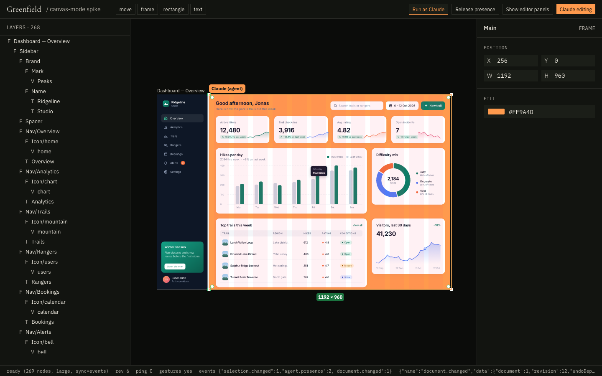
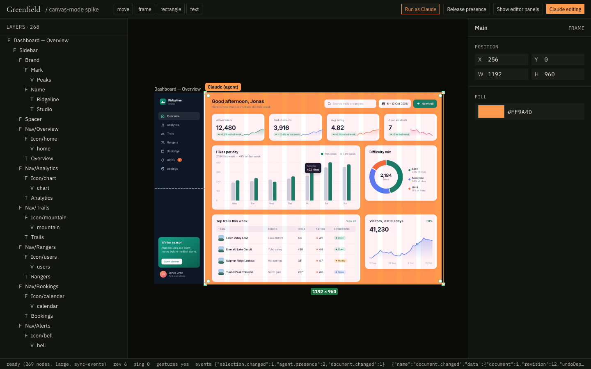
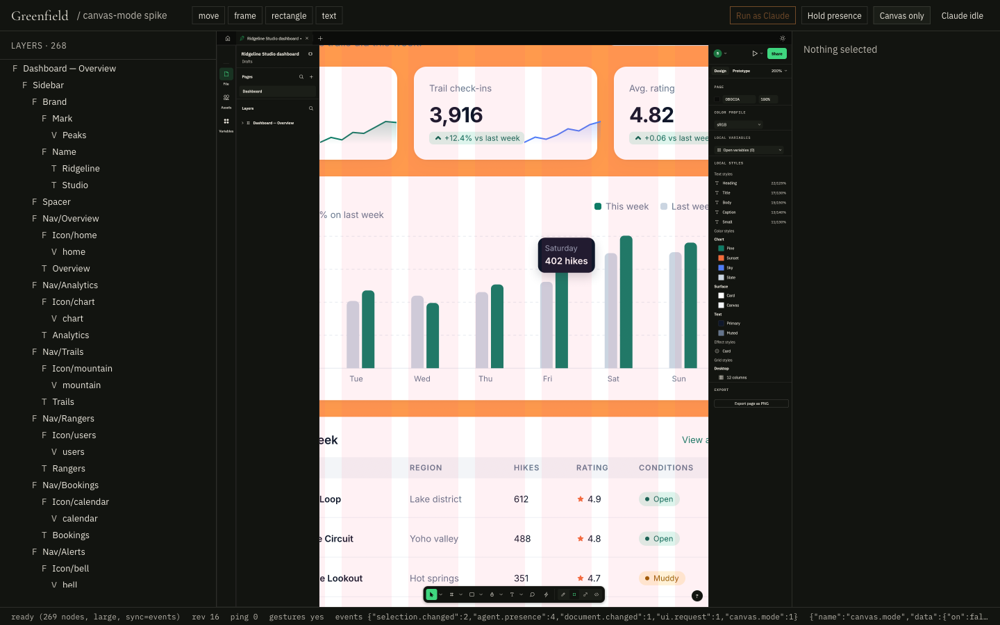

# ADR 0005: Canvas mode, with Greenfield's own chrome around the FigCraft canvas (Story 5.0)

- **Status:** Accepted (2026-11-24): **go** for Epic 5, on three conditions (see Decision).
- **Stories:** 5.0 (this spike), 2.11, 2.12, 2.4, 2.3 (SPEC D28, D29)
- **Date:** 2026-11-24
- **Raw data:** [`spikes/5.0-canvas-spike/results/`](../../spikes/5.0-canvas-spike/results/) (one JSON per
  run), regenerated into tables by `summarize.mjs`. The spike is `apps/web/src/app/dev/canvas-spike`
  (throwaway; Story 5.6 replaces it).

## Context

D28 moves the editor to canvas mode: the FigCraft fork draws only the canvas and everything around it
(toolbar, layers, inspector, menus) is Greenfield's React. The risk is that panels outside the editor feel
slower than panels inside it. The editor's own panels redraw in the same frame as the canvas. Ours have to
learn about a change across the iframe boundary, then render, then paint. The target in Story 5.0 is under one
frame (16 ms at 60 fps) of added latency.

The spike built a page laid out like [`docs/brand/mockups/editor.png`](../brand/mockups/editor.png): a top
bar, a React layers list, a React inspector (X, Y, W, H and fill) with scrubbable number fields, and the
editor in canvas mode in the middle. It ran first on today's editor (`view.toggleUi` plus polling), then on
each fork build as the Rust lane delivered it.

## Decision

**Go.** Canvas mode works in Chrome, Safari's engine and Firefox. Every feature the spike needed exists and
behaves: the canvas draws alone, right-click and colour pickers become host requests, a scrub is one undo
step and Esc restores it, Claude's presence holds for a turn in ember, and the editor's own panels come back
without a reload. Latency is the open item. With the events as shipped (ids only) the panels land 24 to 31 ms
after the canvas in Chrome and Firefox on the small and large files, 51 ms on the 5,002-node file, and 42 to
60 ms in Playwright's WebKit (see below). That is one to three frames at 60 fps, and far under what anyone
notices on a click. It does not meet the written target. The measured floor for an event that carries its data is 9 to 11 ms in Chrome and Firefox, inside one
frame. So the target is reachable, and the way to it is small.

Conditions:

1. **2.3 carries payloads.** `selection.changed` includes the selected layers' inspector fields (id, name,
   type, x, y, width, height, fills). `document.changed` includes the changed layers with their fields, and
   for added, removed and moved layers their id, parent and index. Without it every panel update costs one
   control call, and a control call costs at least 16 ms (below).
2. **5.6 has no polling.** The store applies event payloads. It reads the whole tree once on open and on
   `file.open`, never on a timer.
3. **Test on real Safari before Epic 5 ships.** Playwright's WebKit is Safari's engine but ran the editor at
   about 33 ms per frame headless, which bounds every WebKit number. It is not evidence about the real
   browser.

## What each patch does

Fork patches by the Rust lane, each on its own branch and PR (stacked; none merged). Wasm at the top of the
stack: 25,738,621 B (budget 26,214,400, headroom 475,779 B). Two clean builds from the pinned image give the
same wasm sha256 (`1668239248bf7239fb5a39a0673d0ab82cee75a93a30201538b644821d7dedc0`) and the same dist tree.

| Story | Patch                         | PR  | What it does                                                                                                                                                                                                                                                                                                                                                                                                                                                                                                                       |
| ----- | ----------------------------- | --- | ---------------------------------------------------------------------------------------------------------------------------------------------------------------------------------------------------------------------------------------------------------------------------------------------------------------------------------------------------------------------------------------------------------------------------------------------------------------------------------------------------------------------------------- |
| 2.11  | `0008-canvas-mode`            | #19 | `view.canvasMode {on?}` and `?canvas` (`?canvas=0` off). On: no tab bar, rail, panels, toolbar, menus or home screen; handles, size label, overlays and shortcuts stay. Turning it off redraws the panels the next frame, no reload. The editor posts `ui.request {kind, screen, data}` to the host instead of opening a context menu (`contextMenu`, with the selection ids), a colour picker (`colorPicker`, with its target), the comment tool (`comment.new`, page point) and keyboard-raised dialogs; and `canvas.mode {on}`. |
| 2.12  | `0009-gesture-commands`       | #20 | `edit.begin {label}`, `edit.preview {commands}`, `edit.commit`, `edit.cancel`, on the engine's interaction functions. A preview resets the document to the gesture start, then runs its commands, so values are absolute. Commit gives one undo step (none when the values end where they began). `edit.undo` and `edit.redo` refuse while a gesture is open.                                                                                                                                                                      |
| 2.4   | `0010-agent-presence`         | #21 | The agent colour is a theme token: `#ff9a4d` dark, `#a54a0f` light (a test checks 3:1 contrast). `agent.presence {name, active}` holds the avatar and outline for the whole turn, no 8 s linger until released. Host event `agent.presence {active, name, held, layers}`. `command.batch` already carried `agent` to every step through `engine.execute`; the gap was the page API, so `window.figcraft.executeAs(agent, command, params)` is new.                                                                                 |
| 2.3   | `0011-host-events`            | #22 | `selection.changed {document, page, ids}` and `document.changed {document, revision, undoDepth}`, at most once a frame. Fires on content change (edit, undo, redo, gesture preview), not on zoom or pan.                                                                                                                                                                                                                                                                                                                           |
| 8.1   | workflow + `fetch-editor.mjs` | #18 | Publishes the built site on push to `main`. Not part of this spike's measurements.                                                                                                                                                                                                                                                                                                                                                                                                                                                 |

Events travel as `window.parent.postMessage({type: 'figcraft:event', name, data})`.

## How it was measured

- **Browsers.** Chrome 158 (headed, Apple M4 Pro GPU, 120 Hz display), Playwright WebKit (Safari's engine,
  headless, Apple GPU), Playwright Firefox (headless). Real input through Playwright, so pointer and key events
  reach the page like a person's.
- **Files.** _Small_: a generated 14-node document. _Large_: `examples/ridgeline-studio-dashboard.figcraft`
  from FigCraft v0.18.1, 269 nodes, the biggest example at the pinned ref (60 KB; none is truly large).
  _Stress_: a generated 5,002-node document, Chrome only. The e2e spec's 20 MB case is one big image, which
  tests saving, not layers.
- **Build.** `next build` and `next start`, not the dev server. Each run starts with the machine at 75% CPU
  idle or more; a Docker build on the same machine had wrecked the first runs.
- **Clock.** One `performance.now()`, from the host page. Listeners on the editor are registered from the
  host, and the editor's `requestAnimationFrame` is wrapped to log when each editor frame ends.
- **Added over the canvas** = our panel painted minus the end of the first editor frame after the input. It is
  an upper bound on what the editor's own panel would beat us by, since the editor frame ends before the
  browser presents it.
- **Sync modes.** _poll_: `document.inspect` every 100 ms (today's detector polls every 400 ms).
  _pointer_: editor input as a hint, read one frame later. _events_: the 2.3 events, then one `node.get`.
  _floor_: an event posted from inside an editor frame to our React tree painted, with no read back.
- Up to 20 trials per cell (60 pointer moves for the scrub). p50 / p95 in ms.

## Numbers

**Canvas click to inspector.** Added over the canvas, p50 / p95 ms. Target: under 16.

| Browser           | File           | poll 100 ms | pointer hint | events (2.3 as shipped) | floor (event with data) |
| ----------------- | -------------- | ----------- | ------------ | ----------------------- | ----------------------- |
| Chrome            | small (14)     | 68 / 76     | 43 / 49      | 26 / 50                 | 9.0 / 10.3              |
| Chrome            | large (269)    | 66 / 109    | 43 / 44      | 26 / 27                 | 9.1 / 10.3              |
| Chrome            | stress (5,002) | n/a         | 51 / 75      | 51 / 53                 | 9.1 / 10.8              |
| Firefox           | small          | 74 / 120    | 49 / 72      | 24 / 35                 | 10 / 14                 |
| Firefox           | large          | 71 / 140    | 47 / 56      | 31 / 40                 | 11 / 13                 |
| WebKit (headless) | small          | 134 / 168   | 103 / 125    | 42 / 59                 | 36 / 38                 |
| WebKit (headless) | large          | 135 / 139   | 105 / 134    | 60 / 98                 | 35 / 39                 |

Absolute click to inspector, Chrome, large: poll 70 ms, pointer 46 ms, events 32 ms. The editor frame itself
finishes 3 to 8 ms after the click.

**Scrub to canvas repaint** (inspector scrub, 60 moves, `edit.preview` per move, two in flight).
Pointermove to the end of the next editor frame: Chrome 3 to 13 ms p50, Firefox 3 to 7 ms, WebKit 21 to 28 ms
(its frame period). 60 of 60 previews applied on every run. One undo step per scrub, on every browser and file.
Esc during a scrub restores the value in Chrome and WebKit. Steady state, a preview round trip is 17 ms
(the reply poll) and the canvas has already drawn it. p95 is 62 to 99 ms on Chrome where the first preview
after `edit.begin` on a 269-node file takes 60 to 90 ms. On the 5,002-node file p95 stays under 5 ms.

**Canvas edit to layers list.** Cmd+D on the canvas to the list painted with the new rows, p50 / p95 ms.

| Browser           | File           | pointer hint          | events  |
| ----------------- | -------------- | --------------------- | ------- |
| Chrome            | small          | 85 / 95               | 49 / 61 |
| Chrome            | large          | 318 / 325 (see below) | 40 / 44 |
| Chrome            | stress (5,002) | 107 / 113             | 76 / 86 |
| Firefox           | small          | 74 / 95               | 41 / 54 |
| Firefox           | large          | 83 / 130              | 54 / 57 |
| WebKit (headless) | large          | 147 / 158             | 88 / 89 |

A rename sent through the bridge (what the agent does) paints in 27 to 29 ms on Chrome and 34 to 37 ms on
Firefox with events. Re-reading the whole layers outline costs 18 ms for 269 nodes and 64 ms for 5,002. So the
list has to apply patches, not re-read the tree.

Full tables, with the controls: `spikes/5.0-canvas-spike/results/` and the Rust lane's
`notes-rust.md`.

## What the numbers say

- **A control call costs at least one reply poll.** `window.figcraft` resolves replies on a 16 ms timer
  (`POLL_MS` in `api.rs`). Every read measured 16.6 to 17.5 ms on Chrome at any document size, so polling,
  pointer hints and events-then-read all pay one or two of them. Pointer hints pay two (the revision gate,
  then `node.get`), which is why they land at 43 to 51 ms. Events skip the gate and land at 24 to 31 ms (51 ms
  on 5,002 nodes, where the first read after an edit waits behind a 64 ms tree read).
- **Only an event with its data can get under a frame.** The floor is the browser's own frame: 9 ms in Chrome
  on a 120 Hz display, 10 to 11 ms in Firefox, 36 ms in headless WebKit (its frame period). That is the whole
  cost of `postMessage` (0.2 ms) plus a React render plus the next paint.
- **Scrubbing is fine now.** The inspector shows the scrubbed value at once, the editor draws it in its next
  frame, and the engine's gesture gives one undo step. Nothing in it needs more from the fork.
- **The editor shares the host's main thread.** The iframe is same-origin, so a slow editor frame stalls our
  panels. In real Chrome, frames while the pointer moves took 0.4 ms of work (p50) and 0.7 ms (p95) even at
  5,002 nodes, so this did not bite. In software-rendered Chromium, with the machine busy, moving a 269-node
  frame took 130 ms per call and few of the pointer events reached our panels. Treat a machine without a GPU
  as a risk.

## Screenshots

Chrome on the large file, with Claude holding presence and a command run as `agent: "Claude"` (fill set to
ember, outline and name tag in ember). Left: the mockup. Right: the spike.

| Target                                            | Spike (Chrome)                                                   |
| ------------------------------------------------- | ---------------------------------------------------------------- |
|  |  |

The same state in the other two engines, and the fallback (the editor's own panels back, no reload):

| Safari engine                                       | Firefox                                               | Fallback (Chrome)                                             |
| --------------------------------------------------- | ----------------------------------------------------- | ------------------------------------------------------------- |
|  |  |  |

The spike's chrome is the app's brand tokens, not the final design, and the layers list has no icons or
drag handles. Two differences from the mockup are the fork's, not the spike's: the canvas stays light under
`view.themeDark` (the spike sets the page background to `#0b0c0a`, which edits the open document), and there
is no dot grid.

## What didn't work

- **Polling, with or without input hints.** 43 to 135 ms over the canvas, one to two control calls behind.
  Not a basis for panels.
- **Events with ids only.** Better (24 to 31 ms, 51 ms on 5,002 nodes) but still one control call behind. See condition 1.
- **`document.inspect.revision` as a change gate.** It moves on every command, zoom and pan included (the Rust
  lane's finding), so it fires the tree read on every click. Use `document.changed`.
- **Awaiting each preview.** A scrub capped at one preview per reply poll. The spike keeps two previews in
  flight and lets the newest value replace the one waiting.
- **One stuck gesture blocks all later ones.** `edit.begin` fails while a gesture is open, and a lost commit
  (a hidden tab, a dropped reply) leaves it open. The spike cancels and retries. The real store must too.
- **Esc during a scrub in Firefox.** In Playwright's Firefox the keydown does not reach the page while a mouse
  button is held, so the scrub finished instead of cancelling. Chrome and WebKit cancel. Not checked in a
  real Firefox.
- **Chrome, large file, pointer hints, top-of-stack build: 318 ms** from Cmd+D to the list (tree read 88 ms),
  reproduced twice. The 2.12 build in the same mode gave 75 ms and events mode gave 40 ms. Cause not found.
  Inferred: reads on every revision bump queue behind the editor frame. It only affects the fallback mode.
- **Headless Chromium.** Software GL made every number 3 to 6 times worse. All Chrome numbers are real Chrome.
- **Programmatic commands cannot raise dialogs.** `figcraft.execute` strips `dialog.*` requests, so only keys
  and menus reach the host. The host should not wait for a dialog request from its own commands.
- **The font menu and panel popovers never open in canvas mode.** They are drawn by the panels. Our pickers
  (5.10) replace them, and `colorPicker` is the one popover the canvas can still raise.
- **A host gesture and the user's own canvas drag share the engine's one interaction slot.** The store must
  not start a scrub while the canvas has an interaction open.
- **Presence shows only in the file in front and is display-only.**
- **The spike's canvas drag to inspector measurement** did not grab a layer on the small file, so it is
  reported only for Chrome and Firefox on the large file, where the inspector painted 17 to 20 times for a
  20-move drag and settled 7 to 27 ms after the pointer was released.

## SPEC.md changes recommended

Not edited here.

1. **2.3** Add payloads: `selection.changed` carries the selected layers' fields; `document.changed` carries
   changed layers (id and fields) and structure changes (added, removed, moved: id, parent, index). AC: with
   an event, our inspector paints within one frame of the canvas (measured floor 9 to 11 ms). Also name the
   event shapes as built: `{type: 'figcraft:event', name, data}`; `document.changed` fires on content, not on
   zoom or pan.
2. **2.3 or the page API** Resolve `window.figcraft` replies without the 16 ms poll (a callback when the
   command ran). It halves every control call, for the agent's reads too.
3. **2.1** The canvas background and the empty-canvas grid follow `view.themeDark` / `view.themeLight` in canvas
   mode, with no edit to the document. Today they stay light.
4. **2.11** AC lists the `ui.request` kinds as built (`contextMenu`, `colorPicker`, `comment.new`, and
   `dialog.*`, `panel.*`, `palette.*`, `home*`, `present*`, `preview*`, `layers.rename` from keys) and says
   programmatic commands raise none.
5. **2.12** AC: previews are absolute (each resets to the gesture start); the host keeps two in flight and the
   first preview on a big file can take 60 to 90 ms; `edit.begin` while a gesture is open fails; the host
   cancels a stale gesture. Add an event or a flag so the host knows the canvas has its own interaction open.
6. **2.4** Record the as-built names: `agent.presence {name, active}` and the event `agent.presence {active,
name: "Claude (agent)", held, layers}`; `executeAs`.
7. **5.0** Replace "feels as fast as the editor's own panels (target: under one frame of added latency)" with
   the measured definition: added over the canvas, p50 under one frame at the browser's cadence, with events
   that carry data. Mark 5.0 done on the go in this ADR.
8. **5.6** The store applies event payloads and patches the layers list; no timer polling. It reads the tree
   on open and on file change only. It cancels a stale gesture before a scrub.
9. **5.13** The fallback is proven: `view.canvasMode {on: false}` redraws the editor's panels with no reload.
   Keep it; note it brings the editor's own look back.
10. **Large file.** Define it in §7 or Epic 8: 269 nodes (the biggest FigCraft example) and 5,002 generated
    nodes are what 5.0 used; layers must patch, not re-read, above a few hundred nodes (tree read 18 ms at
    269, 64 ms at 5,002).
11. **Browser matrix.** Add a real-Safari pass (manual or `safaridriver`) to Epic 8; Playwright's WebKit
    headless runs the editor at about 33 ms a frame.
12. **§9** Add D31: panels read events, not polls; a read costs a frame.

## Consequences

- Epic 5 can start: 5.6 first, then 5.7, 5.8, 5.10 and 5.11 as separate lanes, once condition 1 is in the
  Rust lane's queue. Until then the panels work at 24 to 31 ms, which is fine to develop against.
- The fork carries four more patches (0008 to 0011) on top of #17. Offer 2.11 and 2.12 upstream (SPEC §10, question 5)
  so fewer carry.
- The spike stays in the tree until 5.6 replaces it, behind `CANVAS_SPIKE=1` in production builds and open in
  dev. `spikes/5.0-canvas-spike/` holds the measurement scripts so a later change can be re-measured with
  `run-matrix.mjs`.
