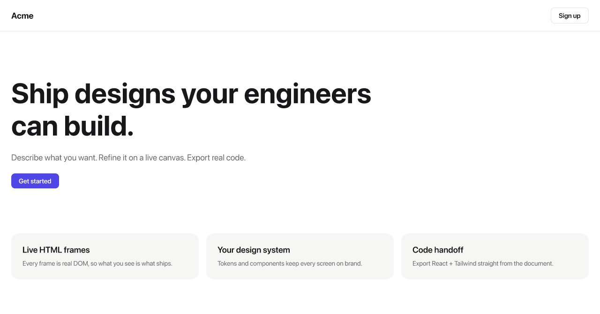
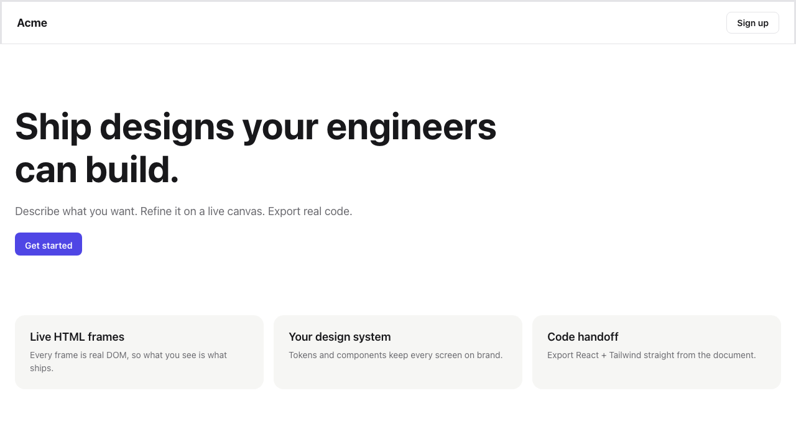
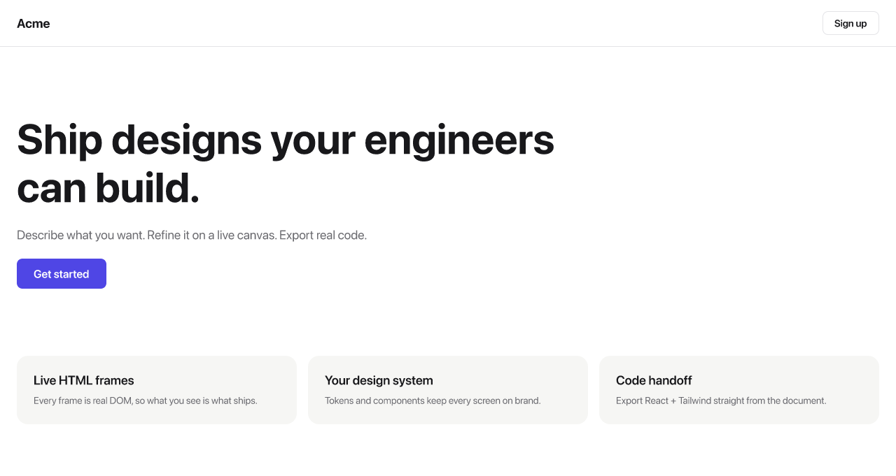
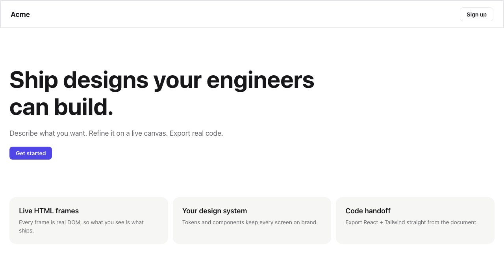
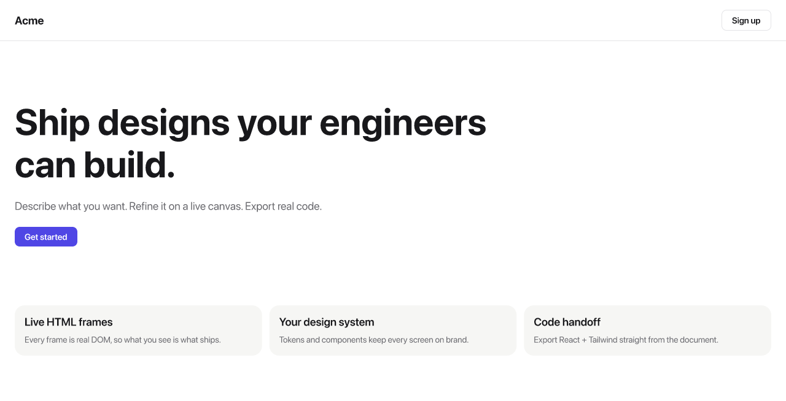
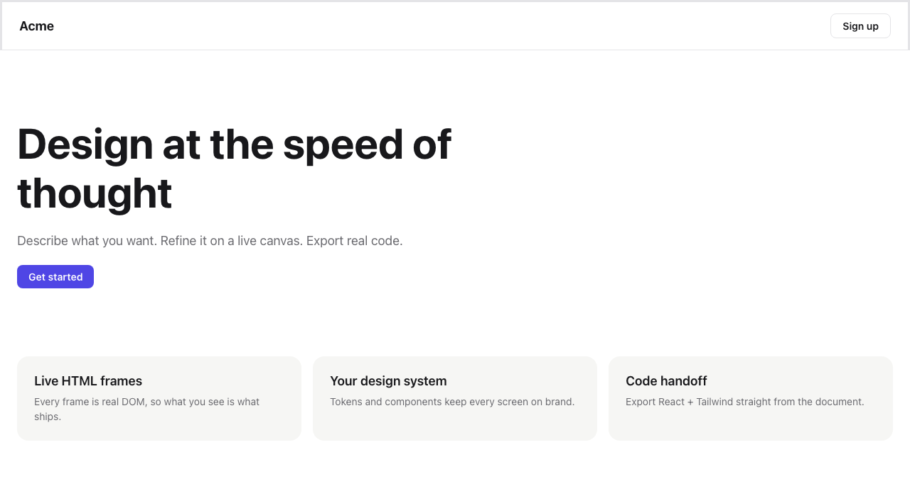
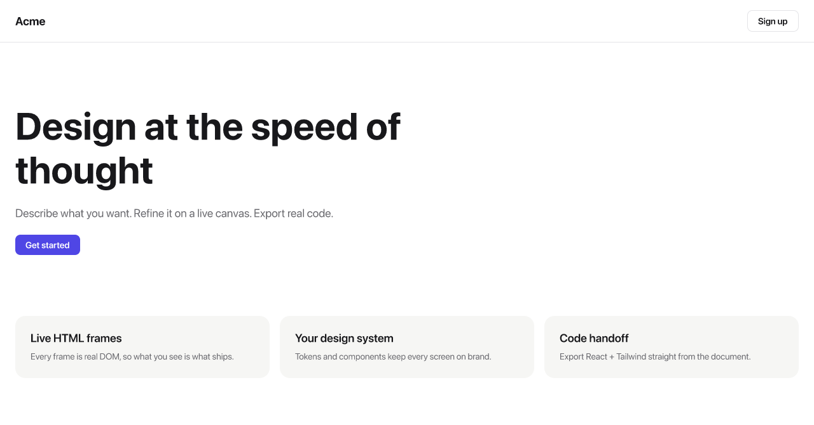

# Story 0.3: can Claude draw? FigCraft commands vs HTML frames

Model `claude-sonnet-5-5` via scripted, same model for both arms. Generated 2026-11-24T04:27:57.513Z.

> **Scripted run**: canned model turns, no network. Proves the pipeline only; says nothing about quality.

## Summary

Tokens are totals over the 6 cases; turns and wall time are per-case means.

| Arm / variant | Pass | Input (uncached) | Cache read | Cache write | Output | Est. cost | Turns | Wall |
|---|---|---|---|---|---|---|---|---|
| HTML frame (current agent) | 6/6 | 14400 | 48000 | 0 | 1800 | $0.0564 | 2.0 | 0.0 s |
| FigCraft `v1` | 6/6 | 20400 | 68000 | 0 | 2550 | $0.0799 | 2.8 | 0.0 s |

<details><summary>Method, adaptations and fixture gaps</summary>

- **Cases**: `evals/golden/interactive.json` (6 prompts on the `landing` fixture), same prompt text,
  selection and scope for both arms.
- **HTML arm**: the current interactive agent run as `packages/agent/src/evals/harness.ts` does
  (prefix, turn context, memory host with scope enforcement), rendered with `@crunch/renderer`'s
  static HTML in headless Chromium at 1280 px.
- **FigCraft arm**: headless `figcraft-cli mcp` (v0.18.1), fixture rebuilt with one `batch`
  (`spikes/0.3-agent/src/figcraft/fixture.ts`); each layer is named after its HTML node id. Same
  request shape (adaptive thinking, medium effort, cached prefix, automatic conversation
  breakpoint) and the same `suggest_generation_job` tool. Render = the `screenshot` tool (CPU
  renderer); `ui.render` is browser-only.
- **Touched layers** (FigCraft): layers named in mutating command params, plus a document diff
  that ignores layout-derived geometry (x/y, and width/height on hug/fill axes). Button label
  layers count as their button (the HTML Button is one instance node). Scoped requests are
  enforced like the HTML host: an out-of-scope edit is undone and returned as a tool error.
- **lintClean** (FigCraft): no ds-lint for layers, so touched layers are checked for off-token
  values (colours, font sizes, radii, gap/padding not in the token scales given in the prompt).
- **Not comparable**: the HTML agent also has `create_slider` and `ask_questions`; the FigCraft
  arm has neither (density-slider can only be an edit there).
- **Fixture gaps**: tokens are literal values (no variables/styles); the Button is a plain
  auto-layout frame, not a component instance; no responsive breakpoints (desktop/lg only);
  no semantic tags; `ch` max-widths approximated in px; grid cards hug instead of stretching
  to equal height; Inter isn't installed, so both arms fall back to SF Pro (Chromium picks the
  SF Text/Display optical size, so wrapping differs slightly).
</details>

## alternatives-offers-job

> What would this page look like with a completely different layout? I'd like to compare a few.

| Arm | Result | Turns | In | Cache r | Cache w | Out | Wall | Touched |
|---|---|---|---|---|---|---|---|---|
| HTML frame | pass | 2 | 2400 | 8000 | 0 | 300 | 0.0 s | – · job: alternatives |
| FigCraft `v1` | pass | 2 | 2400 | 8000 | 0 | 300 | 0.0 s | – · job: alternatives |

| HTML frame | FigCraft `v1` |
|---|---|
|  |  |

<details><summary>FigCraft <code>v1</code>: reply and commands</summary>

```json
{
 "reply": "That is bigger than a quick edit, so I am offering a background job.\nOffered a job.",
 "commands": []
}
```
</details>

<details><summary>HTML frame: reply and patches</summary>

```json
{
 "reply": "That is bigger than a quick edit, so I am offering a background job.\nOffered a job.",
 "commits": []
}
```
</details>

## button-larger-scoped

> Make this button larger.

| Arm | Result | Turns | In | Cache r | Cache w | Out | Wall | Touched |
|---|---|---|---|---|---|---|---|---|
| HTML frame | pass | 2 | 2400 | 8000 | 0 | 300 | 0.0 s | n_herocta001 |
| FigCraft `v1` | pass | 4 | 4800 | 16000 | 0 | 600 | 0.0 s | n_herocta001 |

| HTML frame | FigCraft `v1` |
|---|---|
|  |  |

<details><summary>FigCraft <code>v1</code>: reply and commands</summary>

```json
{
 "reply": "Made the button larger: more padding and a 16px label.",
 "commands": [
  {
   "command": "node.set",
   "params": {
    "ids": [
     10
    ],
    "props": {
     "padding": [
      12,
      24,
      12,
      24
     ]
    }
   }
  },
  {
   "command": "node.set",
   "params": {
    "ids": [
     11
    ],
    "props": {
     "fontSize": 16
    }
   }
  }
 ]
}
```
</details>

<details><summary>HTML frame: reply and patches</summary>

```json
{
 "reply": "Made the button larger.",
 "commits": [
  {
   "ops": [
    {
     "op": "setStyle",
     "id": "n_herocta001",
     "breakpoint": "base",
     "prop": "paddingTop",
     "value": {
      "token": "space.3"
     }
    }
   ],
   "label": "larger"
  }
 ]
}
```
</details>

## density-slider

> Give me a control to adjust how dense the feature cards are.

| Arm | Result | Turns | In | Cache r | Cache w | Out | Wall | Touched |
|---|---|---|---|---|---|---|---|---|
| HTML frame | pass | 2 | 2400 | 8000 | 0 | 300 | 0.0 s | n_features01 |
| FigCraft `v1` | pass | 3 | 3600 | 12000 | 0 | 450 | 0.0 s | n_features01, n_feat1card00, n_feat2card00, n_feat3card00 |

| HTML frame | FigCraft `v1` |
|---|---|
|  |  |

<details><summary>FigCraft <code>v1</code>: reply and commands</summary>

```json
{
 "reply": "Tightened the feature grid gap to 12 and card padding to 16.",
 "commands": [
  {
   "command": "node.set",
   "params": {
    "ids": [
     12
    ],
    "props": {
     "gap": 12
    }
   }
  },
  {
   "command": "node.set",
   "params": {
    "ids": [
     13,
     16,
     19
    ],
    "props": {
     "padding": 16
    }
   }
  }
 ]
}
```
</details>

<details><summary>HTML frame: reply and patches</summary>

```json
{
 "reply": "Tightened the grid gap.",
 "commits": [
  {
   "ops": [
    {
     "op": "setStyle",
     "id": "n_features01",
     "breakpoint": "base",
     "prop": "gap",
     "value": {
      "token": "space.3"
     }
    }
   ],
   "label": "tighten"
  }
 ]
}
```
</details>

## feature-cards-spacing

> Tighten the spacing in the features section a bit.

| Arm | Result | Turns | In | Cache r | Cache w | Out | Wall | Touched |
|---|---|---|---|---|---|---|---|---|
| HTML frame | pass | 2 | 2400 | 8000 | 0 | 300 | 0.0 s | n_features01 |
| FigCraft `v1` | pass | 3 | 3600 | 12000 | 0 | 450 | 0.0 s | n_features01, n_feat1card00, n_feat2card00, n_feat3card00 |

| HTML frame | FigCraft `v1` |
|---|---|
|  |  |

<details><summary>FigCraft <code>v1</code>: reply and commands</summary>

```json
{
 "reply": "Tightened the feature grid gap to 12 and card padding to 16.",
 "commands": [
  {
   "command": "node.set",
   "params": {
    "ids": [
     12
    ],
    "props": {
     "gap": 12
    }
   }
  },
  {
   "command": "node.set",
   "params": {
    "ids": [
     13,
     16,
     19
    ],
    "props": {
     "padding": 16
    }
   }
  }
 ]
}
```
</details>

<details><summary>HTML frame: reply and patches</summary>

```json
{
 "reply": "Tightened the grid gap.",
 "commits": [
  {
   "ops": [
    {
     "op": "setStyle",
     "id": "n_features01",
     "breakpoint": "base",
     "prop": "gap",
     "value": {
      "token": "space.3"
     }
    }
   ],
   "label": "tighten"
  }
 ]
}
```
</details>

## headline-copy

> Change this headline to 'Design at the speed of thought'.

| Arm | Result | Turns | In | Cache r | Cache w | Out | Wall | Touched |
|---|---|---|---|---|---|---|---|---|
| HTML frame | pass | 2 | 2400 | 8000 | 0 | 300 | 0.0 s | n_herotitle1 |
| FigCraft `v1` | pass | 3 | 3600 | 12000 | 0 | 450 | 0.0 s | n_herotitle1 |

| HTML frame | FigCraft `v1` |
|---|---|
|  |  |

<details><summary>FigCraft <code>v1</code>: reply and commands</summary>

```json
{
 "reply": "Updated the headline.",
 "commands": [
  {
   "command": "text.set",
   "params": {
    "id": 8,
    "characters": "Design at the speed of thought"
   }
  }
 ]
}
```
</details>

<details><summary>HTML frame: reply and patches</summary>

```json
{
 "reply": "Updated the headline.",
 "commits": [
  {
   "ops": [
    {
     "op": "setProps",
     "id": "n_herotitle1",
     "patch": {
      "text": "Design at the speed of thought"
     }
    }
   ],
   "label": "headline"
  }
 ]
}
```
</details>

## pricing-page-offers-job

> Now add a full pricing page with three tiers and an FAQ.

| Arm | Result | Turns | In | Cache r | Cache w | Out | Wall | Touched |
|---|---|---|---|---|---|---|---|---|
| HTML frame | pass | 2 | 2400 | 8000 | 0 | 300 | 0.0 s | – · job: generate |
| FigCraft `v1` | pass | 2 | 2400 | 8000 | 0 | 300 | 0.0 s | – · job: generate |

| HTML frame | FigCraft `v1` |
|---|---|
|  |  |

<details><summary>FigCraft <code>v1</code>: reply and commands</summary>

```json
{
 "reply": "That is bigger than a quick edit, so I am offering a background job.\nOffered a job.",
 "commands": []
}
```
</details>

<details><summary>HTML frame: reply and patches</summary>

```json
{
 "reply": "That is bigger than a quick edit, so I am offering a background job.\nOffered a job.",
 "commits": []
}
```
</details>

