# Story 0.3: can Claude draw? FigCraft commands vs HTML frames

Model `claude-sonnet-5-5` via gateway-oidc, same model for both arms. Generated 2026-11-24T16:35:09.508Z.

## Summary

Tokens are totals over the 6 cases; turns and wall time are per-case means.

| Arm / variant | Pass | Input (uncached) | Cache read | Cache write | Output | Est. cost | Turns | Wall |
|---|---|---|---|---|---|---|---|---|
| HTML frame (current agent) | 6/8 | 50 | 404751 | 109065 | 15704 | $0.5108 | 2.1 | 11.6 s |
| FigCraft `curated` | 5/6 | 38 | 83911 | 23780 | 3465 | $0.1110 | 2.2 | 5.9 s |
| FigCraft `full-catalog` | 5/6 | 36 | 447453 | 162363 | 3339 | $0.5289 | 2.0 | 6.2 s |
| FigCraft `minimal` | 5/6 | 64 | 240313 | 75479 | 5704 | $0.2939 | 4.3 | 9.9 s |
| FigCraft `run-command` | 6/6 | 50 | 136930 | 28862 | 3964 | $0.1393 | 3.2 | 7.7 s |
| FigCraft `v1` | 7/8 | 72 | 288000 | 65256 | 14176 | $0.3626 | 3.5 | 14.0 s |
| FigCraft `v1-auto-render` | 5/6 | 36 | 77501 | 32350 | 3258 | $0.1290 | 2.0 | 5.6 s |
| FigCraft `v1-no-render` | 5/6 | 36 | 82367 | 20620 | 3175 | $0.0998 | 2.0 | 5.7 s |
| FigCraft `v2` | 8/8 | 66 | 260152 | 75459 | 13541 | $0.3762 | 3.1 | 12.6 s |

<details><summary>Method, adaptations and fixture gaps</summary>

- **Cases**: `evals/golden/interactive.json` (6 prompts on the `landing` fixture), same prompt text,
  selection and scope for both arms.
- **HTML arm**: the current interactive agent run as `packages/agent/src/evals/harness.ts` does
  (prefix, turn context, memory host with scope enforcement), rendered with `@greenfield/renderer`'s
  static HTML in headless Chromium at 1280 px.
- **FigCraft arm**: headless `figcraft-cli mcp` (v0.18.1), fixture rebuilt with one `batch`
  (`spikes/0.3-agent/src/figcraft/fixture.ts`); each layer is named after its HTML node id. Same
  request shape (adaptive thinking, medium effort, cached prefix, automatic conversation
  breakpoint) and the same `suggest_generation_job` tool. Render = the `screenshot` tool (CPU
  renderer); `ui.render` is browser-only.
- **Touched layers** (FigCraft): layers named in mutating command params, plus a document diff
  that ignores layout-derived geometry (x/y, and width/height on hug/fill axes). Button label
  layers count as their button (the HTML Button is one instance node). Scoped requests are
  enforced like the HTML host: an out-of-scope edit is undone and returned as a tool error.
- **lintClean** (FigCraft): no ds-lint for layers, so touched layers are checked for off-token
  values (colours, font sizes, radii, gap/padding not in the token scales given in the prompt).
- **Not comparable**: the HTML agent also has `create_slider` and `ask_questions`; the FigCraft
  arm has neither (density-slider can only be an edit there).
- **Fixture gaps**: tokens are literal values (no variables/styles); the Button is a plain
  auto-layout frame, not a component instance; no responsive breakpoints (desktop/lg only);
  no semantic tags; `ch` max-widths approximated in px; grid cards hug instead of stretching
  to equal height; Inter isn't installed, so both arms fall back to SF Pro (Chromium picks the
  SF Text/Display optical size, so wrapping differs slightly).
</details>

## alternatives-offers-job

> What would this page look like with a completely different layout? I'd like to compare a few.

| Arm | Result | Turns | In | Cache r | Cache w | Out | Wall | Touched |
|---|---|---|---|---|---|---|---|---|
| HTML frame | **fail**: job suggestion: expected alternatives, got null | 1 | 4 | 27380 | 613 | 594 | 4.7 s | – |
| FigCraft `curated` | pass | 2 | 6 | 12789 | 1428 | 465 | 4.9 s | – · job: alternatives |
| FigCraft `full-catalog` | pass | 2 | 6 | 97983 | 1385 | 416 | 5.5 s | – · job: alternatives |
| FigCraft `minimal` | pass | 2 | 6 | 8191 | 1389 | 412 | 4.9 s | – · job: alternatives |
| FigCraft `run-command` | pass | 2 | 6 | 13127 | 1372 | 407 | 5.1 s | – · job: alternatives |
| FigCraft `v1` | pass | 2 | 6 | 14277 | 1378 | 362 | 4.7 s | – · job: alternatives |
| FigCraft `v1-auto-render` | pass | 2 | 6 | 14299 | 1415 | 437 | 5.1 s | – · job: alternatives |
| FigCraft `v1-no-render` | pass | 2 | 6 | 13979 | 1440 | 459 | 5.2 s | – · job: alternatives |
| FigCraft `v2` | pass | 2 | 6 | 15023 | 1398 | 400 | 5.2 s | – · job: alternatives |

| HTML frame | FigCraft `curated` | FigCraft `full-catalog` | FigCraft `minimal` | FigCraft `run-command` | FigCraft `v1` | FigCraft `v1-auto-render` | FigCraft `v1-no-render` | FigCraft `v2` |
|---|---|---|---|---|---|---|---|---|
| 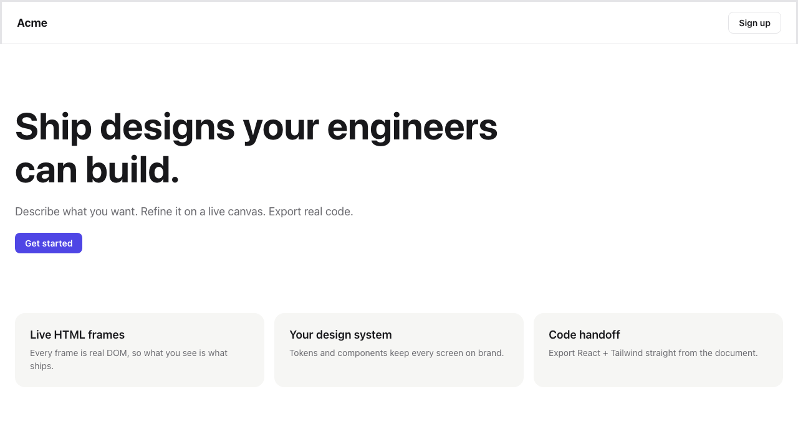 |  |  |  |  |  |  |  |  |

<details><summary>FigCraft <code>curated</code>: reply and commands</summary>

```json
{
 "reply": "I haven't changed anything on the page. Comparing several full-page layouts needs new frames, so I've offered a background job that makes 3 alternatives. Your current page stays as it is. The job keeps your copy and design tokens and changes the structure. Examples are a split hero, a centered hero, and a bento-style feature grid. Start the job if you want to compare them.",
 "commands": []
}
```
</details>

<details><summary>FigCraft <code>full-catalog</code>: reply and commands</summary>

```json
{
 "reply": "Comparing layouts means building several new versions of the page. I've offered a background job that makes three alternatives of the page, so I haven't changed your current design. The three are a split hero, a centered hero over a feature grid, and a stacked layout with alternating feature rows. All three keep your copy and design tokens. Start the job if you'd like to compare them.",
 "commands": []
}
```
</details>

<details><summary>FigCraft <code>minimal</code>: reply and commands</summary>

```json
{
 "reply": "I haven't changed your page. Comparing several full layouts means making new frames, so I've offered a background job that creates 3 alternatives of the page. They would keep your copy and design tokens. One would have a split hero, one a centered hero with a card grid, and one a stacked feature list. Start the job if you'd like to see them.",
 "commands": []
}
```
</details>

<details><summary>FigCraft <code>run-command</code>: reply and commands</summary>

```json
{
 "reply": "I haven't changed your page. Comparing completely different layouts means making new frames, so I've offered a background job that creates 3 alternatives of the page. Each one keeps your content and design tokens. The layouts are a split hero, a centered hero with a 3-column feature grid, and a stacked layout with alternating feature rows. You can start the job when you're ready.",
 "commands": []
}
```
</details>

<details><summary>FigCraft <code>v1</code>: reply and commands</summary>

```json
{
 "reply": "I've offered a background job that would make 3 alternative layouts of the page. Comparing different layouts means building new full-page frames, so I didn't edit your current page. Start the job if you want to compare them.",
 "commands": []
}
```
</details>

<details><summary>FigCraft <code>v1-auto-render</code>: reply and commands</summary>

```json
{
 "reply": "I haven't changed your page. Comparing several layouts means making new alternative frames, so I've offered a background job that makes 3 versions of the page. They would be a split hero, a centered hero with a feature grid, and alternating feature rows. All three keep your copy and design tokens. Start the job if you'd like to see them.",
 "commands": []
}
```
</details>

<details><summary>FigCraft <code>v1-no-render</code>: reply and commands</summary>

```json
{
 "reply": "I've offered a job that would make 3 alternative layouts of the page. Your current design stays as it is. The alternatives would keep your copy and design tokens. Each would change the structure, for example a split hero, a centered hero with stacked features, or a bento-style feature grid. Start the job if you want to compare them.",
 "commands": []
}
```
</details>

<details><summary>FigCraft <code>v2</code>: reply and commands</summary>

```json
{
 "reply": "I haven't changed your page. Comparing layouts means building several new full-page frames, so I've offered a background job that creates 3 alternatives from the current page. Each one keeps your copy and design tokens. If you start the job, you can compare the results next to the original.",
 "commands": []
}
```
</details>

<details><summary>HTML frame: reply and patches</summary>

```json
{
 "reply": "I can set up a few layout alternatives to compare. First, a few questions to steer them.",
 "commits": [],
 "notes": [
  "turn ended on ask_questions"
 ]
}
```
</details>

## button-larger-scoped

> Make this button larger.

| Arm | Result | Turns | In | Cache r | Cache w | Out | Wall | Touched |
|---|---|---|---|---|---|---|---|---|
| HTML frame | pass | 2 | 6 | 27621 | 28144 | 458 | 3.6 s | n_herocta001 |
| FigCraft `curated` | pass | 2 | 6 | 12393 | 940 | 233 | 2.9 s | n_herocta001 |
| FigCraft `full-catalog` | pass | 2 | 6 | 49119 | 49412 | 229 | 3.4 s | n_herocta001 |
| FigCraft `minimal` | pass | 4 | 10 | 27143 | 18845 | 458 | 7.3 s | n_herocta001 |
| FigCraft `run-command` | pass | 3 | 8 | 13637 | 7042 | 288 | 5.1 s | n_herocta001 |
| FigCraft `v1` | pass | 2 | 6 | 7266 | 7573 | 241 | 4.0 s | n_herocta001 |
| FigCraft `v1-auto-render` | pass | 2 | 6 | 7277 | 7469 | 191 | 3.4 s | n_herocta001 |
| FigCraft `v1-no-render` | pass | 2 | 6 | 7117 | 7322 | 245 | 3.8 s | n_herocta001 |
| FigCraft `v2` | pass | 2 | 6 | 7639 | 7930 | 234 | 3.3 s | n_herocta001 |

| HTML frame | FigCraft `curated` | FigCraft `full-catalog` | FigCraft `minimal` | FigCraft `run-command` | FigCraft `v1` | FigCraft `v1-auto-render` | FigCraft `v1-no-render` | FigCraft `v2` |
|---|---|---|---|---|---|---|---|---|
| 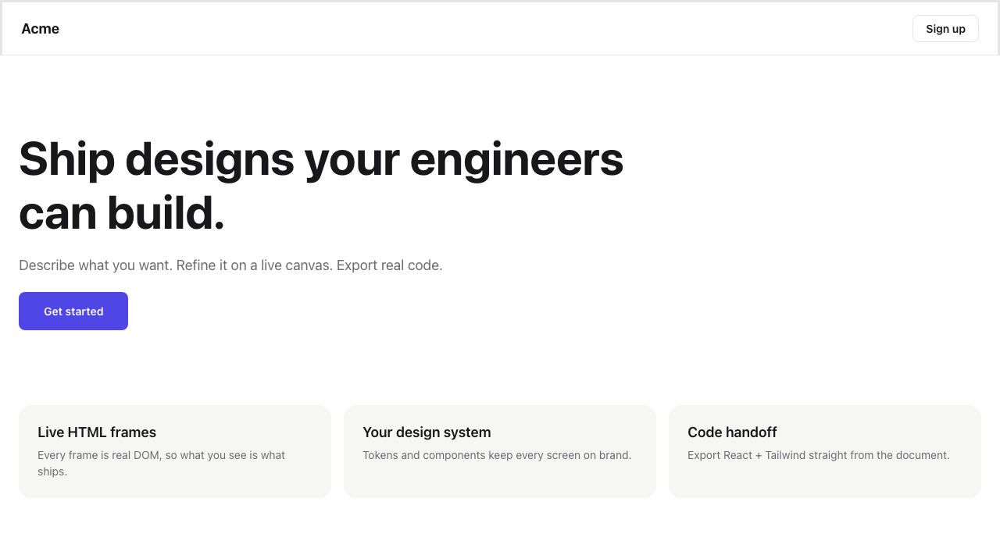 | 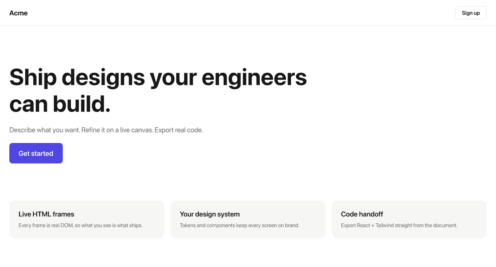 |  | 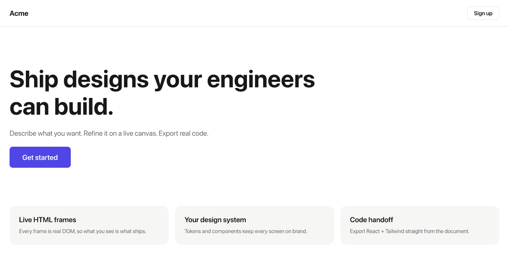 |  | 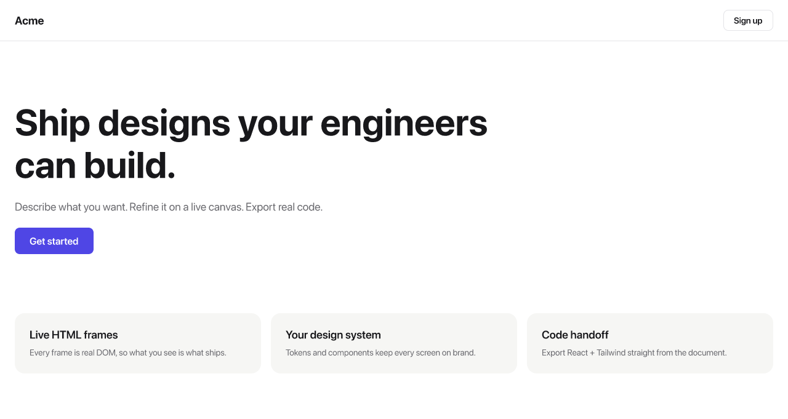 |  |  |  |

<details><summary>FigCraft <code>curated</code>: reply and commands</summary>

```json
{
 "reply": "I made the button larger. The padding went from 8/16 to 16/24, and the label font size went from 14 to 18. Both values come from the design tokens. The button still sizes itself to its content. I rendered it afterward and it looks right.",
 "commands": [
  {
   "command": "node.set",
   "params": {
    "id": 10,
    "padding": [
     16,
     24,
     16,
     24
    ],
    "cornerRadius": 8
   }
  },
  {
   "command": "node.set",
   "params": {
    "id": 11,
    "fontSize": 18
   }
  }
 ]
}
```
</details>

<details><summary>FigCraft <code>full-catalog</code>: reply and commands</summary>

```json
{
 "reply": "I made the button larger. I raised the padding from 8/16 to 16/32 and the label font size from 14 to 18. I left the corner radius and colors alone. The render shows the button hugging its text correctly.",
 "commands": [
  {
   "command": "node.set",
   "params": {
    "ids": [
     10
    ],
    "padding": [
     16,
     32,
     16,
     32
    ],
    "cornerRadius": 8
   }
  },
  {
   "command": "node.set",
   "params": {
    "ids": [
     11
    ],
    "fontSize": 18
   }
  }
 ]
}
```
</details>

<details><summary>FigCraft <code>minimal</code>: reply and commands</summary>

```json
{
 "reply": "I made the button larger. Its padding is now 16px top and bottom and 32px left and right, up from 8px and 16px. The label is 18px, up from 14px. Both values come from the design system's spacing and size tokens. The corner radius is still 8px. The render looks right.",
 "commands": [
  {
   "command": "node.set",
   "params": {
    "ids": [
     10
    ],
    "padding": [
     16,
     32,
     16,
     32
    ],
    "cornerRadius": 8
   }
  },
  {
   "command": "node.set",
   "params": {
    "ids": [
     11
    ],
    "fontSize": 18
   }
  }
 ]
}
```
</details>

<details><summary>FigCraft <code>run-command</code>: reply and commands</summary>

```json
{
 "reply": "I made the button larger. I raised the padding from 8/16 to 12/24 and the label from 14 to 16. The button is still hugging its content, so it grows with the text. I rendered it afterward and it looks right.",
 "commands": [
  {
   "command": "node.set",
   "params": {
    "ids": [
     10
    ],
    "padding": [
     12,
     24,
     12,
     24
    ]
   }
  },
  {
   "command": "node.set",
   "params": {
    "ids": [
     11
    ],
    "fontSize": 16
   }
  }
 ]
}
```
</details>

<details><summary>FigCraft <code>v1</code>: reply and commands</summary>

```json
{
 "reply": "I'll increase the padding and font size using tokens: padding 12/24, font 16.\nI made the button larger. I raised the padding from 8/16 to 12/24 and the label size from 14 to 16. Both values come from the design tokens. I rendered it, and the button looks correct.",
 "commands": [
  {
   "command": "node.set",
   "params": {
    "id": 10,
    "padding": [
     12,
     24,
     12,
     24
    ]
   }
  },
  {
   "command": "node.set",
   "params": {
    "id": 11,
    "fontSize": 16
   }
  }
 ]
}
```
</details>

<details><summary>FigCraft <code>v1-auto-render</code>: reply and commands</summary>

```json
{
 "reply": "I made the button larger. I increased its padding from 8/16 to 16/24 and the label size from 14 to 18. It still hugs its content, so it grew to fit. The corner radius is unchanged at 8, and the render looks right.",
 "commands": [
  {
   "command": "node.set",
   "params": {
    "id": 10,
    "padding": [
     16,
     24,
     16,
     24
    ],
    "cornerRadius": 8
   }
  },
  {
   "command": "node.set",
   "params": {
    "id": 11,
    "fontSize": 18
   }
  }
 ]
}
```
</details>

<details><summary>FigCraft <code>v1-no-render</code>: reply and commands</summary>

```json
{
 "reply": "I made the button larger. The label is now 16px instead of 14px, and the padding is 12px top and bottom and 24px left and right, up from 8px and 16px. The button hugs its content, so it grows to fit. I haven't checked the new dimensions.",
 "commands": [
  {
   "command": "node.set",
   "params": {
    "ids": [
     11
    ],
    "fontSize": 16
   }
  },
  {
   "command": "node.set",
   "params": {
    "ids": [
     10
    ],
    "padding": [
     12,
     24,
     12,
     24
    ]
   }
  }
 ]
}
```
</details>

<details><summary>FigCraft <code>v2</code>: reply and commands</summary>

```json
{
 "reply": "I made the button larger. I increased the padding from 8/16 to 16/32 and the label size from 14 to 18. The fill, corner radius and Semibold weight are the same. In the render it looks balanced and the label isn't clipped.",
 "commands": [
  {
   "command": "node.set",
   "params": {
    "id": 10,
    "padding": [
     16,
     32,
     16,
     32
    ],
    "cornerRadius": 8
   }
  },
  {
   "command": "node.set",
   "params": {
    "id": 11,
    "fontSize": 18
   }
  }
 ]
}
```
</details>

<details><summary>HTML frame: reply and patches</summary>

```json
{
 "reply": "I made the CTA button larger. It now has more padding (1rem top and bottom, 2rem left and right) and a larger label size (`text.lg`). The lint check found no issues.",
 "commits": [
  {
   "ops": [
    {
     "op": "setStyle",
     "id": "n_herocta001",
     "breakpoint": "base",
     "prop": "paddingTop",
     "value": {
      "token": "space.4"
     }
    },
    {
     "op": "setStyle",
     "id": "n_herocta001",
     "breakpoint": "base",
     "prop": "paddingBottom",
     "value": {
      "token": "space.4"
     }
    },
    {
     "op": "setStyle",
     "id": "n_herocta001",
     "breakpoint": "base",
     "prop": "paddingLeft",
     "value": {
      "token": "space.8"
     }
    },
    {
     "op": "setStyle",
     "id": "n_herocta001",
     "breakpoint": "base",
     "prop": "paddingRight",
     "value": {
      "token": "space.8"
     }
    },
    {
     "op": "setStyle",
     "id": "n_herocta001",
     "breakpoint": "base",
     "prop": "fontSize",
     "value": {
      "token": "text.lg"
     }
    }
   ],
   "label": "Make CTA button larger"
  }
 ]
}
```
</details>

## density-slider

> Give me a control to adjust how dense the feature cards are.

| Arm | Result | Turns | In | Cache r | Cache w | Out | Wall | Touched |
|---|---|---|---|---|---|---|---|---|
| HTML frame | pass | 2 | 6 | 57064 | 4049 | 1725 | 11.3 s | – |
| FigCraft `curated` | **fail**: patch scope: touched outside n_features01: new:22, new:23, new:24, new:25, new:26, new:27, new:28, new:29, new:30 | 2 | 6 | 15358 | 6625 | 1617 | 12.1 s | new:22, new:23, new:24, new:25, new:26, new:27, new:28, new:29, new:30 |
| FigCraft `full-catalog` | **fail**: patch scope: touched outside n_features01: new:22, new:23, new:24, new:25, new:26, new:27, new:28, new:29, new:30 | 2 | 6 | 100552 | 6601 | 1555 | 11.6 s | new:22, new:23, new:24, new:25, new:26, new:27, new:28, new:29, new:30 |
| FigCraft `minimal` | **fail**: patch scope: touched outside n_features01: new:22, new:23, new:24, new:25, new:26, new:27, new:28, new:29, new:30 | 8 | 18 | 136379 | 23504 | 3466 | 29.2 s | new:22, new:23, new:24, new:25, new:26, new:27, new:28, new:29, new:30 |
| FigCraft `run-command` | pass | 5 | 12 | 48812 | 6136 | 1868 | 17.3 s | n_features01, new:22, new:23, new:24, new:25, new:26, new:27, new:28 |
| FigCraft `v1` | **fail**: patch scope: touched outside n_features01: new:22, new:23, new:24, new:25, new:26, new:27, new:28, new:29 | 5 | 12 | 59966 | 10817 | 1983 | 18.9 s | new:22, new:23, new:24, new:25, new:26, new:27, new:28, new:29 |
| FigCraft `v1-auto-render` | **fail**: patch scope: touched outside n_features01: new:22, new:23, new:24, new:25, new:26, new:27, new:28, new:29, new:30 | 2 | 6 | 16868 | 7869 | 1688 | 11.9 s | new:22, new:23, new:24, new:25, new:26, new:27, new:28, new:29, new:30 |
| FigCraft `v1-no-render` | **fail**: patch scope: touched outside n_features01: new:22, new:23, new:24, new:25, new:26, new:27, new:28 | 2 | 6 | 16548 | 5096 | 1481 | 11.5 s | new:22, new:23, new:24, new:25, new:26, new:27, new:28 |
| FigCraft `v2` | pass | 2 | 6 | 10604 | 13577 | 1626 | 12.3 s | new:22, new:23, new:24, new:25, new:26, new:27, new:28, new:29, new:30 |

| HTML frame | FigCraft `curated` | FigCraft `full-catalog` | FigCraft `minimal` | FigCraft `run-command` | FigCraft `v1` | FigCraft `v1-auto-render` | FigCraft `v1-no-render` | FigCraft `v2` |
|---|---|---|---|---|---|---|---|---|
|  | 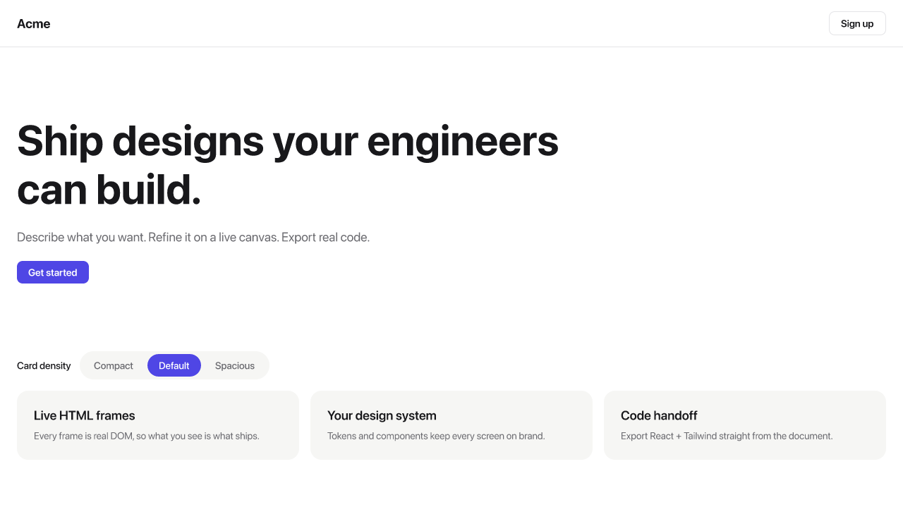 | 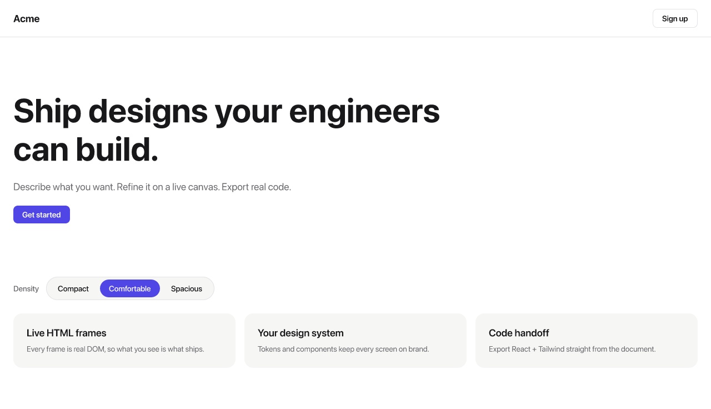 | 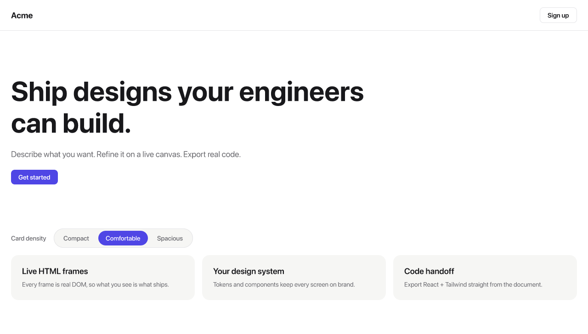 | 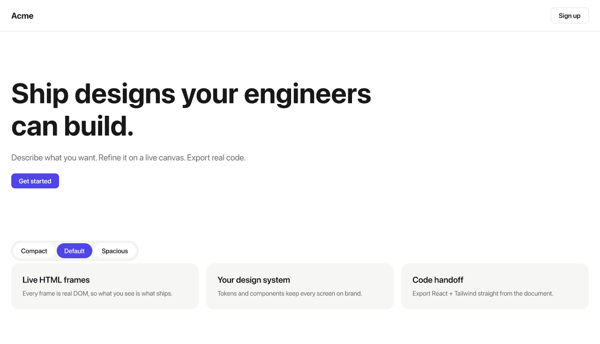 | 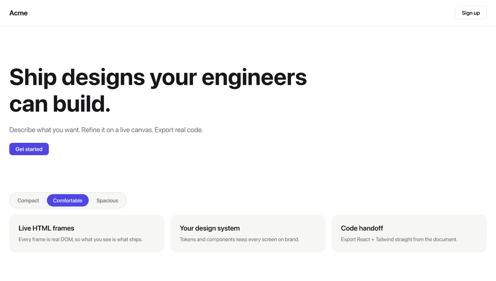 |  | 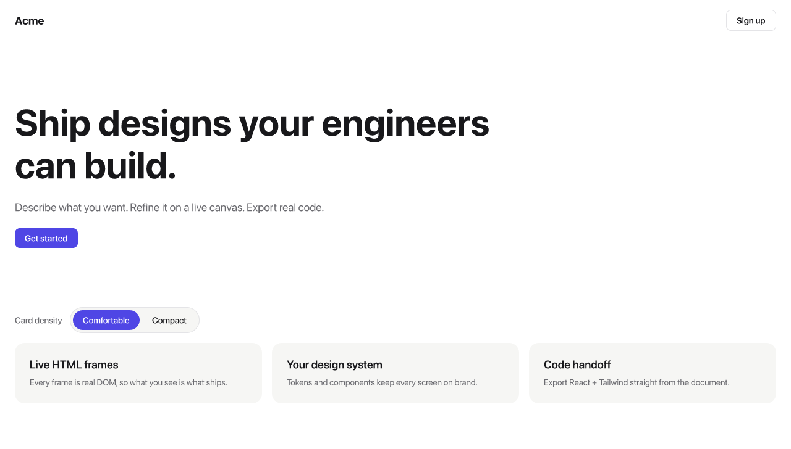 | 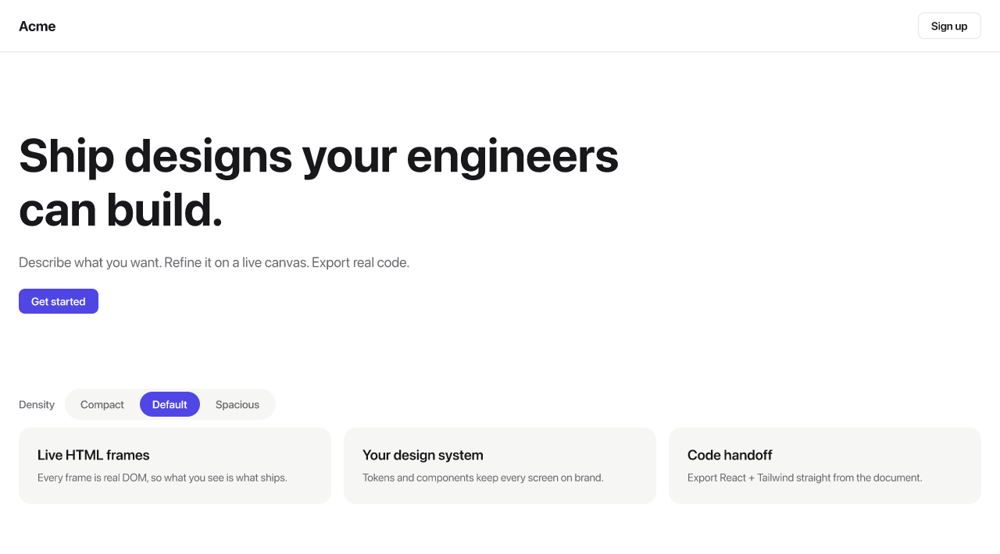 |

<details><summary>FigCraft <code>curated</code>: reply and commands</summary>

```json
{
 "reply": "I added a \"Card density\" segmented control above the feature cards. It has three options, Compact, Default and Spacious, with Default selected. It uses the surface, primary and muted tokens.\n\nIt's only the control's visuals so far. Nothing is wired to the cards yet, so clicking an option won't change their padding or gap.",
 "commands": [
  {
   "command": "node.create",
   "as": "w",
   "params": {
    "type": "frame",
    "parent": 2,
    "index": 2,
    "name": "n_density0001",
    "props": {
     "layout": "horizontal",
     "gap": 12,
     "padding": [
      0,
      24,
      16,
      24
     ],
     "crossAlign": "center",
     "sizingH": "fill",
     "sizingV": "hug",
     "fill": "none"
    }
   }
  },
  {
   "command": "node.create",
   "params": {
    "type": "text",
    "parent": {
     "$ref": "w"
    },
    "name": "n_density_label",
    "characters": "Card density",
    "props": {
     "fontFamily": "SF Pro",
     "fontStyle": "Medium",
     "fontSize": 14,
     "fill": "#18181B"
    }
   }
  },
  {
   "command": "node.create",
   "as": "seg",
   "params": {
    "type": "frame",
    "parent": {
     "$ref": "w"
    },
    "name": "n_density_seg",
    "props": {
     "layout": "horizontal",
     "gap": 4,
     "padding": 4,
     "crossAlign": "center",
     "sizingH": "hug",
     "sizingV": "hug",
     "fill": "#F6F6F4",
     "cornerRadius": 9999
    }
   }
  },
  {
   "command": "node.create",
   "as": "o1",
   "params": {
    "type": "frame",
    "parent": {
     "$ref": "seg"
    },
    "name": "n_density_compact",
    "props": {
     "layout": "horizontal",
     "padding": [
      8,
      16,
      8,
      16
     ],
     "sizingH": "hug",
     "sizingV": "hug",
     "fill": "none",
     "cornerRadius": 9999
    }
   }
  },
  {
   "command": "node.create",
   "params": {
    "type": "text",
    "parent": {
     "$ref": "o1"
    },
    "name": "n_density_compact_label",
    "characters": "Compact",
    "props": {
     "fontFamily": "SF Pro",
     "fontStyle": "Medium",
     "fontSize": 14,
     "fill": "#6B6B70"
    }
   }
  },
  {
   "command": "node.create",
   "as": "o2",
   "params": {
    "type": "frame",
    "parent": {
     "$ref": "seg"
    },
    "name": "n_density_default",
    "props": {
     "layout": "horizontal",
     "padding": [
      8,
      16,
      8,
      16
     ],
     "sizingH": "hug",
     "sizingV": "hug",
     "fill": "#4F46E5",
     "cornerRadius": 9999
    }
   }
  },
  {
   "command": "node.create",
   "params": {
    "type": "text",
    "parent": {
     "$ref": "o2"
    },
    "name": "n_density_default_label",
    "characters": "Default",
    "props": {
     "fontFamily": "SF Pro",
     "fontStyle": "Medium",
     "fontSize": 14,
     "fill": "#FFFFFF"
    }
   }
  },
  {
   "command": "node.create",
   "as": "o3",
   "params": {
    "type": "frame",
    "parent": {
     "$ref": "seg"
    },
    "name": "n_density_spacious",
    "props": {
     "layout": "horizontal",
     "padding": [
      8,
      16,
      8,
      16
     ],
     "sizingH": "hug",
     "sizingV": "hug",
     "fill": "none",
     "cornerRadius": 9999
    }
   }
  },
  {
   "command": "node.create",
   "params": {
    "type": "text",
    "parent": {
     "$ref": "o3"
    },
    "name": "n_density_spacious_label",
    "characters": "Spacious",
    "props": {
     "fontFamily": "SF Pro",
     "fontStyle": "Medium",
     "fontSize": 14,
     "fill": "#6B6B70"
    }
   }
  }
 ]
}
```
</details>

<details><summary>FigCraft <code>full-catalog</code>: reply and commands</summary>

```json
{
 "reply": "I added a \"Density\" segmented control (Compact / Comfortable / Spacious) just above the feature cards, named `n_densityctl01`. Comfortable is selected by default and uses the primary colour. The control is visual only and isn't wired to change the cards yet. If you want, I can set up the Compact and Spacious variants of the card spacing.",
 "commands": [
  {
   "command": "node.create",
   "as": "ctl",
   "params": {
    "type": "frame",
    "name": "n_densityctl01",
    "parent": 2,
    "index": 2,
    "props": {
     "layout": "horizontal",
     "gap": 12,
     "padding": [
      0,
      24,
      24,
      24
     ],
     "crossAlign": "center",
     "sizingH": "fill",
     "sizingV": "hug",
     "fill": "none"
    }
   }
  },
  {
   "command": "node.create",
   "params": {
    "type": "text",
    "name": "n_densitylabel",
    "parent": {
     "$ref": "ctl"
    },
    "text": "Density",
    "props": {
     "fontFamily": "SF Pro",
     "fontStyle": "Medium",
     "fontSize": 14,
     "fill": "#6B6B70"
    }
   }
  },
  {
   "command": "node.create",
   "as": "seg",
   "params": {
    "type": "frame",
    "name": "n_densityseg01",
    "parent": {
     "$ref": "ctl"
    },
    "props": {
     "layout": "horizontal",
     "gap": 4,
     "padding": 4,
     "crossAlign": "center",
     "sizingH": "hug",
     "sizingV": "hug",
     "fill": "#F6F6F4",
     "cornerRadius": 9999,
     "stroke": "#E4E4E7",
     "strokeWeight": 1
    }
   }
  },
  {
   "command": "node.create",
   "as": "o1",
   "params": {
    "type": "frame",
    "name": "n_densityopt_compact",
    "parent": {
     "$ref": "seg"
    },
    "props": {
     "layout": "horizontal",
     "padding": [
      8,
      16,
      8,
      16
     ],
     "sizingH": "hug",
     "sizingV": "hug",
     "fill": "none",
     "cornerRadius": 9999
    }
   }
  },
  {
   "command": "node.create",
   "params": {
    "type": "text",
    "name": "n_densityopt_compact_label",
    "parent": {
     "$ref": "o1"
    },
    "text": "Compact",
    "props": {
     "fontFamily": "SF Pro",
     "fontStyle": "Medium",
     "fontSize": 14,
     "fill": "#18181B"
    }
   }
  },
  {
   "command": "node.create",
   "as": "o2",
   "params": {
    "type": "frame",
    "name": "n_densityopt_comfortable",
    "parent": {
     "$ref": "seg"
    },
    "props": {
     "layout": "horizontal",
     "padding": [
      8,
      16,
      8,
      16
     ],
     "sizingH": "hug",
     "sizingV": "hug",
     "fill": "#4F46E5",
     "cornerRadius": 9999
    }
   }
  },
  {
   "command": "node.create",
   "params": {
    "type": "text",
    "name": "n_densityopt_comfortable_label",
    "parent": {
     "$ref": "o2"
    },
    "text": "Comfortable",
    "props": {
     "fontFamily": "SF Pro",
     "fontStyle": "Medium",
     "fontSize": 14,
     "fill": "#FFFFFF"
    }
   }
  },
  {
   "command": "node.create",
   "as": "o3",
   "params": {
    "type": "frame",
    "name": "n_densityopt_spacious",
    "parent": {
     "$ref": "seg"
    },
    "props": {
     "layout": "horizontal",
     "padding": [
      8,
      16,
      8,
      16
     ],
     "sizingH": "hug",
     "sizingV": "hug",
     "fill": "none",
     "cornerRadius": 9999
    }
   }
  },
  {
   "command": "node.create",
   "params": {
    "type": "text",
    "name": "n_densityopt_spacious_label",
    "parent": {
     "$ref": "o3"
    },
    "text": "Spacious",
    "props": {
     "fontFamily": "SF Pro",
     "fontStyle": "Medium",
     "fontSize": 14,
     "fill": "#18181B"
    }
   }
  }
 ]
}
```
</details>

<details><summary>FigCraft <code>minimal</code>: reply and commands</summary>

```json
{
 "reply": "Creation takes only basic params, so I'll set the rest with node.set.\nI added a \"Card density\" segmented control (Compact / Comfortable / Spacious) just above the feature cards. It follows your tokens: pill shape, with Comfortable highlighted in the primary colour.\n\nIt's a static visual only. Clicking an option doesn't change the cards yet, and Comfortable matches the current 24px padding. I can wire it up as a prototype interaction, or as a variable mode that changes card padding and gap, if you'd like.",
 "commands": [
  {
   "command": "node.create",
   "as": "bar",
   "params": {
    "type": "frame",
    "name": "density_control",
    "parent": 2,
    "index": 1
   }
  },
  {
   "command": "node.set",
   "params": {
    "id": {
     "$ref": "bar"
    },
    "layout": "horizontal",
    "gap": 16,
    "padding": [
     0,
     24,
     16,
     24
    ],
    "crossAlign": "center",
    "sizingH": "fill",
    "sizingV": "hug",
    "fill": "none"
   }
  },
  {
   "command": "node.create",
   "as": "lbl",
   "params": {
    "type": "text",
    "parent": {
     "$ref": "bar"
    },
    "name": "density_label",
    "characters": "Card density"
   }
  },
  {
   "command": "node.set",
   "params": {
    "id": {
     "$ref": "lbl"
    },
    "fontFamily": "SF Pro",
    "fontStyle": "Medium",
    "fontSize": 14,
    "fill": "#6B6B70"
   }
  },
  {
   "command": "node.create",
   "as": "seg",
   "params": {
    "type": "frame",
    "parent": {
     "$ref": "bar"
    },
    "name": "density_segmented"
   }
  },
  {
   "command": "node.set",
   "params": {
    "id": {
     "$ref": "seg"
    },
    "layout": "horizontal",
    "gap": 4,
    "padding": 4,
    "crossAlign": "center",
    "cornerRadius": 9999,
    "fill": "#F6F6F4",
    "stroke": "#E4E4E7",
    "strokeWeight": 1,
    "sizingH": "hug",
    "sizingV": "hug"
   }
  },
  {
   "command": "node.create",
   "as": "o1",
   "params": {
    "type": "frame",
    "parent": {
     "$ref": "seg"
    },
    "name": "density_compact"
   }
  },
  {
   "command": "node.set",
   "params": {
    "id": {
     "$ref": "o1"
    },
    "layout": "horizontal",
    "padding": [
     8,
     16,
     8,
     16
    ],
    "cornerRadius": 9999,
    "fill": "none",
    "sizingH": "hug",
    "sizingV": "hug"
   }
  },
  {
   "command": "node.create",
   "as": "t1",
   "params": {
    "type": "text",
    "parent": {
     "$ref": "o1"
    },
    "name": "density_compact_label",
    "characters": "Compact"
   }
  },
  {
   "command": "node.set",
   "params": {
    "id": {
     "$ref": "t1"
    },
    "fontFamily": "SF Pro",
    "fontStyle": "Medium",
    "fontSize": 14,
    "fill": "#6B6B70"
   }
  },
  {
   "command": "node.create",
   "as": "o2",
   "params": {
    "type": "frame",
    "parent": {
     "$ref": "seg"
    },
    "name": "density_comfortable"
   }
  },
  {
   "command": "node.set",
   "params": {
    "id": {
     "$ref": "o2"
    },
    "layout": "horizontal",
    "padding": [
     8,
     16,
     8,
     16
    ],
    "cornerRadius": 9999,
    "fill": "#4F46E5",
    "sizingH": "hug",
    "sizingV": "hug"
   }
  },
  {
   "command": "node.create",
   "as": "t2",
   "params": {
    "type": "text",
    "parent": {
     "$ref": "o2"
    },
    "name": "density_comfortable_label",
    "characters": "Comfortable"
   }
  },
  {
   "command": "node.set",
   "params": {
    "id": {
     "$ref": "t2"
    },
    "fontFamily": "SF Pro",
    "fontStyle": "Medium",
    "fontSize": 14,
    "fill": "#FFFFFF"
   }
  },
  {
   "command": "node.create",
   "as": "o3",
   "params": {
    "type": "frame",
    "parent": {
     "$ref": "seg"
    },
    "name": "density_spacious"
   }
  },
  {
   "command": "node.set",
   "params": {
    "id": {
     "$ref": "o3"
    },
    "layout": "horizontal",
    "padding": [
     8,
     16,
     8,
     16
    ],
    "cornerRadius": 9999,
    "fill": "none",
    "sizingH": "hug",
    "sizingV": "hug"
   }
  },
  {
   "command": "node.create",
   "as": "t3",
   "params": {
    "type": "text",
    "parent": {
     "$ref": "o3"
    },
    "name": "density_spacious_label",
    "characters": "Spacious"
   }
  },
  {
   "command": "node.set",
   "params": {
    "id": {
     "$ref": "t3"
    },
    "fontFamily": "SF Pro",
    "fontStyle": "Medium",
    "fontSize": 14,
    "fill": "#6B6B70"
   }
  },
  {
   "command": "node.reorder",
   "params": {
    "id": 22,
    "index": 2
   }
  },
  {
   "command": "node.set",
   "params": {
    "id": 22,
    "padding": [
     0,
     24,
     16,
     24
    ]
   }
  }
 ]
}
```
</details>

<details><summary>FigCraft <code>run-command</code>: reply and commands</summary>

```json
{
 "reply": "Now the three options.\nI added a density control above the feature cards. It's a pill-shaped segmented control (`n_densityctl01`) with Compact, Default and Spacious options, and Default is highlighted. To make room I raised the section's top padding to 64.\n\nIt's only the visual control for now. Nothing is wired up, so clicking an option doesn't change the card padding or gap yet.",
 "commands": [
  {
   "command": "node.set",
   "params": {
    "ids": [
     12
    ],
    "paddingTop": 64
   }
  },
  {
   "command": "node.create",
   "params": {
    "type": "frame",
    "parent": 12,
    "name": "n_densityctl01",
    "x": 24,
    "y": 16,
    "props": {
     "layout": "horizontal",
     "gap": 4,
     "padding": 4,
     "sizingH": "hug",
     "sizingV": "hug",
     "fill": "#F6F6F4",
     "cornerRadius": 9999,
     "absolute": true,
     "stroke": "#E4E4E7",
     "strokeWeight": 1
    }
   }
  },
  {
   "command": "node.create",
   "params": {
    "type": "frame",
    "parent": 22,
    "name": "n_density_compact",
    "props": {
     "layout": "horizontal",
     "padding": [
      8,
      16,
      8,
      16
     ],
     "sizingH": "hug",
     "sizingV": "hug",
     "fill": "#FFFFFF",
     "cornerRadius": 9999
    }
   }
  },
  {
   "command": "node.create",
   "params": {
    "type": "frame",
    "parent": 22,
    "name": "n_density_default",
    "props": {
     "layout": "horizontal",
     "padding": [
      8,
      16,
      8,
      16
     ],
     "sizingH": "hug",
     "sizingV": "hug",
     "fill": "#4F46E5",
     "cornerRadius": 9999
    }
   }
  },
  {
   "command": "node.create",
   "params": {
    "type": "frame",
    "parent": 22,
    "name": "n_density_spacious",
    "props": {
     "layout": "horizontal",
     "padding": [
      8,
      16,
      8,
      16
     ],
     "sizingH": "hug",
     "sizingV": "hug",
     "fill": "#FFFFFF",
     "cornerRadius": 9999
    }
   }
  },
  {
   "command": "node.create",
   "params": {
    "type": "text",
    "parent": 23,
    "name": "n_density_compact_label",
    "text": "Compact",
    "props": {
     "fontFamily": "SF Pro",
     "fontStyle": "Medium",
     "fontSize": 14,
     "fill": "#18181B"
    }
   }
  },
  {
   "command": "node.create",
   "params": {
    "type": "text",
    "parent": 24,
    "name": "n_density_default_label",
    "text": "Default",
    "props": {
     "fontFamily": "SF Pro",
     "fontStyle": "Medium",
     "fontSize": 14,
     "fill": "#FFFFFF"
    }
   }
  },
  {
   "command": "node.create",
   "params": {
    "type": "text",
    "parent": 25,
    "name": "n_density_spacious_label",
    "text": "Spacious",
    "props": {
     "fontFamily": "SF Pro",
     "fontStyle": "Medium",
     "fontSize": 14,
     "fill": "#18181B"
    }
   }
  }
 ]
}
```
</details>

<details><summary>FigCraft <code>v1</code>: reply and commands</summary>

```json
{
 "reply": "Root is a vertical auto layout, so I'll pad the control with a wrapper-free approach: add left padding via a wrapper.\nI added a segmented control above the feature cards with three options: Compact, Comfortable and Spacious. Comfortable is selected, which matches the current card spacing.\n\nIt's a visual control only. Nothing is wired to it, so picking an option doesn't change the card padding or gaps yet. I didn't create separate Compact and Spacious spacing values for the cards either.\n\nI put it in a wrapper (`n_densitywrap1`) so it lines up with the 24px page margin.",
 "commands": [
  {
   "command": "node.create",
   "as": "c",
   "params": {
    "type": "frame",
    "parent": 2,
    "index": 2,
    "name": "n_densityctl01",
    "props": {
     "layout": "horizontal",
     "gap": 4,
     "padding": 4,
     "fill": "#F6F6F4",
     "stroke": "#E4E4E7",
     "cornerRadius": 9999,
     "sizingH": "hug",
     "sizingV": "hug",
     "crossAlign": "center"
    }
   }
  },
  {
   "command": "node.create",
   "as": "o1",
   "params": {
    "type": "frame",
    "parent": {
     "$ref": "c"
    },
    "name": "n_densityopt1",
    "props": {
     "layout": "horizontal",
     "padding": [
      8,
      16,
      8,
      16
     ],
     "cornerRadius": 9999,
     "fill": "none",
     "sizingH": "hug",
     "sizingV": "hug"
    }
   }
  },
  {
   "command": "node.create",
   "params": {
    "type": "text",
    "parent": {
     "$ref": "o1"
    },
    "name": "n_densityopt1_label",
    "text": "Compact",
    "props": {
     "fontFamily": "SF Pro",
     "fontStyle": "Medium",
     "fontSize": 14,
     "fill": "#6B6B70"
    }
   }
  },
  {
   "command": "node.create",
   "as": "o2",
   "params": {
    "type": "frame",
    "parent": {
     "$ref": "c"
    },
    "name": "n_densityopt2",
    "props": {
     "layout": "horizontal",
     "padding": [
      8,
      16,
      8,
      16
     ],
     "cornerRadius": 9999,
     "fill": "#4F46E5",
     "sizingH": "hug",
     "sizingV": "hug"
    }
   }
  },
  {
   "command": "node.create",
   "params": {
    "type": "text",
    "parent": {
     "$ref": "o2"
    },
    "name": "n_densityopt2_label",
    "text": "Comfortable",
    "props": {
     "fontFamily": "SF Pro",
     "fontStyle": "Medium",
     "fontSize": 14,
     "fill": "#FFFFFF"
    }
   }
  },
  {
   "command": "node.create",
   "as": "o3",
   "params": {
    "type": "frame",
    "parent": {
     "$ref": "c"
    },
    "name": "n_densityopt3",
    "props": {
     "layout": "horizontal",
     "padding": [
      8,
      16,
      8,
      16
     ],
     "cornerRadius": 9999,
     "fill": "none",
     "sizingH": "hug",
     "sizingV": "hug"
    }
   }
  },
  {
   "command": "node.create",
   "params": {
    "type": "text",
    "parent": {
     "$ref": "o3"
    },
    "name": "n_densityopt3_label",
    "text": "Spacious",
    "props": {
     "fontFamily": "SF Pro",
     "fontStyle": "Medium",
     "fontSize": 14,
     "fill": "#6B6B70"
    }
   }
  },
  {
   "command": "node.set",
   "params": {
    "id": 22,
    "x": 24,
    "y": 444
   }
  },
  {
   "command": "node.create",
   "as": "w",
   "params": {
    "type": "frame",
    "parent": 2,
    "index": 2,
    "name": "n_densitywrap1",
    "props": {
     "layout": "horizontal",
     "padding": [
      0,
      24,
      16,
      24
     ],
     "sizingH": "fill",
     "sizingV": "hug",
     "fill": "none"
    }
   }
  },
  {
   "command": "node.reparent",
   "params": {
    "ids": [
     22
    ],
    "parent": {
     "$ref": "w"
    }
   }
  }
 ]
}
```
</details>

<details><summary>FigCraft <code>v1-auto-render</code>: reply and commands</summary>

```json
{
 "reply": "I added a segmented density control, \"Card density\", with Compact, Comfortable (selected) and Spacious options. It sits just above the feature cards and uses the design system's colors, spacing and radii.\n\nIt's a static visual only. Nothing is connected to it yet, so clicking an option won't change the card padding or gap. For reference, the cards currently use 24px padding and an 8px gap, which I've treated as \"Comfortable\".",
 "commands": [
  {
   "command": "node.create",
   "as": "row",
   "params": {
    "type": "frame",
    "parent": 2,
    "index": 2,
    "name": "n_densityrow",
    "props": {
     "layout": "horizontal",
     "gap": 12,
     "padding": [
      0,
      24,
      16,
      24
     ],
     "crossAlign": "center",
     "sizingH": "fill",
     "sizingV": "hug",
     "fill": "none"
    }
   }
  },
  {
   "command": "node.create",
   "params": {
    "type": "text",
    "parent": {
     "$ref": "row"
    },
    "name": "n_densitylabel",
    "text": "Card density",
    "props": {
     "fontFamily": "SF Pro",
     "fontStyle": "Medium",
     "fontSize": 14,
     "fill": "#6B6B70"
    }
   }
  },
  {
   "command": "node.create",
   "as": "seg",
   "params": {
    "type": "frame",
    "parent": {
     "$ref": "row"
    },
    "name": "n_densityseg",
    "props": {
     "layout": "horizontal",
     "gap": 4,
     "padding": 4,
     "crossAlign": "center",
     "sizingH": "hug",
     "sizingV": "hug",
     "fill": "#F6F6F4",
     "stroke": "#E4E4E7",
     "strokeWeight": 1,
     "cornerRadius": 9999
    }
   }
  },
  {
   "command": "node.create",
   "as": "p1",
   "params": {
    "type": "frame",
    "parent": {
     "$ref": "seg"
    },
    "name": "n_density_compact",
    "props": {
     "layout": "horizontal",
     "padding": [
      8,
      16,
      8,
      16
     ],
     "sizingH": "hug",
     "sizingV": "hug",
     "cornerRadius": 9999,
     "fill": "none"
    }
   }
  },
  {
   "command": "node.create",
   "params": {
    "type": "text",
    "parent": {
     "$ref": "p1"
    },
    "name": "n_density_compact_label",
    "text": "Compact",
    "props": {
     "fontFamily": "SF Pro",
     "fontStyle": "Medium",
     "fontSize": 14,
     "fill": "#6B6B70"
    }
   }
  },
  {
   "command": "node.create",
   "as": "p2",
   "params": {
    "type": "frame",
    "parent": {
     "$ref": "seg"
    },
    "name": "n_density_comfortable",
    "props": {
     "layout": "horizontal",
     "padding": [
      8,
      16,
      8,
      16
     ],
     "sizingH": "hug",
     "sizingV": "hug",
     "cornerRadius": 9999,
     "fill": "#4F46E5"
    }
   }
  },
  {
   "command": "node.create",
   "params": {
    "type": "text",
    "parent": {
     "$ref": "p2"
    },
    "name": "n_density_comfortable_label",
    "text": "Comfortable",
    "props": {
     "fontFamily": "SF Pro",
     "fontStyle": "Medium",
     "fontSize": 14,
     "fill": "#FFFFFF"
    }
   }
  },
  {
   "command": "node.create",
   "as": "p3",
   "params": {
    "type": "frame",
    "parent": {
     "$ref": "seg"
    },
    "name": "n_density_spacious",
    "props": {
     "layout": "horizontal",
     "padding": [
      8,
      16,
      8,
      16
     ],
     "sizingH": "hug",
     "sizingV": "hug",
     "cornerRadius": 9999,
     "fill": "none"
    }
   }
  },
  {
   "command": "node.create",
   "params": {
    "type": "text",
    "parent": {
     "$ref": "p3"
    },
    "name": "n_density_spacious_label",
    "text": "Spacious",
    "props": {
     "fontFamily": "SF Pro",
     "fontStyle": "Medium",
     "fontSize": 14,
     "fill": "#6B6B70"
    }
   }
  }
 ]
}
```
</details>

<details><summary>FigCraft <code>v1-no-render</code>: reply and commands</summary>

```json
{
 "reply": "I added a \"Card density\" segmented control (Comfortable / Compact) in a new row, `n_density000`. It sits just above the feature cards. \"Comfortable\" is shown as selected, and the pill uses the design-system colors and radius.\n\nThe control is only a visual layer, so clicking \"Compact\" does nothing yet. I can set the cards' padding and gap for each density if you tell me the values you want. For example, Compact could be padding 16 and gap 4, against the current 24 and 8.\n\nI also didn't check where the new row landed in the page layout.",
 "commands": [
  {
   "command": "node.create",
   "as": "row",
   "params": {
    "type": "frame",
    "name": "n_density000",
    "parent": 2,
    "index": 2,
    "select": false,
    "props": {
     "layout": "horizontal",
     "gap": 12,
     "padding": [
      0,
      24,
      16,
      24
     ],
     "crossAlign": "center",
     "sizingH": "fill",
     "sizingV": "hug",
     "fill": "none"
    }
   }
  },
  {
   "command": "node.create",
   "params": {
    "type": "text",
    "name": "n_density_label",
    "parent": {
     "$ref": "row"
    },
    "characters": "Card density",
    "select": false,
    "props": {
     "fontFamily": "SF Pro",
     "fontStyle": "Medium",
     "fontSize": 14,
     "fill": "#6B6B70"
    }
   }
  },
  {
   "command": "node.create",
   "as": "seg",
   "params": {
    "type": "frame",
    "name": "n_density_seg",
    "parent": {
     "$ref": "row"
    },
    "select": false,
    "props": {
     "layout": "horizontal",
     "gap": 4,
     "padding": 4,
     "crossAlign": "center",
     "sizingH": "hug",
     "sizingV": "hug",
     "fill": "#F6F6F4",
     "stroke": "#E4E4E7",
     "cornerRadius": 9999
    }
   }
  },
  {
   "command": "node.create",
   "as": "o1",
   "params": {
    "type": "frame",
    "name": "n_density_opt_comfortable",
    "parent": {
     "$ref": "seg"
    },
    "select": false,
    "props": {
     "layout": "horizontal",
     "padding": [
      8,
      16,
      8,
      16
     ],
     "sizingH": "hug",
     "sizingV": "hug",
     "fill": "#4F46E5",
     "cornerRadius": 9999
    }
   }
  },
  {
   "command": "node.create",
   "params": {
    "type": "text",
    "name": "n_density_opt_comfortable_label",
    "parent": {
     "$ref": "o1"
    },
    "characters": "Comfortable",
    "select": false,
    "props": {
     "fontFamily": "SF Pro",
     "fontStyle": "Medium",
     "fontSize": 14,
     "fill": "#FFFFFF"
    }
   }
  },
  {
   "command": "node.create",
   "as": "o2",
   "params": {
    "type": "frame",
    "name": "n_density_opt_compact",
    "parent": {
     "$ref": "seg"
    },
    "select": false,
    "props": {
     "layout": "horizontal",
     "padding": [
      8,
      16,
      8,
      16
     ],
     "sizingH": "hug",
     "sizingV": "hug",
     "fill": "none",
     "cornerRadius": 9999
    }
   }
  },
  {
   "command": "node.create",
   "params": {
    "type": "text",
    "name": "n_density_opt_compact_label",
    "parent": {
     "$ref": "o2"
    },
    "characters": "Compact",
    "select": false,
    "props": {
     "fontFamily": "SF Pro",
     "fontStyle": "Medium",
     "fontSize": 14,
     "fill": "#18181B"
    }
   }
  }
 ]
}
```
</details>

<details><summary>FigCraft <code>v2</code>: reply and commands</summary>

```json
{
 "reply": "I added a \"Density\" segmented control above the feature cards, with three options: Compact, Default and Spacious. Default is selected and filled in the primary colour. The control is a new row, `n_density0001`, at the top of the features section. It spans all three columns, so the cards sit below it.\n\nThe control is only visual for now. Clicking an option doesn't change the card spacing, because the document has no interactions set up. To make it work, you'd need to wire each option to the cards' padding and gap.",
 "commands": [
  {
   "command": "node.create",
   "as": "row",
   "params": {
    "type": "frame",
    "parent": 12,
    "index": 0,
    "name": "n_density0001",
    "props": {
     "layout": "horizontal",
     "gap": 12,
     "crossAlign": "center",
     "sizingH": "fill",
     "sizingV": "hug",
     "gridColumn": 0,
     "gridRow": 0,
     "gridColumnSpan": 3,
     "fill": "none"
    }
   }
  },
  {
   "command": "node.create",
   "params": {
    "type": "text",
    "parent": {
     "$ref": "row"
    },
    "name": "n_density_label",
    "text": "Density",
    "props": {
     "fontFamily": "SF Pro",
     "fontStyle": "Medium",
     "fontSize": 14,
     "fill": "#6B6B70"
    }
   }
  },
  {
   "command": "node.create",
   "as": "seg",
   "params": {
    "type": "frame",
    "parent": {
     "$ref": "row"
    },
    "name": "n_density_seg",
    "props": {
     "layout": "horizontal",
     "gap": 4,
     "padding": 4,
     "crossAlign": "center",
     "sizingH": "hug",
     "sizingV": "hug",
     "fill": "#F6F6F4",
     "cornerRadius": 9999
    }
   }
  },
  {
   "command": "node.create",
   "as": "o1",
   "params": {
    "type": "frame",
    "parent": {
     "$ref": "seg"
    },
    "name": "n_density_compact",
    "props": {
     "layout": "horizontal",
     "padding": [
      8,
      16,
      8,
      16
     ],
     "mainAlign": "center",
     "crossAlign": "center",
     "sizingH": "hug",
     "sizingV": "hug",
     "fill": "none",
     "cornerRadius": 9999
    }
   }
  },
  {
   "command": "node.create",
   "params": {
    "type": "text",
    "parent": {
     "$ref": "o1"
    },
    "name": "n_density_compact_label",
    "text": "Compact",
    "props": {
     "fontFamily": "SF Pro",
     "fontStyle": "Medium",
     "fontSize": 14,
     "fill": "#6B6B70"
    }
   }
  },
  {
   "command": "node.create",
   "as": "o2",
   "params": {
    "type": "frame",
    "parent": {
     "$ref": "seg"
    },
    "name": "n_density_default",
    "props": {
     "layout": "horizontal",
     "padding": [
      8,
      16,
      8,
      16
     ],
     "mainAlign": "center",
     "crossAlign": "center",
     "sizingH": "hug",
     "sizingV": "hug",
     "fill": "#4F46E5",
     "cornerRadius": 9999
    }
   }
  },
  {
   "command": "node.create",
   "params": {
    "type": "text",
    "parent": {
     "$ref": "o2"
    },
    "name": "n_density_default_label",
    "text": "Default",
    "props": {
     "fontFamily": "SF Pro",
     "fontStyle": "Semibold",
     "fontSize": 14,
     "fill": "#FFFFFF"
    }
   }
  },
  {
   "command": "node.create",
   "as": "o3",
   "params": {
    "type": "frame",
    "parent": {
     "$ref": "seg"
    },
    "name": "n_density_spacious",
    "props": {
     "layout": "horizontal",
     "padding": [
      8,
      16,
      8,
      16
     ],
     "mainAlign": "center",
     "crossAlign": "center",
     "sizingH": "hug",
     "sizingV": "hug",
     "fill": "none",
     "cornerRadius": 9999
    }
   }
  },
  {
   "command": "node.create",
   "params": {
    "type": "text",
    "parent": {
     "$ref": "o3"
    },
    "name": "n_density_spacious_label",
    "text": "Spacious",
    "props": {
     "fontFamily": "SF Pro",
     "fontStyle": "Medium",
     "fontSize": 14,
     "fill": "#6B6B70"
    }
   }
  }
 ]
}
```
</details>

<details><summary>HTML frame: reply and patches</summary>

```json
{
 "reply": "I added a \"Card density\" slider. It controls the padding inside each feature card, the gap between a card's title and body, and the gap between the cards. The default position of 24 matches your current spacing. Drag it left for tighter cards or right for roomier ones.\n\nI didn't run the lint check, since the slider doesn't change any nodes until you move it.",
 "commits": [
  {
   "ops": [
    {
     "op": "upsertSlider",
     "slider": {
      "id": "s_density01",
      "label": "Card density (padding)",
      "min": 8,
      "max": 40,
      "step": 2,
      "value": 24,
      "bindings": [
       {
        "target": {
         "nodeId": "n_feat1card00",
         "prop": "paddingTop",
         "breakpoint": "base"
        },
        "map": {
         "type": "linear",
         "from": 8,
         "to": 40,
         "unit": "px"
        }
       },
       {
        "target": {
         "nodeId": "n_feat1card00",
         "prop": "paddingBottom",
         "breakpoint": "base"
        },
        "map": {
         "type": "linear",
         "from": 8,
         "to": 40,
         "unit": "px"
        }
       },
       {
        "target": {
         "nodeId": "n_feat1card00",
         "prop": "paddingLeft",
         "breakpoint": "base"
        },
        "map": {
         "type": "linear",
         "from": 8,
         "to": 40,
         "unit": "px"
        }
       },
       {
        "target": {
         "nodeId": "n_feat1card00",
         "prop": "paddingRight",
         "breakpoint": "base"
        },
        "map": {
         "type": "linear",
         "from": 8,
         "to": 40,
         "unit": "px"
        }
       },
       {
        "target": {
         "nodeId": "n_feat2card00",
         "prop": "paddingTop",
         "breakpoint": "base"
        },
        "map": {
         "type": "linear",
         "from": 8,
         "to": 40,
         "unit": "px"
        }
       },
       {
        "target": {
         "nodeId": "n_feat2card00",
         "prop": "paddingBottom",
         "breakpoint": "base"
        },
        "map": {
         "type": "linear",
         "from": 8,
         "to": 40,
         "unit": "px"
        }
       },
       {
        "target": {
         "nodeId": "n_feat2card00",
         "prop": "paddingLeft",
         "breakpoint": "base"
        },
        "map": {
         "type": "linear",
         "from": 8,
         "to": 40,
         "unit": "px"
        }
       },
       {
        "target": {
         "nodeId": "n_feat2card00",
         "prop": "paddingRight",
         "breakpoint": "base"
        },
        "map": {
         "type": "linear",
         "from": 8,
         "to": 40,
         "unit": "px"
        }
       },
       {
        "target": {
         "nodeId": "n_feat3card00",
         "prop": "paddingTop",
         "breakpoint": "base"
        },
        "map": {
         "type": "linear",
         "from": 8,
         "to": 40,
         "unit": "px"
        }
       },
       {
        "target": {
         "nodeId": "n_feat3card00",
         "prop": "paddingBottom",
         "breakpoint": "base"
        },
        "map": {
         "type": "linear",
         "from": 8,
         "to": 40,
         "unit": "px"
        }
       },
       {
        "target": {
         "nodeId": "n_feat3card00",
         "prop": "paddingLeft",
         "breakpoint": "base"
        },
        "map": {
         "type": "linear",
         "from": 8,
         "to": 40,
         "unit": "px"
        }
       },
       {
        "target": {
         "nodeId": "n_feat3card00",
         "prop": "paddingRight",
         "breakpoint": "base"
        },
        "map": {
         "type": "linear",
         "from": 8,
         "to": 40,
         "unit": "px"
        }
       },
       {
        "target": {
         "nodeId": "n_feat1card00",
         "prop": "gap",
         "breakpoint": "base"
        },
        "map": {
         "type": "linear",
         "from": 2,
         "to": 14,
         "unit": "px"
        }
       },
       {
        "target": {
         "nodeId": "n_feat2card00",
         "prop": "gap",
         "breakpoint": "base"
        },
        "map": {
         "type": "linear",
         "from": 2,
         "to": 14,
         "unit": "px"
        }
       },
       {
        "target": {
         "nodeId": "n_feat3card00",
         "prop": "gap",
         "breakpoint": "base"
        },
        "map": {
         "type": "linear",
         "from": 2,
         "to": 14,
         "unit": "px"
        }
       },
       {
        "target": {
         "nodeId": "n_features01",
         "prop": "gap",
         "breakpoint": "base"
        },
        "map": {
         "type": "linear",
         "from": 4,
         "to": 28,
         "unit": "px"
        }
       }
      ],
      "pinned": false,
      "createdBy": "agent"
     }
    }
   ],
   "label": "Add slider “Card density (padding)”"
  }
 ]
}
```
</details>

## feature-cards-spacing

> Tighten the spacing in the features section a bit.

| Arm | Result | Turns | In | Cache r | Cache w | Out | Wall | Touched |
|---|---|---|---|---|---|---|---|---|
| HTML frame | pass | 2 | 6 | 29681 | 30624 | 923 | 6.2 s | n_features01, n_feat1card00, n_feat2card00, n_feat3card00 |
| FigCraft `curated` | pass | 2 | 6 | 15355 | 4396 | 505 | 4.9 s | n_features01, n_feat1card00, n_feat2card00, n_feat3card00 |
| FigCraft `full-catalog` | pass | 2 | 6 | 52081 | 52890 | 579 | 7.2 s | n_features01, n_feat1card00, n_feat2card00, n_feat3card00 |
| FigCraft `minimal` | pass | 6 | 14 | 32453 | 10763 | 691 | 8.8 s | n_features01, n_feat1card00, n_feat2card00, n_feat3card00 |
| FigCraft `run-command` | pass | 3 | 8 | 25995 | 4624 | 758 | 8.6 s | n_features01, n_feat1card00, n_feat2card00, n_feat3card00 |
| FigCraft `v1` | pass | 2 | 6 | 16843 | 4399 | 576 | 6.5 s | n_features01, n_feat1card00, n_feat2card00, n_feat3card00 |
| FigCraft `v1-auto-render` | pass | 2 | 6 | 16865 | 5142 | 472 | 5.2 s | n_features01, n_feat1card00, n_feat2card00, n_feat3card00 |
| FigCraft `v1-no-render` | pass | 2 | 6 | 16545 | 4031 | 495 | 6.0 s | n_features01, n_feat1card00, n_feat2card00, n_feat3card00 |
| FigCraft `v2` | pass | 2 | 6 | 10601 | 11409 | 543 | 5.4 s | n_features01, n_feat1card00, n_feat2card00, n_feat3card00 |

| HTML frame | FigCraft `curated` | FigCraft `full-catalog` | FigCraft `minimal` | FigCraft `run-command` | FigCraft `v1` | FigCraft `v1-auto-render` | FigCraft `v1-no-render` | FigCraft `v2` |
|---|---|---|---|---|---|---|---|---|
|  |  |  |  | 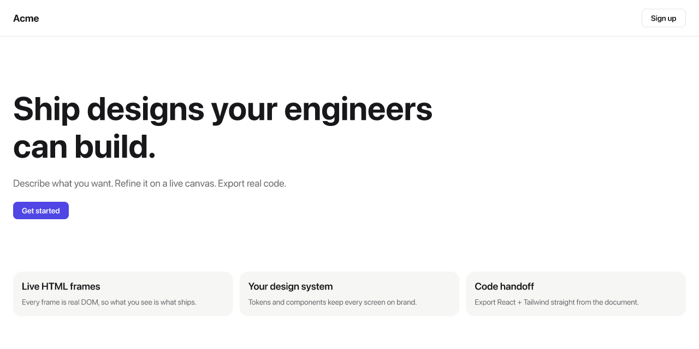 |  |  | 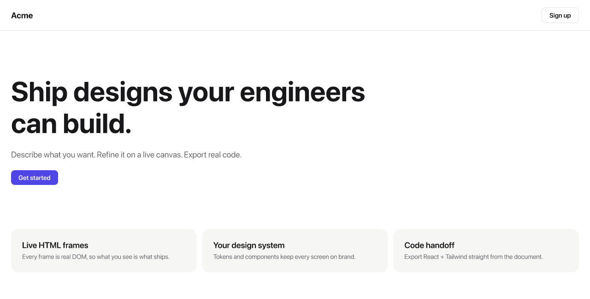 |  |

<details><summary>FigCraft <code>curated</code>: reply and commands</summary>

```json
{
 "reply": "I tightened the features section. I made three changes:\n- **Card padding:** 24 → 16 on all three cards.\n- **Gap between cards:** 16 → 12.\n- **Bottom padding of the section:** 64 → 48.\n\nI checked the render and the cards look fine. I left the gap between each card's title and body text at 8.",
 "commands": [
  {
   "command": "node.set",
   "params": {
    "id": 12,
    "gap": 12,
    "padding": [
     0,
     24,
     48,
     24
    ]
   }
  },
  {
   "command": "node.set",
   "params": {
    "id": 13,
    "padding": 16
   }
  },
  {
   "command": "node.set",
   "params": {
    "id": 16,
    "padding": 16
   }
  },
  {
   "command": "node.set",
   "params": {
    "id": 19,
    "padding": 16
   }
  }
 ]
}
```
</details>

<details><summary>FigCraft <code>full-catalog</code>: reply and commands</summary>

```json
{
 "reply": "I tightened the spacing in the features section. I checked it in a render of that section.\n\n- **Section:** the bottom padding went from 64 to 48, and the gap between cards went from 16 to 12.\n- **Cards:** the inner padding on all three went from 24 to 16.\n\nIf you want it looser, card padding of 24 with the other changes kept is the first thing I'd put back.",
 "commands": [
  {
   "command": "node.set",
   "params": {
    "ids": [
     12
    ],
    "padding": [
     0,
     24,
     48,
     24
    ],
    "gap": 12
   }
  },
  {
   "command": "node.set",
   "params": {
    "ids": [
     13,
     16,
     19
    ],
    "padding": 16
   }
  }
 ]
}
```
</details>

<details><summary>FigCraft <code>minimal</code>: reply and commands</summary>

```json
{
 "reply": "Tighten the section: gap 16→12, bottom padding 64→48, and card padding 24→16 would be too much; keep cards.\nI tightened the spacing in the features section, and the render looks right.\n\n- **Section:** the gap between the cards went from 16 to 12, and the bottom padding went from 64 to 48.\n- **Cards:** the padding inside each card went from 24 to 16, and the gap between the title and body text went from 8 to 4.\n\nAll values are from the spacing tokens.",
 "commands": [
  {
   "command": "node.set",
   "params": {
    "ids": [
     12
    ],
    "gap": 12,
    "crossGap": 12,
    "padding": [
     0,
     24,
     48,
     24
    ]
   }
  },
  {
   "command": "node.set",
   "params": {
    "ids": [
     13,
     16,
     19
    ],
    "gap": 4,
    "padding": 16
   }
  }
 ]
}
```
</details>

<details><summary>FigCraft <code>run-command</code>: reply and commands</summary>

```json
{
 "reply": "I tightened the spacing in the features section using token values:\n- **Grid:** the gap between cards went from 16 to 12, and the bottom padding from 64 to 48.\n- **Cards:** the inner padding on all three cards went from 24 to 16.\n\nThe render looks right. There's still some empty space under the cards. It may come from a second grid row that has nothing in it. I set that row gap to 12, up from an off-token 10, so the space may be a little larger than before.",
 "commands": [
  {
   "command": "node.set",
   "params": {
    "ids": [
     12
    ],
    "gap": 12,
    "crossGap": 12,
    "padding": [
     0,
     24,
     48,
     24
    ]
   }
  },
  {
   "command": "node.set",
   "params": {
    "ids": [
     13,
     16,
     19
    ],
    "padding": 16
   }
  }
 ]
}
```
</details>

<details><summary>FigCraft <code>v1</code>: reply and commands</summary>

```json
{
 "reply": "I tightened the spacing in the features section. I checked it with a render, and it looks fine.\n\n- **Section:** the gap between cards goes from 16px to 12px, and the bottom padding from 64px to 48px.\n- **Cards:** the inner padding goes from 24px to 16px, and the gap between each card's title and body from 8px to 4px.\n\nI also set the row gap to 12px. It had been 10px, which isn't a design-system value.",
 "commands": [
  {
   "command": "node.set",
   "params": {
    "ids": [
     12
    ],
    "gap": 12,
    "crossGap": 12,
    "padding": [
     0,
     24,
     48,
     24
    ]
   }
  },
  {
   "command": "node.set",
   "params": {
    "ids": [
     13,
     16,
     19
    ],
    "padding": 16,
    "gap": 4
   }
  }
 ]
}
```
</details>

<details><summary>FigCraft <code>v1-auto-render</code>: reply and commands</summary>

```json
{
 "reply": "I tightened the spacing in the features section, using only token values:\n- The gap between the three cards is now 12px, down from 16px.\n- The bottom padding of the section is now 48px, down from 64px.\n- The gap between each card's title and body text is now 4px, down from 8px.\n\nI left the card padding at 24px. I checked the render and the layout looks right.",
 "commands": [
  {
   "command": "node.set",
   "params": {
    "ids": [
     12
    ],
    "padding": [
     0,
     24,
     48,
     24
    ],
    "gap": 12,
    "crossGap": 12
   }
  },
  {
   "command": "node.set",
   "params": {
    "ids": [
     13,
     16,
     19
    ],
    "gap": 4
   }
  }
 ]
}
```
</details>

<details><summary>FigCraft <code>v1-no-render</code>: reply and commands</summary>

```json
{
 "reply": "I tightened the spacing in the features section in three ways:\n- **Card gap:** the gap between the three cards goes from 16 to 12.\n- **Bottom padding:** the section's bottom padding goes from 64 to 48.\n- **Inside each card:** the gap between title and body goes from 8 to 4.\n\nThe card padding is unchanged. I didn't check the result visually.",
 "commands": [
  {
   "command": "node.set",
   "params": {
    "ids": [
     12
    ],
    "gap": 12,
    "padding": [
     0,
     24,
     48,
     24
    ]
   }
  },
  {
   "command": "node.set",
   "params": {
    "ids": [
     13,
     16,
     19
    ],
    "gap": 4
   }
  }
 ]
}
```
</details>

<details><summary>FigCraft <code>v2</code>: reply and commands</summary>

```json
{
 "reply": "I tightened the spacing in the features section. I rendered it afterward and it looks fine.\n\n- **Section:** the bottom padding goes from 64 to 48, and the gap between cards from 16 to 12.\n- **Cards:** the inner padding goes from 24 to 16, and the gap between each title and its body text from 8 to 4.\n\nAll the new values are from the spacing tokens.",
 "commands": [
  {
   "command": "node.set",
   "params": {
    "id": 12,
    "padding": [
     0,
     24,
     48,
     24
    ],
    "gap": 12,
    "crossGap": 12
   }
  },
  {
   "command": "node.set",
   "params": {
    "id": 13,
    "padding": 16,
    "gap": 4
   }
  },
  {
   "command": "node.set",
   "params": {
    "id": 16,
    "padding": 16,
    "gap": 4
   }
  },
  {
   "command": "node.set",
   "params": {
    "id": 19,
    "padding": 16,
    "gap": 4
   }
  }
 ]
}
```
</details>

<details><summary>HTML frame: reply and patches</summary>

```json
{
 "reply": "I tightened the features section. The gap between cards is now `space.3` (was `space.4`), and the section's bottom padding is `space.12` (was `space.16`). Each card's padding is `space.4` (was `space.6`). I didn't run the lint check on these changes.",
 "commits": [
  {
   "ops": [
    {
     "op": "setStyle",
     "id": "n_features01",
     "breakpoint": "base",
     "prop": "gap",
     "value": {
      "token": "space.3"
     }
    },
    {
     "op": "setStyle",
     "id": "n_features01",
     "breakpoint": "base",
     "prop": "paddingBottom",
     "value": {
      "token": "space.12"
     }
    },
    {
     "op": "setStyle",
     "id": "n_feat1card00",
     "breakpoint": "base",
     "prop": "paddingTop",
     "value": {
      "token": "space.4"
     }
    },
    {
     "op": "setStyle",
     "id": "n_feat1card00",
     "breakpoint": "base",
     "prop": "paddingBottom",
     "value": {
      "token": "space.4"
     }
    },
    {
     "op": "setStyle",
     "id": "n_feat1card00",
     "breakpoint": "base",
     "prop": "paddingLeft",
     "value": {
      "token": "space.4"
     }
    },
    {
     "op": "setStyle",
     "id": "n_feat1card00",
     "breakpoint": "base",
     "prop": "paddingRight",
     "value": {
      "token": "space.4"
     }
    },
    {
     "op": "setStyle",
     "id": "n_feat2card00",
     "breakpoint": "base",
     "prop": "paddingTop",
     "value": {
      "token": "space.4"
     }
    },
    {
     "op": "setStyle",
     "id": "n_feat2card00",
     "breakpoint": "base",
     "prop": "paddingBottom",
     "value": {
      "token": "space.4"
     }
    },
    {
     "op": "setStyle",
     "id": "n_feat2card00",
     "breakpoint": "base",
     "prop": "paddingLeft",
     "value": {
      "token": "space.4"
     }
    },
    {
     "op": "setStyle",
     "id": "n_feat2card00",
     "breakpoint": "base",
     "prop": "paddingRight",
     "value": {
      "token": "space.4"
     }
    },
    {
     "op": "setStyle",
     "id": "n_feat3card00",
     "breakpoint": "base",
     "prop": "paddingTop",
     "value": {
      "token": "space.4"
     }
    },
    {
     "op": "setStyle",
     "id": "n_feat3card00",
     "breakpoint": "base",
     "prop": "paddingBottom",
     "value": {
      "token": "space.4"
     }
    },
    {
     "op": "setStyle",
     "id": "n_feat3card00",
     "breakpoint": "base",
     "prop": "paddingLeft",
     "value": {
      "token": "space.4"
     }
    },
    {
     "op": "setStyle",
     "id": "n_feat3card00",
     "breakpoint": "base",
     "prop": "paddingRight",
     "value": {
      "token": "space.4"
     }
    }
   ],
   "label": "Tighten features spacing"
  }
 ]
}
```
</details>

## headline-copy

> Change this headline to 'Design at the speed of thought'.

| Arm | Result | Turns | In | Cache r | Cache w | Out | Wall | Touched |
|---|---|---|---|---|---|---|---|---|
| HTML frame | pass | 2 | 6 | 28190 | 28342 | 152 | 2.3 s | n_herotitle1 |
| FigCraft `curated` | pass | 3 | 8 | 15230 | 9048 | 293 | 6.1 s | n_herotitle1 |
| FigCraft `full-catalog` | pass | 2 | 6 | 49738 | 50699 | 187 | 3.7 s | n_herotitle1 |
| FigCraft `minimal` | pass | 4 | 10 | 27959 | 19599 | 306 | 5.1 s | n_herotitle1 |
| FigCraft `run-command` | pass | 4 | 10 | 22235 | 8338 | 278 | 4.9 s | n_herotitle1 |
| FigCraft `v1` | pass | 3 | 8 | 15877 | 8814 | 189 | 3.7 s | n_herotitle1 |
| FigCraft `v1-auto-render` | pass | 2 | 6 | 7896 | 9128 | 131 | 3.5 s | n_herotitle1 |
| FigCraft `v1-no-render` | pass | 2 | 6 | 14202 | 1377 | 145 | 3.7 s | n_herotitle1 |
| FigCraft `v2` | pass | 3 | 8 | 16623 | 9187 | 174 | 4.2 s | n_herotitle1 |

| HTML frame | FigCraft `curated` | FigCraft `full-catalog` | FigCraft `minimal` | FigCraft `run-command` | FigCraft `v1` | FigCraft `v1-auto-render` | FigCraft `v1-no-render` | FigCraft `v2` |
|---|---|---|---|---|---|---|---|---|
| 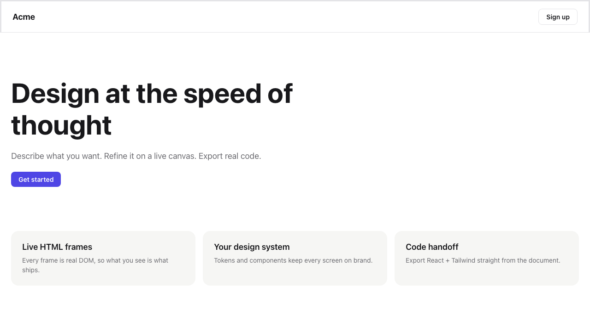 |  |  |  | 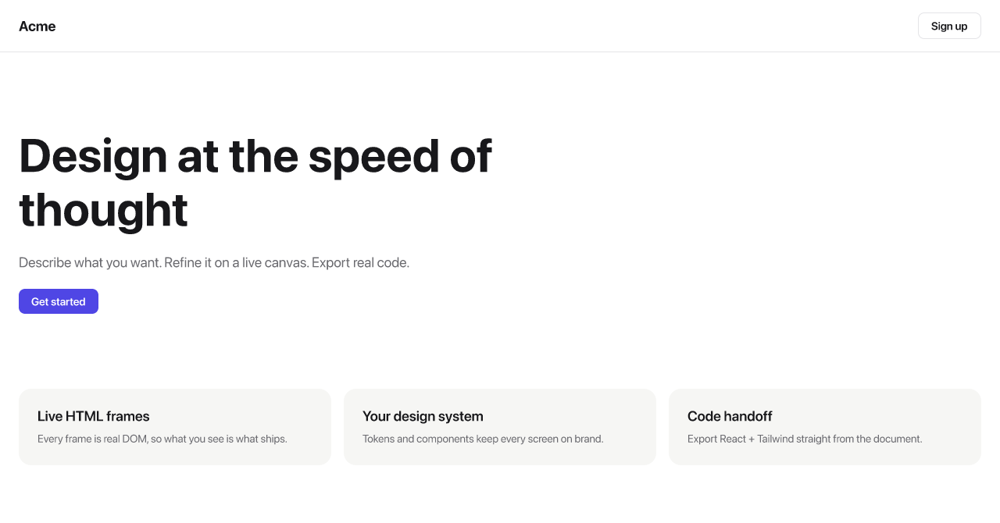 |  |  |  |  |

<details><summary>FigCraft <code>curated</code>: reply and commands</summary>

```json
{
 "reply": "I changed the headline to \"Design at the speed of thought\" and kept its styling. In the render, it wraps onto two lines, with \"thought\" on the second.",
 "commands": [
  {
   "command": "text.set",
   "params": {
    "id": 8,
    "characters": "Design at the speed of thought"
   }
  }
 ]
}
```
</details>

<details><summary>FigCraft <code>full-catalog</code>: reply and commands</summary>

```json
{
 "reply": "I changed the headline to \"Design at the speed of thought\". I checked the render. It wraps to two lines at its current 60px size, with \"thought\" alone on the second line. I didn't change the styling.",
 "commands": [
  {
   "command": "text.set",
   "params": {
    "id": 8,
    "characters": "Design at the speed of thought"
   }
  }
 ]
}
```
</details>

<details><summary>FigCraft <code>minimal</code>: reply and commands</summary>

```json
{
 "reply": "I changed the headline to \"Design at the speed of thought\". In the render it wraps onto two lines, with \"thought\" on the second, and the layout still looks fine.",
 "commands": [
  {
   "command": "text.set",
   "params": {
    "id": 8,
    "text": "Design at the speed of thought"
   }
  }
 ]
}
```
</details>

<details><summary>FigCraft <code>run-command</code>: reply and commands</summary>

```json
{
 "reply": "I changed the headline to \"Design at the speed of thought\". It now wraps onto two lines (\"…speed of / thought\"). I didn't change anything else, and the layout around it still looks fine in the render.",
 "commands": [
  {
   "command": "text.set",
   "params": {
    "id": 8,
    "characters": "Design at the speed of thought"
   }
  }
 ]
}
```
</details>

<details><summary>FigCraft <code>v1</code>: reply and commands</summary>

```json
{
 "reply": "I changed the headline to \"Design at the speed of thought\". I left the styling alone. It now wraps onto two lines, with \"thought\" on the second. The layout around it still looks fine in the render.",
 "commands": [
  {
   "command": "text.set",
   "params": {
    "id": 8,
    "characters": "Design at the speed of thought"
   }
  }
 ]
}
```
</details>

<details><summary>FigCraft <code>v1-auto-render</code>: reply and commands</summary>

```json
{
 "reply": "I changed the headline to \"Design at the speed of thought\". It wraps onto two lines, with \"thought\" on the second, and I left the styling as it was.",
 "commands": [
  {
   "command": "text.set",
   "params": {
    "id": 8,
    "characters": "Design at the speed of thought"
   }
  }
 ]
}
```
</details>

<details><summary>FigCraft <code>v1-no-render</code>: reply and commands</summary>

```json
{
 "reply": "I changed the headline to \"Design at the speed of thought\". I only changed the text. The font, size and colour are the same as before. I haven't checked how the new text wraps or how tall the headline is now.",
 "commands": [
  {
   "command": "text.set",
   "params": {
    "id": 8,
    "characters": "Design at the speed of thought"
   }
  }
 ]
}
```
</details>

<details><summary>FigCraft <code>v2</code>: reply and commands</summary>

```json
{
 "reply": "I changed the headline to \"Design at the speed of thought\". In the render it now wraps onto two lines, and the font, size and color are unchanged.",
 "commands": [
  {
   "command": "text.set",
   "params": {
    "id": 8,
    "characters": "Design at the speed of thought"
   }
  }
 ]
}
```
</details>

<details><summary>HTML frame: reply and patches</summary>

```json
{
 "reply": "I changed the headline to \"Design at the speed of thought\". I didn't run lint, since only the text changed.",
 "commits": [
  {
   "ops": [
    {
     "op": "setProps",
     "id": "n_herotitle1",
     "patch": {
      "text": "Design at the speed of thought"
     }
    }
   ],
   "label": "Update headline text"
  }
 ]
}
```
</details>

## pricing-page-offers-job

> Now add a full pricing page with three tiers and an FAQ.

| Arm | Result | Turns | In | Cache r | Cache w | Out | Wall | Touched |
|---|---|---|---|---|---|---|---|---|
| HTML frame | **fail**: job suggestion: expected generate, got null | 1 | 4 | 27380 | 610 | 605 | 4.5 s | – |
| FigCraft `curated` | pass | 2 | 6 | 12786 | 1343 | 352 | 4.8 s | – · job: generate |
| FigCraft `full-catalog` | pass | 2 | 6 | 97980 | 1376 | 373 | 5.8 s | – · job: generate |
| FigCraft `minimal` | pass | 2 | 6 | 8188 | 1379 | 371 | 4.1 s | – · job: generate |
| FigCraft `run-command` | pass | 2 | 6 | 13124 | 1350 | 365 | 5.0 s | – · job: generate |
| FigCraft `v1` | pass | 2 | 6 | 14274 | 1343 | 348 | 4.2 s | – · job: generate |
| FigCraft `v1-auto-render` | pass | 2 | 6 | 14296 | 1327 | 339 | 4.5 s | – · job: generate |
| FigCraft `v1-no-render` | pass | 2 | 6 | 13976 | 1354 | 350 | 4.3 s | – · job: generate |
| FigCraft `v2` | pass | 2 | 6 | 15020 | 1358 | 358 | 4.6 s | – · job: generate |

| HTML frame | FigCraft `curated` | FigCraft `full-catalog` | FigCraft `minimal` | FigCraft `run-command` | FigCraft `v1` | FigCraft `v1-auto-render` | FigCraft `v1-no-render` | FigCraft `v2` |
|---|---|---|---|---|---|---|---|---|
|  | 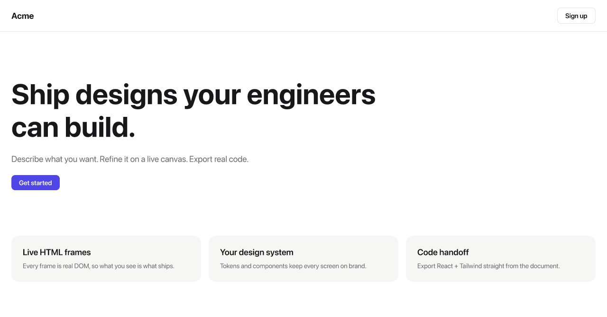 |  |  |  |  |  |  |  |

<details><summary>FigCraft <code>curated</code>: reply and commands</summary>

```json
{
 "reply": "A full pricing page with three tiers and an FAQ needs a new frame and a lot of new layers, so I didn't edit the current page. I've offered it as a background generation job instead. If you start it, the new frame will use the same nav, tokens and styling as the landing page.",
 "commands": []
}
```
</details>

<details><summary>FigCraft <code>full-catalog</code>: reply and commands</summary>

```json
{
 "reply": "A full pricing page with three tiers and an FAQ is a new page, so I've offered it as a background generation job instead of editing this frame. I haven't changed anything in your document. If you start the job, it will build the page in your existing design system.",
 "commands": []
}
```
</details>

<details><summary>FigCraft <code>minimal</code>: reply and commands</summary>

```json
{
 "reply": "A pricing page with three tiers and an FAQ is a whole new frame, so I haven't edited anything yet. I've offered a background generation job instead. If you start it, it will build the page in the same style as your landing page.",
 "commands": []
}
```
</details>

<details><summary>FigCraft <code>run-command</code>: reply and commands</summary>

```json
{
 "reply": "A full pricing page needs a new frame and a lot of new layers, so I've offered it as a background generation job instead of editing this document directly. If you start the job, it will build the page in the existing style. That includes the nav, a header, three tiers with the middle one highlighted, and an FAQ.",
 "commands": []
}
```
</details>

<details><summary>FigCraft <code>v1</code>: reply and commands</summary>

```json
{
 "reply": "A full pricing page with three tiers and an FAQ is a new page-sized frame, so I didn't edit your document. I've offered a background generation job instead. If you start it, it will build the page with your nav and design tokens. It will also highlight the middle tier.",
 "commands": []
}
```
</details>

<details><summary>FigCraft <code>v1-auto-render</code>: reply and commands</summary>

```json
{
 "reply": "A full pricing page with three tiers and an FAQ is a new page, which is too big for me to build as one edit. I've offered a background generation job instead. It would match your landing page's nav, tokens and type. If you start it, the job will build the page. I haven't changed anything in the document.",
 "commands": []
}
```
</details>

<details><summary>FigCraft <code>v1-no-render</code>: reply and commands</summary>

```json
{
 "reply": "A full pricing page needs a new frame, so I didn't edit your existing layers. I've offered a background generation job instead. It would build the page with a header, three tiers, an FAQ and the same nav. Start it when you're ready.",
 "commands": []
}
```
</details>

<details><summary>FigCraft <code>v2</code>: reply and commands</summary>

```json
{
 "reply": "A full pricing page is a new page-sized frame, so I didn't edit the current design. I've offered a background generation job instead. If you start it, it will build the page in the style of your landing page. It will have three tiers, an FAQ and a footer.",
 "commands": []
}
```
</details>

<details><summary>HTML frame: reply and patches</summary>

```json
{
 "reply": "I'll ask a few quick questions first so the pricing page fits your product.",
 "commits": [],
 "notes": [
  "turn ended on ask_questions"
 ]
}
```
</details>

## x-build-pricing

> Build a pricing section directly below the features section: a heading, three tiers (Free, Pro, Team) as cards with the price, a short feature list and a call-to-action button each, with Pro highlighted as recommended. Then add an FAQ section with four questions and answers below it. Build it directly on this page now; do not suggest a job.

| Arm | Result | Turns | In | Cache r | Cache w | Out | Wall | Touched |
|---|---|---|---|---|---|---|---|---|
| HTML frame | pass | 4 | 10 | 121895 | 9818 | 7380 | 38.9 s | n_root000001, n_price00001, n_priceh0001, n_pricegrid1, n_pfree00001, n_pfreet0001, n_pfreep0001, n_pfreel0001, n_pfreei0001, n_pfreei0002, n_pfreei0003, n_pfreeb0001, n_ppro000001, n_pprobadge1, n_pprot00001, n_pprop00001, n_pprol00001, n_pproi00001, n_pproi00002, n_pproi00003, n_pprob00001, n_pteam00001, n_pteamt0001, n_pteamp0001, n_pteaml0001, n_pteami0001, n_pteami0002, n_pteami0003, n_pteamb0001, n_faq0000001, n_faqh000001, n_faqlist001, n_faqi00001, n_faqq00001, n_faqa00001, n_faqi00002, n_faqq00002, n_faqa00002, n_faqi00003, n_faqq00003, n_faqa00003, n_faqi00004, n_faqq00004, n_faqa00004 |
| FigCraft `v1` | pass | 8 | 18 | 125897 | 21771 | 7201 | 49.4 s | new:22, new:23, new:24, new:25, new:26, new:27, new:28, new:29, new:30, new:31, new:32, new:33, new:34, new:35, new:36, new:37, new:38, new:39, new:40, new:41, new:42, new:43, new:44, new:45, new:46, new:47, new:48, new:49, new:50, new:51, new:52, new:53, new:54, new:55, new:56, new:57, new:58 |
| FigCraft `v2` | pass | 9 | 20 | 156789 | 19831 | 7100 | 47.6 s | new:22, new:23, new:24, new:25, new:26, new:27, new:28, new:29, new:30, new:31, new:32, new:33, new:34, new:35, new:36, new:37, new:38, new:39, new:40, new:41, new:42, new:43, new:44, new:45, new:46, new:47, new:48, new:49, new:50, new:51, new:52, new:53, new:54, new:55, new:56, new:57, new:58, new:59, new:60, new:61 |

| HTML frame | FigCraft `v1` | FigCraft `v2` |
|---|---|---|
| 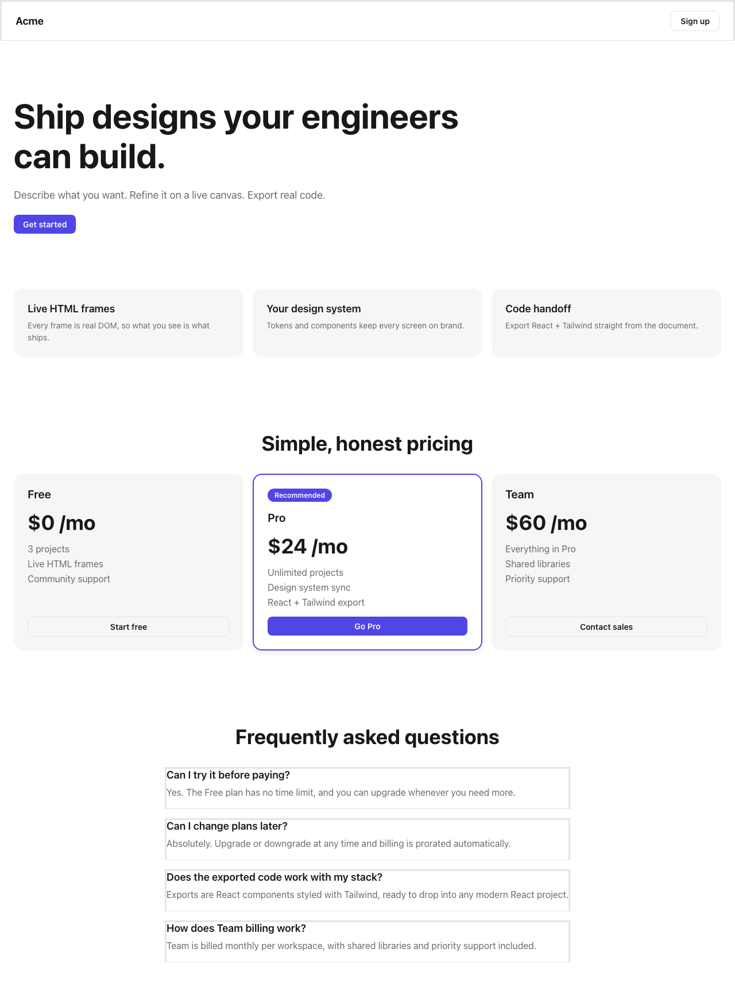 | 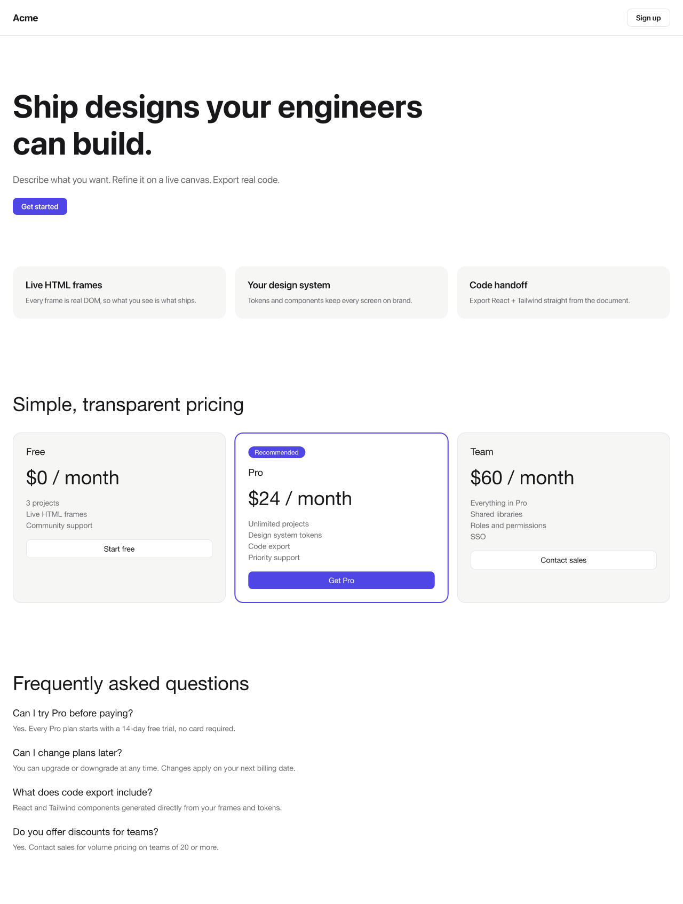 | 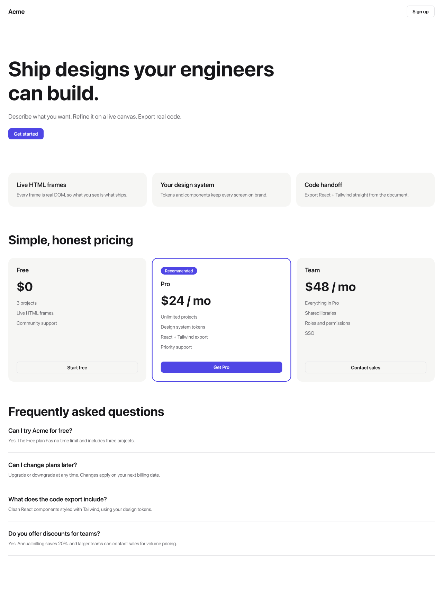 |

<details><summary>FigCraft <code>v1</code>: reply and commands</summary>

```json
{
 "reply": "I added a pricing section and an FAQ section below the features section.\n\n- **Pricing:** There's a heading and three equal-width cards for Free ($0), Pro ($24) and Team ($60). Each card has a short feature list and a call-to-action button. Pro is highlighted with an indigo border, a \"Recommended\" pill and a filled button.\n- **FAQ:** It has a heading and four question-and-answer pairs.\n\nThe card prices, features and FAQ answers are placeholder copy I wrote, so check them.\n\nThe render shows the section headings, tier names, prices and FAQ questions in a regular weight, not the bold or semibold I set. The style command ran without errors, so I haven't confirmed whether that's a render problem or the weights didn't apply.\n\nThe three cards are different heights because the Free and Team buttons sit directly under their feature lists. I didn't fix that.",
 "commands": [
  {
   "command": "node.create",
   "as": "ps",
   "params": {
    "type": "frame",
    "name": "n_pricing0001",
    "parent": 2,
    "props": {
     "layout": "vertical",
     "gap": 32,
     "padding": [
      64,
      24,
      64,
      24
     ],
     "sizingH": "fill",
     "sizingV": "hug",
     "fill": "#FFFFFF"
    }
   }
  },
  {
   "command": "node.create",
   "params": {
    "type": "text",
    "name": "n_pricetitle1",
    "parent": {
     "$ref": "ps"
    },
    "text": "Simple, transparent pricing",
    "props": {
     "fontSize": 36,
     "fontStyle": "Bold",
     "fill": "#18181B"
    }
   }
  },
  {
   "command": "node.create",
   "as": "pr",
   "params": {
    "type": "frame",
    "name": "n_pricerow001",
    "parent": {
     "$ref": "ps"
    },
    "props": {
     "layout": "horizontal",
     "gap": 16,
     "sizingH": "fill",
     "sizingV": "hug",
     "crossAlign": "min",
     "fill": "none"
    }
   }
  },
  {
   "command": "node.create",
   "as": "c1",
   "params": {
    "type": "frame",
    "name": "n_tierfree001",
    "parent": {
     "$ref": "pr"
    },
    "props": {
     "layout": "vertical",
     "gap": 16,
     "padding": 24,
     "sizingH": "fill",
     "sizingV": "hug",
     "cornerRadius": 16,
     "fill": "#F6F6F4",
     "stroke": "#E4E4E7",
     "strokeWeight": 1
    }
   }
  },
  {
   "command": "node.create",
   "params": {
    "type": "text",
    "name": "n_tierfree_name",
    "parent": {
     "$ref": "c1"
    },
    "text": "Free",
    "props": {
     "fontSize": 18,
     "fontStyle": "Semibold",
     "fill": "#18181B"
    }
   }
  },
  {
   "command": "node.create",
   "params": {
    "type": "text",
    "name": "n_tierfree_price",
    "parent": {
     "$ref": "c1"
    },
    "text": "$0 / month",
    "props": {
     "fontSize": 36,
     "fontStyle": "Bold",
     "fill": "#18181B"
    }
   }
  },
  {
   "command": "node.create",
   "params": {
    "type": "text",
    "name": "n_tierfree_feats",
    "parent": {
     "$ref": "c1"
    },
    "text": "3 projects\nLive HTML frames\nCommunity support",
    "props": {
     "fontSize": 14,
     "lineHeight": "150%",
     "fill": "#6B6B70"
    }
   }
  },
  {
   "command": "node.create",
   "as": "b1",
   "params": {
    "type": "frame",
    "name": "n_tierfree_cta",
    "parent": {
     "$ref": "c1"
    },
    "props": {
     "layout": "horizontal",
     "padding": [
      8,
      16,
      8,
      16
     ],
     "mainAlign": "center",
     "crossAlign": "center",
     "sizingH": "fill",
     "cornerRadius": 8,
     "fill": "#FFFFFF",
     "stroke": "#E4E4E7",
     "strokeWeight": 1
    }
   }
  },
  {
   "command": "node.create",
   "params": {
    "type": "text",
    "name": "n_tierfree_cta_label",
    "parent": {
     "$ref": "b1"
    },
    "text": "Start free",
    "props": {
     "fontSize": 14,
     "fontStyle": "Semibold",
     "fill": "#18181B"
    }
   }
  },
  {
   "command": "node.create",
   "as": "c2",
   "params": {
    "type": "frame",
    "name": "n_tierpro0001",
    "parent": {
     "$ref": "pr"
    },
    "props": {
     "layout": "vertical",
     "gap": 16,
     "padding": 24,
     "sizingH": "fill",
     "sizingV": "hug",
     "cornerRadius": 16,
     "fill": "#FFFFFF",
     "stroke": "#4F46E5",
     "strokeWeight": 2
    }
   }
  },
  {
   "command": "node.create",
   "as": "bd",
   "params": {
    "type": "frame",
    "name": "n_tierpro_badge",
    "parent": {
     "$ref": "c2"
    },
    "props": {
     "layout": "horizontal",
     "padding": [
      4,
      12,
      4,
      12
     ],
     "cornerRadius": 9999,
     "fill": "#4F46E5"
    }
   }
  },
  {
   "command": "node.create",
   "params": {
    "type": "text",
    "name": "n_tierpro_badge_label",
    "parent": {
     "$ref": "bd"
    },
    "text": "Recommended",
    "props": {
     "fontSize": 12,
     "fontStyle": "Semibold",
     "fill": "#FFFFFF"
    }
   }
  },
  {
   "command": "node.create",
   "params": {
    "type": "text",
    "name": "n_tierpro_name",
    "parent": {
     "$ref": "c2"
    },
    "text": "Pro",
    "props": {
     "fontSize": 18,
     "fontStyle": "Semibold",
     "fill": "#18181B"
    }
   }
  },
  {
   "command": "node.create",
   "params": {
    "type": "text",
    "name": "n_tierpro_price",
    "parent": {
     "$ref": "c2"
    },
    "text": "$24 / month",
    "props": {
     "fontSize": 36,
     "fontStyle": "Bold",
     "fill": "#18181B"
    }
   }
  },
  {
   "command": "node.create",
   "params": {
    "type": "text",
    "name": "n_tierpro_feats",
    "parent": {
     "$ref": "c2"
    },
    "text": "Unlimited projects\nDesign system tokens\nCode export\nPriority support",
    "props": {
     "fontSize": 14,
     "lineHeight": "150%",
     "fill": "#6B6B70"
    }
   }
  },
  {
   "command": "node.create",
   "as": "b2",
   "params": {
    "type": "frame",
    "name": "n_tierpro_cta",
    "parent": {
     "$ref": "c2"
    },
    "props": {
     "layout": "horizontal",
     "padding": [
      8,
      16,
      8,
      16
     ],
     "mainAlign": "center",
     "crossAlign": "center",
     "sizingH": "fill",
     "cornerRadius": 8,
     "fill": "#4F46E5"
    }
   }
  },
  {
   "command": "node.create",
   "params": {
    "type": "text",
    "name": "n_tierpro_cta_label",
    "parent": {
     "$ref": "b2"
    },
    "text": "Get Pro",
    "props": {
     "fontSize": 14,
     "fontStyle": "Semibold",
     "fill": "#FFFFFF"
    }
   }
  },
  {
   "command": "node.create",
   "as": "c3",
   "params": {
    "type": "frame",
    "name": "n_tierteam001",
    "parent": {
     "$ref": "pr"
    },
    "props": {
     "layout": "vertical",
     "gap": 16,
     "padding": 24,
     "sizingH": "fill",
     "sizingV": "hug",
     "cornerRadius": 16,
     "fill": "#F6F6F4",
     "stroke": "#E4E4E7",
     "strokeWeight": 1
    }
   }
  },
  {
   "command": "node.create",
   "params": {
    "type": "text",
    "name": "n_tierteam_name",
    "parent": {
     "$ref": "c3"
    },
    "text": "Team",
    "props": {
     "fontSize": 18,
     "fontStyle": "Semibold",
     "fill": "#18181B"
    }
   }
  },
  {
   "command": "node.create",
   "params": {
    "type": "text",
    "name": "n_tierteam_price",
    "parent": {
     "$ref": "c3"
    },
    "text": "$60 / month",
    "props": {
     "fontSize": 36,
     "fontStyle": "Bold",
     "fill": "#18181B"
    }
   }
  },
  {
   "command": "node.create",
   "params": {
    "type": "text",
    "name": "n_tierteam_feats",
    "parent": {
     "$ref": "c3"
    },
    "text": "Everything in Pro\nShared libraries\nRoles and permissions\nSSO",
    "props": {
     "fontSize": 14,
     "lineHeight": "150%",
     "fill": "#6B6B70"
    }
   }
  },
  {
   "command": "node.create",
   "as": "b3",
   "params": {
    "type": "frame",
    "name": "n_tierteam_cta",
    "parent": {
     "$ref": "c3"
    },
    "props": {
     "layout": "horizontal",
     "padding": [
      8,
      16,
      8,
      16
     ],
     "mainAlign": "center",
     "crossAlign": "center",
     "sizingH": "fill",
     "cornerRadius": 8,
     "fill": "#FFFFFF",
     "stroke": "#E4E4E7",
     "strokeWeight": 1
    }
   }
  },
  {
   "command": "node.create",
   "params": {
    "type": "text",
    "name": "n_tierteam_cta_label",
    "parent": {
     "$ref": "b3"
    },
    "text": "Contact sales",
    "props": {
     "fontSize": 14,
     "fontStyle": "Semibold",
     "fill": "#18181B"
    }
   }
  },
  {
   "command": "node.create",
   "as": "fs",
   "params": {
    "type": "frame",
    "name": "n_faq00000001",
    "parent": 2,
    "props": {
     "layout": "vertical",
     "gap": 24,
     "padding": [
      64,
      24,
      96,
      24
     ],
     "sizingH": "fill",
     "sizingV": "hug",
     "fill": "#FFFFFF"
    }
   }
  },
  {
   "command": "node.create",
   "params": {
    "type": "text",
    "name": "n_faqtitle001",
    "parent": {
     "$ref": "fs"
    },
    "text": "Frequently asked questions",
    "props": {
     "fontSize": 36,
     "fontStyle": "Bold",
     "fill": "#18181B"
    }
   }
  },
  {
   "command": "node.create",
   "as": "q1",
   "params": {
    "type": "frame",
    "name": "n_faq1",
    "parent": {
     "$ref": "fs"
    },
    "props": {
     "layout": "vertical",
     "gap": 8,
     "sizingH": "fill",
     "sizingV": "hug",
     "fill": "none"
    }
   }
  },
  {
   "command": "node.create",
   "params": {
    "type": "text",
    "name": "n_faq1_q",
    "parent": {
     "$ref": "q1"
    },
    "text": "Can I try Pro before paying?",
    "props": {
     "fontSize": 18,
     "fontStyle": "Semibold",
     "fill": "#18181B"
    }
   }
  },
  {
   "command": "node.create",
   "params": {
    "type": "text",
    "name": "n_faq1_a",
    "parent": {
     "$ref": "q1"
    },
    "text": "Yes. Every Pro plan starts with a 14-day free trial, no card required.",
    "props": {
     "fontSize": 14,
     "lineHeight": "150%",
     "fill": "#6B6B70"
    }
   }
  },
  {
   "command": "node.create",
   "as": "q2",
   "params": {
    "type": "frame",
    "name": "n_faq2",
    "parent": {
     "$ref": "fs"
    },
    "props": {
     "layout": "vertical",
     "gap": 8,
     "sizingH": "fill",
     "sizingV": "hug",
     "fill": "none"
    }
   }
  },
  {
   "command": "node.create",
   "params": {
    "type": "text",
    "name": "n_faq2_q",
    "parent": {
     "$ref": "q2"
    },
    "text": "Can I change plans later?",
    "props": {
     "fontSize": 18,
     "fontStyle": "Semibold",
     "fill": "#18181B"
    }
   }
  },
  {
   "command": "node.create",
   "params": {
    "type": "text",
    "name": "n_faq2_a",
    "parent": {
     "$ref": "q2"
    },
    "text": "You can upgrade or downgrade at any time. Changes apply on your next billing date.",
    "props": {
     "fontSize": 14,
     "lineHeight": "150%",
     "fill": "#6B6B70"
    }
   }
  },
  {
   "command": "node.create",
   "as": "q3",
   "params": {
    "type": "frame",
    "name": "n_faq3",
    "parent": {
     "$ref": "fs"
    },
    "props": {
     "layout": "vertical",
     "gap": 8,
     "sizingH": "fill",
     "sizingV": "hug",
     "fill": "none"
    }
   }
  },
  {
   "command": "node.create",
   "params": {
    "type": "text",
    "name": "n_faq3_q",
    "parent": {
     "$ref": "q3"
    },
    "text": "What does code export include?",
    "props": {
     "fontSize": 18,
     "fontStyle": "Semibold",
     "fill": "#18181B"
    }
   }
  },
  {
   "command": "node.create",
   "params": {
    "type": "text",
    "name": "n_faq3_a",
    "parent": {
     "$ref": "q3"
    },
    "text": "React and Tailwind components generated directly from your frames and tokens.",
    "props": {
     "fontSize": 14,
     "lineHeight": "150%",
     "fill": "#6B6B70"
    }
   }
  },
  {
   "command": "node.create",
   "as": "q4",
   "params": {
    "type": "frame",
    "name": "n_faq4",
    "parent": {
     "$ref": "fs"
    },
    "props": {
     "layout": "vertical",
     "gap": 8,
     "sizingH": "fill",
     "sizingV": "hug",
     "fill": "none"
    }
   }
  },
  {
   "command": "node.create",
   "params": {
    "type": "text",
    "name": "n_faq4_q",
    "parent": {
     "$ref": "q4"
    },
    "text": "Do you offer discounts for teams?",
    "props": {
     "fontSize": 18,
     "fontStyle": "Semibold",
     "fill": "#18181B"
    }
   }
  },
  {
   "command": "node.create",
   "params": {
    "type": "text",
    "name": "n_faq4_a",
    "parent": {
     "$ref": "q4"
    },
    "text": "Yes. Contact sales for volume pricing on teams of 20 or more.",
    "props": {
     "fontSize": 14,
     "lineHeight": "150%",
     "fill": "#6B6B70"
    }
   }
  },
  {
   "command": "node.set",
   "params": {
    "ids": [
     29,
     37,
     43,
     32
    ],
    "sizingV": "hug"
   }
  },
  {
   "command": "node.set",
   "params": {
    "ids": [
     32
    ],
    "sizingH": "hug"
   }
  },
  {
   "command": "node.set",
   "params": {
    "ids": [
     25,
     31,
     39
    ],
    "sizingV": "fill"
   }
  },
  {
   "command": "node.set",
   "params": {
    "ids": [
     23,
     46,
     27,
     35,
     41
    ],
    "fontStyle": "Bold"
   }
  },
  {
   "command": "node.set",
   "params": {
    "ids": [
     26,
     34,
     40,
     33,
     30,
     38,
     44,
     48,
     51,
     54,
     57
    ],
    "fontStyle": "Semibold"
   }
  },
  {
   "command": "text.style",
   "params": {
    "id": 23,
    "fontStyle": "Bold"
   }
  },
  {
   "command": "text.style",
   "params": {
    "id": 46,
    "fontStyle": "Bold"
   }
  },
  {
   "command": "text.style",
   "params": {
    "id": 27,
    "fontStyle": "Bold"
   }
  },
  {
   "command": "text.style",
   "params": {
    "id": 35,
    "fontStyle": "Bold"
   }
  },
  {
   "command": "text.style",
   "params": {
    "id": 41,
    "fontStyle": "Bold"
   }
  },
  {
   "command": "text.style",
   "params": {
    "id": 26,
    "fontStyle": "Semibold"
   }
  },
  {
   "command": "text.style",
   "params": {
    "id": 34,
    "fontStyle": "Semibold"
   }
  },
  {
   "command": "text.style",
   "params": {
    "id": 40,
    "fontStyle": "Semibold"
   }
  },
  {
   "command": "text.style",
   "params": {
    "id": 48,
    "fontStyle": "Semibold"
   }
  },
  {
   "command": "text.style",
   "params": {
    "id": 51,
    "fontStyle": "Semibold"
   }
  },
  {
   "command": "text.style",
   "params": {
    "id": 54,
    "fontStyle": "Semibold"
   }
  },
  {
   "command": "text.style",
   "params": {
    "id": 57,
    "fontStyle": "Semibold"
   }
  }
 ]
}
```
</details>

<details><summary>FigCraft <code>v2</code>: reply and commands</summary>

```json
{
 "reply": "Pricing row is empty-looking; inspecting.\nI added a pricing section and an FAQ section below the features section, on the same page.\n\n- **Pricing:** The section has a heading and three equal-height cards for Free ($0), Pro ($24/mo) and Team ($48/mo). Each card has a short feature list and a button pinned to the bottom. Pro is highlighted with a 2px indigo border, a \"Recommended\" pill and a filled indigo button. Free and Team have outlined buttons.\n- **FAQ:** The section has a heading and four question-and-answer pairs separated by thin dividers. I wrote the plan features, prices and FAQ answers myself, so check the wording.\n\nI checked the pricing section in a render after fixing the card heights. I didn't re-render the FAQ after the fix. It looked right in the earlier full-page render.",
 "commands": [
  {
   "command": "node.create",
   "as": "ps",
   "params": {
    "type": "frame",
    "parent": 2,
    "name": "n_pricing001",
    "props": {
     "layout": "vertical",
     "gap": 32,
     "padding": [
      0,
      24,
      64,
      24
     ],
     "sizingH": "fill",
     "sizingV": "hug",
     "fill": "none"
    }
   }
  },
  {
   "command": "node.create",
   "params": {
    "type": "text",
    "parent": {
     "$ref": "ps"
    },
    "name": "n_pricehead01",
    "text": "Simple, honest pricing",
    "props": {
     "fontFamily": "SF Pro",
     "fontStyle": "Bold",
     "fontSize": 36,
     "fill": "#18181B"
    }
   }
  },
  {
   "command": "node.create",
   "as": "row",
   "params": {
    "type": "frame",
    "parent": {
     "$ref": "ps"
    },
    "name": "n_pricerow01",
    "props": {
     "layout": "horizontal",
     "gap": 16,
     "crossAlign": "min",
     "sizingH": "fill",
     "sizingV": "hug",
     "fill": "none"
    }
   }
  },
  {
   "command": "node.create",
   "as": "c1",
   "params": {
    "type": "frame",
    "parent": {
     "$ref": "row"
    },
    "name": "n_tierfree01",
    "props": {
     "layout": "vertical",
     "gap": 16,
     "padding": 24,
     "cornerRadius": 16,
     "fill": "#F6F6F4",
     "sizingH": "fill",
     "sizingV": "fill"
    }
   }
  },
  {
   "command": "node.create",
   "params": {
    "type": "text",
    "parent": {
     "$ref": "c1"
    },
    "name": "n_tierfree01_name",
    "text": "Free",
    "props": {
     "fontFamily": "SF Pro",
     "fontStyle": "Semibold",
     "fontSize": 18,
     "fill": "#18181B"
    }
   }
  },
  {
   "command": "node.create",
   "params": {
    "type": "text",
    "parent": {
     "$ref": "c1"
    },
    "name": "n_tierfree01_price",
    "text": "$0",
    "props": {
     "fontFamily": "SF Pro",
     "fontStyle": "Bold",
     "fontSize": 36,
     "fill": "#18181B"
    }
   }
  },
  {
   "command": "node.create",
   "params": {
    "type": "text",
    "parent": {
     "$ref": "c1"
    },
    "name": "n_tierfree01_list",
    "text": "3 projects\nLive HTML frames\nCommunity support",
    "props": {
     "fontFamily": "SF Pro",
     "fontStyle": "Regular",
     "fontSize": 14,
     "fill": "#6B6B70",
     "lineHeight": "150%",
     "paragraphSpacing": 8,
     "sizingH": "fill",
     "textAutoResize": "height"
    }
   }
  },
  {
   "command": "node.create",
   "params": {
    "type": "frame",
    "parent": {
     "$ref": "c1"
    },
    "name": "n_tierfree01_spacer",
    "props": {
     "sizingH": "fill",
     "sizingV": "fill",
     "fill": "none"
    }
   }
  },
  {
   "command": "node.create",
   "as": "b1",
   "params": {
    "type": "frame",
    "parent": {
     "$ref": "c1"
    },
    "name": "n_tierfree01_cta",
    "props": {
     "layout": "horizontal",
     "padding": [
      8,
      16,
      8,
      16
     ],
     "mainAlign": "center",
     "crossAlign": "center",
     "cornerRadius": 8,
     "sizingH": "fill",
     "sizingV": "hug",
     "fill": "none",
     "stroke": "#E4E4E7",
     "strokeWeight": 1
    }
   }
  },
  {
   "command": "node.create",
   "params": {
    "type": "text",
    "parent": {
     "$ref": "b1"
    },
    "name": "n_tierfree01_cta_label",
    "text": "Start free",
    "props": {
     "fontFamily": "SF Pro",
     "fontStyle": "Semibold",
     "fontSize": 14,
     "fill": "#18181B"
    }
   }
  },
  {
   "command": "node.create",
   "as": "c2",
   "params": {
    "type": "frame",
    "parent": {
     "$ref": "row"
    },
    "name": "n_tierpro0001",
    "props": {
     "layout": "vertical",
     "gap": 16,
     "padding": 24,
     "cornerRadius": 16,
     "fill": "#FFFFFF",
     "stroke": "#4F46E5",
     "strokeWeight": 2,
     "sizingH": "fill",
     "sizingV": "fill"
    }
   }
  },
  {
   "command": "node.create",
   "as": "badge",
   "params": {
    "type": "frame",
    "parent": {
     "$ref": "c2"
    },
    "name": "n_tierpro0001_badge",
    "props": {
     "layout": "horizontal",
     "padding": [
      4,
      12,
      4,
      12
     ],
     "cornerRadius": 9999,
     "fill": "#4F46E5",
     "sizingH": "hug",
     "sizingV": "hug"
    }
   }
  },
  {
   "command": "node.create",
   "params": {
    "type": "text",
    "parent": {
     "$ref": "badge"
    },
    "name": "n_tierpro0001_badge_label",
    "text": "Recommended",
    "props": {
     "fontFamily": "SF Pro",
     "fontStyle": "Semibold",
     "fontSize": 12,
     "fill": "#FFFFFF"
    }
   }
  },
  {
   "command": "node.create",
   "params": {
    "type": "text",
    "parent": {
     "$ref": "c2"
    },
    "name": "n_tierpro0001_name",
    "text": "Pro",
    "props": {
     "fontFamily": "SF Pro",
     "fontStyle": "Semibold",
     "fontSize": 18,
     "fill": "#18181B"
    }
   }
  },
  {
   "command": "node.create",
   "params": {
    "type": "text",
    "parent": {
     "$ref": "c2"
    },
    "name": "n_tierpro0001_price",
    "text": "$24 / mo",
    "props": {
     "fontFamily": "SF Pro",
     "fontStyle": "Bold",
     "fontSize": 36,
     "fill": "#18181B"
    }
   }
  },
  {
   "command": "node.create",
   "params": {
    "type": "text",
    "parent": {
     "$ref": "c2"
    },
    "name": "n_tierpro0001_list",
    "text": "Unlimited projects\nDesign system tokens\nReact + Tailwind export\nPriority support",
    "props": {
     "fontFamily": "SF Pro",
     "fontStyle": "Regular",
     "fontSize": 14,
     "fill": "#6B6B70",
     "lineHeight": "150%",
     "paragraphSpacing": 8,
     "sizingH": "fill",
     "textAutoResize": "height"
    }
   }
  },
  {
   "command": "node.create",
   "params": {
    "type": "frame",
    "parent": {
     "$ref": "c2"
    },
    "name": "n_tierpro0001_spacer",
    "props": {
     "sizingH": "fill",
     "sizingV": "fill",
     "fill": "none"
    }
   }
  },
  {
   "command": "node.create",
   "as": "b2",
   "params": {
    "type": "frame",
    "parent": {
     "$ref": "c2"
    },
    "name": "n_tierpro0001_cta",
    "props": {
     "layout": "horizontal",
     "padding": [
      8,
      16,
      8,
      16
     ],
     "mainAlign": "center",
     "crossAlign": "center",
     "cornerRadius": 8,
     "sizingH": "fill",
     "sizingV": "hug",
     "fill": "#4F46E5"
    }
   }
  },
  {
   "command": "node.create",
   "params": {
    "type": "text",
    "parent": {
     "$ref": "b2"
    },
    "name": "n_tierpro0001_cta_label",
    "text": "Get Pro",
    "props": {
     "fontFamily": "SF Pro",
     "fontStyle": "Semibold",
     "fontSize": 14,
     "fill": "#FFFFFF"
    }
   }
  },
  {
   "command": "node.create",
   "as": "c3",
   "params": {
    "type": "frame",
    "parent": {
     "$ref": "row"
    },
    "name": "n_tierteam001",
    "props": {
     "layout": "vertical",
     "gap": 16,
     "padding": 24,
     "cornerRadius": 16,
     "fill": "#F6F6F4",
     "sizingH": "fill",
     "sizingV": "fill"
    }
   }
  },
  {
   "command": "node.create",
   "params": {
    "type": "text",
    "parent": {
     "$ref": "c3"
    },
    "name": "n_tierteam001_name",
    "text": "Team",
    "props": {
     "fontFamily": "SF Pro",
     "fontStyle": "Semibold",
     "fontSize": 18,
     "fill": "#18181B"
    }
   }
  },
  {
   "command": "node.create",
   "params": {
    "type": "text",
    "parent": {
     "$ref": "c3"
    },
    "name": "n_tierteam001_price",
    "text": "$48 / mo",
    "props": {
     "fontFamily": "SF Pro",
     "fontStyle": "Bold",
     "fontSize": 36,
     "fill": "#18181B"
    }
   }
  },
  {
   "command": "node.create",
   "params": {
    "type": "text",
    "parent": {
     "$ref": "c3"
    },
    "name": "n_tierteam001_list",
    "text": "Everything in Pro\nShared libraries\nRoles and permissions\nSSO",
    "props": {
     "fontFamily": "SF Pro",
     "fontStyle": "Regular",
     "fontSize": 14,
     "fill": "#6B6B70",
     "lineHeight": "150%",
     "paragraphSpacing": 8,
     "sizingH": "fill",
     "textAutoResize": "height"
    }
   }
  },
  {
   "command": "node.create",
   "params": {
    "type": "frame",
    "parent": {
     "$ref": "c3"
    },
    "name": "n_tierteam001_spacer",
    "props": {
     "sizingH": "fill",
     "sizingV": "fill",
     "fill": "none"
    }
   }
  },
  {
   "command": "node.create",
   "as": "b3",
   "params": {
    "type": "frame",
    "parent": {
     "$ref": "c3"
    },
    "name": "n_tierteam001_cta",
    "props": {
     "layout": "horizontal",
     "padding": [
      8,
      16,
      8,
      16
     ],
     "mainAlign": "center",
     "crossAlign": "center",
     "cornerRadius": 8,
     "sizingH": "fill",
     "sizingV": "hug",
     "fill": "none",
     "stroke": "#E4E4E7",
     "strokeWeight": 1
    }
   }
  },
  {
   "command": "node.create",
   "params": {
    "type": "text",
    "parent": {
     "$ref": "b3"
    },
    "name": "n_tierteam001_cta_label",
    "text": "Contact sales",
    "props": {
     "fontFamily": "SF Pro",
     "fontStyle": "Semibold",
     "fontSize": 14,
     "fill": "#18181B"
    }
   }
  },
  {
   "command": "node.create",
   "as": "fs",
   "params": {
    "type": "frame",
    "parent": 2,
    "name": "n_faq0000001",
    "props": {
     "layout": "vertical",
     "gap": 24,
     "padding": [
      0,
      24,
      96,
      24
     ],
     "sizingH": "fill",
     "sizingV": "hug",
     "fill": "none"
    }
   }
  },
  {
   "command": "node.create",
   "params": {
    "type": "text",
    "parent": {
     "$ref": "fs"
    },
    "name": "n_faqhead001",
    "text": "Frequently asked questions",
    "props": {
     "fontFamily": "SF Pro",
     "fontStyle": "Bold",
     "fontSize": 36,
     "fill": "#18181B"
    }
   }
  },
  {
   "command": "node.create",
   "as": "q1",
   "params": {
    "type": "frame",
    "parent": {
     "$ref": "fs"
    },
    "name": "n_faqitem001",
    "props": {
     "layout": "vertical",
     "gap": 8,
     "padding": [
      0,
      0,
      24,
      0
     ],
     "sizingH": "fill",
     "sizingV": "hug",
     "fill": "none",
     "strokes": [
      "#E4E4E7"
     ],
     "strokeSides": [
      false,
      false,
      true,
      false
     ],
     "strokeWeight": 1
    }
   }
  },
  {
   "command": "node.create",
   "params": {
    "type": "text",
    "parent": {
     "$ref": "q1"
    },
    "name": "n_faqitem001_q",
    "text": "Can I try Acme for free?",
    "props": {
     "fontFamily": "SF Pro",
     "fontStyle": "Semibold",
     "fontSize": 18,
     "fill": "#18181B"
    }
   }
  },
  {
   "command": "node.create",
   "params": {
    "type": "text",
    "parent": {
     "$ref": "q1"
    },
    "name": "n_faqitem001_a",
    "text": "Yes. The Free plan has no time limit and includes three projects.",
    "props": {
     "fontFamily": "SF Pro",
     "fontStyle": "Regular",
     "fontSize": 14,
     "fill": "#6B6B70",
     "lineHeight": "150%",
     "sizingH": "fill",
     "textAutoResize": "height"
    }
   }
  },
  {
   "command": "node.create",
   "as": "q2",
   "params": {
    "type": "frame",
    "parent": {
     "$ref": "fs"
    },
    "name": "n_faqitem002",
    "props": {
     "layout": "vertical",
     "gap": 8,
     "padding": [
      0,
      0,
      24,
      0
     ],
     "sizingH": "fill",
     "sizingV": "hug",
     "fill": "none",
     "strokes": [
      "#E4E4E7"
     ],
     "strokeSides": [
      false,
      false,
      true,
      false
     ],
     "strokeWeight": 1
    }
   }
  },
  {
   "command": "node.create",
   "params": {
    "type": "text",
    "parent": {
     "$ref": "q2"
    },
    "name": "n_faqitem002_q",
    "text": "Can I change plans later?",
    "props": {
     "fontFamily": "SF Pro",
     "fontStyle": "Semibold",
     "fontSize": 18,
     "fill": "#18181B"
    }
   }
  },
  {
   "command": "node.create",
   "params": {
    "type": "text",
    "parent": {
     "$ref": "q2"
    },
    "name": "n_faqitem002_a",
    "text": "Upgrade or downgrade at any time. Changes apply on your next billing date.",
    "props": {
     "fontFamily": "SF Pro",
     "fontStyle": "Regular",
     "fontSize": 14,
     "fill": "#6B6B70",
     "lineHeight": "150%",
     "sizingH": "fill",
     "textAutoResize": "height"
    }
   }
  },
  {
   "command": "node.create",
   "as": "q3",
   "params": {
    "type": "frame",
    "parent": {
     "$ref": "fs"
    },
    "name": "n_faqitem003",
    "props": {
     "layout": "vertical",
     "gap": 8,
     "padding": [
      0,
      0,
      24,
      0
     ],
     "sizingH": "fill",
     "sizingV": "hug",
     "fill": "none",
     "strokes": [
      "#E4E4E7"
     ],
     "strokeSides": [
      false,
      false,
      true,
      false
     ],
     "strokeWeight": 1
    }
   }
  },
  {
   "command": "node.create",
   "params": {
    "type": "text",
    "parent": {
     "$ref": "q3"
    },
    "name": "n_faqitem003_q",
    "text": "What does the code export include?",
    "props": {
     "fontFamily": "SF Pro",
     "fontStyle": "Semibold",
     "fontSize": 18,
     "fill": "#18181B"
    }
   }
  },
  {
   "command": "node.create",
   "params": {
    "type": "text",
    "parent": {
     "$ref": "q3"
    },
    "name": "n_faqitem003_a",
    "text": "Clean React components styled with Tailwind, using your design tokens.",
    "props": {
     "fontFamily": "SF Pro",
     "fontStyle": "Regular",
     "fontSize": 14,
     "fill": "#6B6B70",
     "lineHeight": "150%",
     "sizingH": "fill",
     "textAutoResize": "height"
    }
   }
  },
  {
   "command": "node.create",
   "as": "q4",
   "params": {
    "type": "frame",
    "parent": {
     "$ref": "fs"
    },
    "name": "n_faqitem004",
    "props": {
     "layout": "vertical",
     "gap": 8,
     "padding": [
      0,
      0,
      24,
      0
     ],
     "sizingH": "fill",
     "sizingV": "hug",
     "fill": "none",
     "strokes": [
      "#E4E4E7"
     ],
     "strokeSides": [
      false,
      false,
      true,
      false
     ],
     "strokeWeight": 1
    }
   }
  },
  {
   "command": "node.create",
   "params": {
    "type": "text",
    "parent": {
     "$ref": "q4"
    },
    "name": "n_faqitem004_q",
    "text": "Do you offer discounts for teams?",
    "props": {
     "fontFamily": "SF Pro",
     "fontStyle": "Semibold",
     "fontSize": 18,
     "fill": "#18181B"
    }
   }
  },
  {
   "command": "node.create",
   "params": {
    "type": "text",
    "parent": {
     "$ref": "q4"
    },
    "name": "n_faqitem004_a",
    "text": "Yes. Annual billing saves 20%, and larger teams can contact sales for volume pricing.",
    "props": {
     "fontFamily": "SF Pro",
     "fontStyle": "Regular",
     "fontSize": 14,
     "fill": "#6B6B70",
     "lineHeight": "150%",
     "sizingH": "fill",
     "textAutoResize": "height"
    }
   }
  },
  {
   "command": "node.set",
   "params": {
    "id": 24,
    "sizingV": "hug"
   }
  },
  {
   "command": "node.set",
   "params": {
    "id": 25,
    "sizingV": "hug"
   }
  },
  {
   "command": "node.set",
   "params": {
    "id": 32,
    "sizingV": "hug"
   }
  },
  {
   "command": "node.set",
   "params": {
    "id": 41,
    "sizingV": "hug"
   }
  },
  {
   "command": "node.set",
   "params": {
    "id": 25,
    "sizingV": "fill"
   }
  },
  {
   "command": "node.set",
   "params": {
    "id": 32,
    "sizingV": "fill"
   }
  },
  {
   "command": "node.set",
   "params": {
    "id": 41,
    "sizingV": "fill"
   }
  },
  {
   "command": "node.set",
   "params": {
    "id": 29,
    "sizingV": "fixed"
   }
  },
  {
   "command": "node.set",
   "params": {
    "id": 29,
    "sizingV": "fill"
   }
  },
  {
   "command": "node.set",
   "params": {
    "id": 38,
    "sizingV": "fixed"
   }
  },
  {
   "command": "node.set",
   "params": {
    "id": 38,
    "sizingV": "fill"
   }
  },
  {
   "command": "node.set",
   "params": {
    "id": 45,
    "sizingV": "fixed"
   }
  },
  {
   "command": "node.set",
   "params": {
    "id": 45,
    "sizingV": "fill"
   }
  }
 ]
}
```
</details>

<details><summary>HTML frame: reply and patches</summary>

```json
{
 "reply": "I added a pricing section and an FAQ section below Features, and the lint check found no issues.\n\n- **Pricing:** It has a heading and three cards (Free $0, Pro $24, Team $60). Each card has a price, three feature bullets and a button. Pro stands out with a primary-colour border, a shadow and a \"Recommended\" badge, and it gets the primary button while the other two use the secondary one. The cards sit in one row on tablet and wider, and stack on mobile.\n- **FAQ:** It has a heading and four question-and-answer pairs, laid out in a centred column.\n\nThe prices, bullets and FAQ answers are placeholder copy I wrote, so replace them with your real plans and answers.",
 "commits": [
  {
   "ops": [
    {
     "op": "insertSubtree",
     "parentId": "n_root000001",
     "index": 3,
     "nodes": [
      {
       "id": "n_price00001",
       "name": "Pricing",
       "parentId": "n_root000001",
       "children": [
        "n_priceh0001",
        "n_pricegrid1"
       ],
       "positioning": "flow",
       "style": {
        "base": {
         "display": "flex",
         "flexDirection": "column",
         "gap": {
          "token": "space.8"
         },
         "paddingTop": {
          "token": "space.16"
         },
         "paddingRight": {
          "token": "space.6"
         },
         "paddingBottom": {
          "token": "space.16"
         },
         "paddingLeft": {
          "token": "space.6"
         }
        }
       },
       "type": "box",
       "tag": "section",
       "props": {}
      },
      {
       "id": "n_priceh0001",
       "parentId": "n_price00001",
       "children": [],
       "positioning": "flow",
       "style": {
        "base": {
         "fontSize": {
          "token": "text.4xl"
         },
         "fontWeight": {
          "token": "weight.bold"
         },
         "textAlign": "center",
         "color": {
          "token": "color.text"
         }
        }
       },
       "type": "text",
       "tag": "h2",
       "props": {
        "text": "Simple, honest pricing"
       }
      },
      {
       "id": "n_pricegrid1",
       "name": "Tiers",
       "parentId": "n_price00001",
       "children": [
        "n_pfree00001",
        "n_ppro000001",
        "n_pteam00001"
       ],
       "positioning": "flow",
       "style": {
        "base": {
         "display": "grid",
         "alignItems": "stretch",
         "gap": {
          "token": "space.4"
         },
         "gridTemplateColumns": "repeat(1, minmax(0, 1fr))"
        },
        "md": {
         "gridTemplateColumns": "repeat(3, minmax(0, 1fr))"
        }
       },
       "type": "box",
       "tag": "div",
       "props": {}
      },
      {
       "id": "n_pfree00001",
       "name": "Tier Free",
       "parentId": "n_pricegrid1",
       "children": [
        "n_pfreet0001",
        "n_pfreep0001",
        "n_pfreel0001",
        "n_pfreeb0001"
       ],
       "positioning": "flow",
       "style": {
        "base": {
         "display": "flex",
         "flexDirection": "column",
         "gap": {
          "token": "space.4"
         },
         "paddingTop": {
          "token": "space.6"
         },
         "paddingRight": {
          "token": "space.6"
         },
         "paddingBottom": {
          "token": "space.6"
         },
         "paddingLeft": {
          "token": "space.6"
         },
         "backgroundColor": {
          "token": "color.surface"
         },
         "borderRadius": {
          "token": "radius.lg"
         }
        }
       },
       "type": "box",
       "tag": "article",
       "props": {}
      },
      {
       "id": "n_pfreet0001",
       "parentId": "n_pfree00001",
       "children": [],
       "positioning": "flow",
       "style": {
        "base": {
         "fontSize": {
          "token": "text.xl"
         },
         "fontWeight": {
          "token": "weight.semibold"
         },
         "color": {
          "token": "color.text"
         }
        }
       },
       "type": "text",
       "tag": "h3",
       "props": {
        "text": "Free"
       }
      },
      {
       "id": "n_pfreep0001",
       "parentId": "n_pfree00001",
       "children": [],
       "positioning": "flow",
       "style": {
        "base": {
         "fontSize": {
          "token": "text.4xl"
         },
         "fontWeight": {
          "token": "weight.bold"
         },
         "color": {
          "token": "color.text"
         }
        }
       },
       "type": "text",
       "tag": "p",
       "props": {
        "text": "$0 /mo"
       }
      },
      {
       "id": "n_pfreel0001",
       "parentId": "n_pfree00001",
       "children": [
        "n_pfreei0001",
        "n_pfreei0002",
        "n_pfreei0003"
       ],
       "positioning": "flow",
       "style": {
        "base": {
         "display": "flex",
         "flexDirection": "column",
         "gap": {
          "token": "space.2"
         },
         "flexGrow": 1
        }
       },
       "type": "box",
       "tag": "ul",
       "props": {}
      },
      {
       "id": "n_pfreei0001",
       "parentId": "n_pfreel0001",
       "children": [],
       "positioning": "flow",
       "style": {
        "base": {
         "fontSize": {
          "token": "text.base"
         },
         "color": {
          "token": "color.muted"
         }
        }
       },
       "type": "text",
       "tag": "li",
       "props": {
        "text": "3 projects"
       }
      },
      {
       "id": "n_pfreei0002",
       "parentId": "n_pfreel0001",
       "children": [],
       "positioning": "flow",
       "style": {
        "base": {
         "fontSize": {
          "token": "text.base"
         },
         "color": {
          "token": "color.muted"
         }
        }
       },
       "type": "text",
       "tag": "li",
       "props": {
        "text": "Live HTML frames"
       }
      },
      {
       "id": "n_pfreei0003",
       "parentId": "n_pfreel0001",
       "children": [],
       "positioning": "flow",
       "style": {
        "base": {
         "fontSize": {
          "token": "text.base"
         },
         "color": {
          "token": "color.muted"
         }
        }
       },
       "type": "text",
       "tag": "li",
       "props": {
        "text": "Community support"
       }
      },
      {
       "id": "n_pfreeb0001",
       "parentId": "n_pfree00001",
       "children": [],
       "positioning": "flow",
       "style": {},
       "type": "instance",
       "componentRef": {
        "componentId": "Button",
        "variant": {
         "variant": "secondary"
        }
       },
       "props": {
        "values": {
         "label": "Start free"
        }
       }
      },
      {
       "id": "n_ppro000001",
       "name": "Tier Pro (Recommended)",
       "parentId": "n_pricegrid1",
       "children": [
        "n_pprobadge1",
        "n_pprot00001",
        "n_pprop00001",
        "n_pprol00001",
        "n_pprob00001"
       ],
       "positioning": "flow",
       "style": {
        "base": {
         "display": "flex",
         "flexDirection": "column",
         "gap": {
          "token": "space.4"
         },
         "paddingTop": {
          "token": "space.6"
         },
         "paddingRight": {
          "token": "space.6"
         },
         "paddingBottom": {
          "token": "space.6"
         },
         "paddingLeft": {
          "token": "space.6"
         },
         "backgroundColor": {
          "token": "color.background"
         },
         "borderWidth": 2,
         "borderStyle": "solid",
         "borderColor": {
          "token": "color.primary"
         },
         "borderRadius": {
          "token": "radius.lg"
         },
         "boxShadow": {
          "token": "shadow.md"
         }
        }
       },
       "type": "box",
       "tag": "article",
       "props": {}
      },
      {
       "id": "n_pprobadge1",
       "name": "Badge",
       "parentId": "n_ppro000001",
       "children": [],
       "positioning": "flow",
       "style": {
        "base": {
         "alignSelf": "flex-start",
         "paddingTop": {
          "token": "space.1"
         },
         "paddingRight": {
          "token": "space.3"
         },
         "paddingBottom": {
          "token": "space.1"
         },
         "paddingLeft": {
          "token": "space.3"
         },
         "fontSize": {
          "token": "text.xs"
         },
         "fontWeight": {
          "token": "weight.semibold"
         },
         "color": {
          "token": "color.primaryText"
         },
         "backgroundColor": {
          "token": "color.primary"
         },
         "borderRadius": {
          "token": "radius.full"
         }
        }
       },
       "type": "text",
       "tag": "span",
       "props": {
        "text": "Recommended"
       }
      },
      {
       "id": "n_pprot00001",
       "parentId": "n_ppro000001",
       "children": [],
       "positioning": "flow",
       "style": {
        "base": {
         "fontSize": {
          "token": "text.xl"
         },
         "fontWeight": {
          "token": "weight.semibold"
         },
         "color": {
          "token": "color.text"
         }
        }
       },
       "type": "text",
       "tag": "h3",
       "props": {
        "text": "Pro"
       }
      },
      {
       "id": "n_pprop00001",
       "parentId": "n_ppro000001",
       "children": [],
       "positioning": "flow",
       "style": {
        "base": {
         "fontSize": {
          "token": "text.4xl"
         },
         "fontWeight": {
          "token": "weight.bold"
         },
         "color": {
          "token": "color.text"
         }
        }
       },
       "type": "text",
       "tag": "p",
       "props": {
        "text": "$24 /mo"
       }
      },
      {
       "id": "n_pprol00001",
       "parentId": "n_ppro000001",
       "children": [
        "n_pproi00001",
        "n_pproi00002",
        "n_pproi00003"
       ],
       "positioning": "flow",
       "style": {
        "base": {
         "display": "flex",
         "flexDirection": "column",
         "gap": {
          "token": "space.2"
         },
         "flexGrow": 1
        }
       },
       "type": "box",
       "tag": "ul",
       "props": {}
      },
      {
       "id": "n_pproi00001",
       "parentId": "n_pprol00001",
       "children": [],
       "positioning": "flow",
       "style": {
        "base": {
         "fontSize": {
          "token": "text.base"
         },
         "color": {
          "token": "color.muted"
         }
        }
       },
       "type": "text",
       "tag": "li",
       "props": {
        "text": "Unlimited projects"
       }
      },
      {
       "id": "n_pproi00002",
       "parentId": "n_pprol00001",
       "children": [],
       "positioning": "flow",
       "style": {
        "base": {
         "fontSize": {
          "token": "text.base"
         },
         "color": {
          "token": "color.muted"
         }
        }
       },
       "type": "text",
       "tag": "li",
       "props": {
        "text": "Design system sync"
       }
      },
      {
       "id": "n_pproi00003",
       "parentId": "n_pprol00001",
       "children": [],
       "positioning": "flow",
       "style": {
        "base": {
         "fontSize": {
          "token": "text.base"
         },
         "color": {
          "token": "color.muted"
         }
        }
       },
       "type": "text",
       "tag": "li",
       "props": {
        "text": "React + Tailwind export"
       }
      },
      {
       "id": "n_pprob00001",
       "parentId": "n_ppro000001",
       "children": [],
       "positioning": "flow",
       "style": {},
       "type": "instance",
       "componentRef": {
        "componentId": "Button",
        "variant": {
         "variant": "primary"
        }
       },
       "props": {
        "values": {
         "label": "Go Pro"
        }
       }
      },
      {
       "id": "n_pteam00001",
       "name": "Tier Team",
       "parentId": "n_pricegrid1",
       "children": [
        "n_pteamt0001",
        "n_pteamp0001",
        "n_pteaml0001",
        "n_pteamb0001"
       ],
       "positioning": "flow",
       "style": {
        "base": {
         "display": "flex",
         "flexDirection": "column",
         "gap": {
          "token": "space.4"
         },
         "paddingTop": {
          "token": "space.6"
         },
         "paddingRight": {
          "token": "space.6"
         },
         "paddingBottom": {
          "token": "space.6"
         },
         "paddingLeft": {
          "token": "space.6"
         },
         "backgroundColor": {
          "token": "color.surface"
         },
         "borderRadius": {
          "token": "radius.lg"
         }
        }
       },
       "type": "box",
       "tag": "article",
       "props": {}
      },
      {
       "id": "n_pteamt0001",
       "parentId": "n_pteam00001",
       "children": [],
       "positioning": "flow",
       "style": {
        "base": {
         "fontSize": {
          "token": "text.xl"
         },
         "fontWeight": {
          "token": "weight.semibold"
         },
         "color": {
          "token": "color.text"
         }
        }
       },
       "type": "text",
       "tag": "h3",
       "props": {
        "text": "Team"
       }
      },
      {
       "id": "n_pteamp0001",
       "parentId": "n_pteam00001",
       "children": [],
       "positioning": "flow",
       "style": {
        "base": {
         "fontSize": {
          "token": "text.4xl"
         },
         "fontWeight": {
          "token": "weight.bold"
         },
         "color": {
          "token": "color.text"
         }
        }
       },
       "type": "text",
       "tag": "p",
       "props": {
        "text": "$60 /mo"
       }
      },
      {
       "id": "n_pteaml0001",
       "parentId": "n_pteam00001",
       "children": [
        "n_pteami0001",
        "n_pteami0002",
        "n_pteami0003"
       ],
       "positioning": "flow",
       "style": {
        "base": {
         "display": "flex",
         "flexDirection": "column",
         "gap": {
          "token": "space.2"
         },
         "flexGrow": 1
        }
       },
       "type": "box",
       "tag": "ul",
       "props": {}
      },
      {
       "id": "n_pteami0001",
       "parentId": "n_pteaml0001",
       "children": [],
       "positioning": "flow",
       "style": {
        "base": {
         "fontSize": {
          "token": "text.base"
         },
         "color": {
          "token": "color.muted"
         }
        }
       },
       "type": "text",
       "tag": "li",
       "props": {
        "text": "Everything in Pro"
       }
      },
      {
       "id": "n_pteami0002",
       "parentId": "n_pteaml0001",
       "children": [],
       "positioning": "flow",
       "style": {
        "base": {
         "fontSize": {
          "token": "text.base"
         },
         "color": {
          "token": "color.muted"
         }
        }
       },
       "type": "text",
       "tag": "li",
       "props": {
        "text": "Shared libraries"
       }
      },
      {
       "id": "n_pteami0003",
       "parentId": "n_pteaml0001",
       "children": [],
       "positioning": "flow",
       "style": {
        "base": {
         "fontSize": {
          "token": "text.base"
         },
         "color": {
          "token": "color.muted"
         }
        }
       },
       "type": "text",
       "tag": "li",
       "props": {
        "text": "Priority support"
       }
      },
      {
       "id": "n_pteamb0001",
       "parentId": "n_pteam00001",
       "children": [],
       "positioning": "flow",
       "style": {},
       "type": "instance",
       "componentRef": {
        "componentId": "Button",
        "variant": {
         "variant": "secondary"
        }
       },
       "props": {
        "values": {
         "label": "Contact sales"
        }
       }
      }
     ]
    },
    {
     "op": "insertSubtree",
     "parentId": "n_root000001",
     "index": 4,
     "nodes": [
      {
       "id": "n_faq0000001",
       "name": "FAQ",
       "parentId": "n_root000001",
       "children": [
        "n_faqh000001",
        "n_faqlist001"
       ],
       "positioning": "flow",
       "style": {
        "base": {
         "display": "flex",
         "flexDirection": "column",
         "gap": {
          "token": "space.8"
         },
         "width": "fill",
         "maxWidth": "48rem",
         "paddingTop": {
          "token": "space.16"
         },
         "paddingRight": {
          "token": "space.6"
         },
         "paddingBottom": {
          "token": "space.16"
         },
         "paddingLeft": {
          "token": "space.6"
         },
         "marginRight": "auto",
         "marginLeft": "auto"
        }
       },
       "type": "box",
       "tag": "section",
       "props": {}
      },
      {
       "id": "n_faqh000001",
       "parentId": "n_faq0000001",
       "children": [],
       "positioning": "flow",
       "style": {
        "base": {
         "fontSize": {
          "token": "text.4xl"
         },
         "fontWeight": {
          "token": "weight.bold"
         },
         "textAlign": "center",
         "color": {
          "token": "color.text"
         }
        }
       },
       "type": "text",
       "tag": "h2",
       "props": {
        "text": "Frequently asked questions"
       }
      },
      {
       "id": "n_faqlist001",
       "name": "Questions",
       "parentId": "n_faq0000001",
       "children": [
        "n_faqi00001",
        "n_faqi00002",
        "n_faqi00003",
        "n_faqi00004"
       ],
       "positioning": "flow",
       "style": {
        "base": {
         "display": "flex",
         "flexDirection": "column",
         "gap": {
          "token": "space.4"
         }
        }
       },
       "type": "box",
       "tag": "div",
       "props": {}
      },
      {
       "id": "n_faqi00001",
       "name": "FAQ 1",
       "parentId": "n_faqlist001",
       "children": [
        "n_faqq00001",
        "n_faqa00001"
       ],
       "positioning": "flow",
       "style": {
        "base": {
         "display": "flex",
         "flexDirection": "column",
         "gap": {
          "token": "space.2"
         },
         "paddingBottom": {
          "token": "space.4"
         },
         "borderBottomWidth": 1,
         "borderStyle": "solid",
         "borderColor": {
          "token": "color.border"
         }
        }
       },
       "type": "box",
       "tag": "article",
       "props": {}
      },
      {
       "id": "n_faqq00001",
       "parentId": "n_faqi00001",
       "children": [],
       "positioning": "flow",
       "style": {
        "base": {
         "fontSize": {
          "token": "text.lg"
         },
         "fontWeight": {
          "token": "weight.semibold"
         },
         "color": {
          "token": "color.text"
         }
        }
       },
       "type": "text",
       "tag": "h3",
       "props": {
        "text": "Can I try it before paying?"
       }
      },
      {
       "id": "n_faqa00001",
       "parentId": "n_faqi00001",
       "children": [],
       "positioning": "flow",
       "style": {
        "base": {
         "fontSize": {
          "token": "text.base"
         },
         "lineHeight": {
          "token": "leading.normal"
         },
         "color": {
          "token": "color.muted"
         }
        }
       },
       "type": "text",
       "tag": "p",
       "props": {
        "text": "Yes. The Free plan has no time limit, and you can upgrade whenever you need more."
       }
      },
      {
       "id": "n_faqi00002",
       "name": "FAQ 2",
       "parentId": "n_faqlist001",
       "children": [
        "n_faqq00002",
        "n_faqa00002"
       ],
       "positioning": "flow",
       "style": {
        "base": {
         "display": "flex",
         "flexDirection": "column",
         "gap": {
          "token": "space.2"
         },
         "paddingBottom": {
          "token": "space.4"
         },
         "borderBottomWidth": 1,
         "borderStyle": "solid",
         "borderColor": {
          "token": "color.border"
         }
        }
       },
       "type": "box",
       "tag": "article",
       "props": {}
      },
      {
       "id": "n_faqq00002",
       "parentId": "n_faqi00002",
       "children": [],
       "positioning": "flow",
       "style": {
        "base": {
         "fontSize": {
          "token": "text.lg"
         },
         "fontWeight": {
          "token": "weight.semibold"
         },
         "color": {
          "token": "color.text"
         }
        }
       },
       "type": "text",
       "tag": "h3",
       "props": {
        "text": "Can I change plans later?"
       }
      },
      {
       "id": "n_faqa00002",
       "parentId": "n_faqi00002",
       "children": [],
       "positioning": "flow",
       "style": {
        "base": {
         "fontSize": {
          "token": "text.base"
         },
         "lineHeight": {
          "token": "leading.normal"
         },
         "color": {
          "token": "color.muted"
         }
        }
       },
       "type": "text",
       "tag": "p",
       "props": {
        "text": "Absolutely. Upgrade or downgrade at any time and billing is prorated automatically."
       }
      },
      {
       "id": "n_faqi00003",
       "name": "FAQ 3",
       "parentId": "n_faqlist001",
       "children": [
        "n_faqq00003",
        "n_faqa00003"
       ],
       "positioning": "flow",
       "style": {
        "base": {
         "display": "flex",
         "flexDirection": "column",
         "gap": {
          "token": "space.2"
         },
         "paddingBottom": {
          "token": "space.4"
         },
         "borderBottomWidth": 1,
         "borderStyle": "solid",
         "borderColor": {
          "token": "color.border"
         }
        }
       },
       "type": "box",
       "tag": "article",
       "props": {}
      },
      {
       "id": "n_faqq00003",
       "parentId": "n_faqi00003",
       "children": [],
       "positioning": "flow",
       "style": {
        "base": {
         "fontSize": {
          "token": "text.lg"
         },
         "fontWeight": {
          "token": "weight.semibold"
         },
         "color": {
          "token": "color.text"
         }
        }
       },
       "type": "text",
       "tag": "h3",
       "props": {
        "text": "Does the exported code work with my stack?"
       }
      },
      {
       "id": "n_faqa00003",
       "parentId": "n_faqi00003",
       "children": [],
       "positioning": "flow",
       "style": {
        "base": {
         "fontSize": {
          "token": "text.base"
         },
         "lineHeight": {
          "token": "leading.normal"
         },
         "color": {
          "token": "color.muted"
         }
        }
       },
       "type": "text",
       "tag": "p",
       "props": {
        "text": "Exports are React components styled with Tailwind, ready to drop into any modern React project."
       }
      },
      {
       "id": "n_faqi00004",
       "name": "FAQ 4",
       "parentId": "n_faqlist001",
       "children": [
        "n_faqq00004",
        "n_faqa00004"
       ],
       "positioning": "flow",
       "style": {
        "base": {
         "display": "flex",
         "flexDirection": "column",
         "gap": {
          "token": "space.2"
         },
         "paddingBottom": {
          "token": "space.4"
         },
         "borderBottomWidth": 1,
         "borderStyle": "solid",
         "borderColor": {
          "token": "color.border"
         }
        }
       },
       "type": "box",
       "tag": "article",
       "props": {}
      },
      {
       "id": "n_faqq00004",
       "parentId": "n_faqi00004",
       "children": [],
       "positioning": "flow",
       "style": {
        "base": {
         "fontSize": {
          "token": "text.lg"
         },
         "fontWeight": {
          "token": "weight.semibold"
         },
         "color": {
          "token": "color.text"
         }
        }
       },
       "type": "text",
       "tag": "h3",
       "props": {
        "text": "How does Team billing work?"
       }
      },
      {
       "id": "n_faqa00004",
       "parentId": "n_faqi00004",
       "children": [],
       "positioning": "flow",
       "style": {
        "base": {
         "fontSize": {
          "token": "text.base"
         },
         "lineHeight": {
          "token": "leading.normal"
         },
         "color": {
          "token": "color.muted"
         }
        }
       },
       "type": "text",
       "tag": "p",
       "props": {
        "text": "Team is billed monthly per workspace, with shared libraries and priority support included."
       }
      }
     ]
    }
   ],
   "label": "Add pricing and FAQ sections"
  }
 ]
}
```
</details>

## x-build-testimonials

> Add a testimonials section after the features: a heading and three customer quote cards, each with the quote, a round avatar placeholder, the person's name and their company. Match the existing page style. Build it directly; do not suggest a job.

| Arm | Result | Turns | In | Cache r | Cache w | Out | Wall | Touched |
|---|---|---|---|---|---|---|---|---|
| HTML frame | pass | 3 | 8 | 85540 | 6865 | 3867 | 21.4 s | n_root000001, n_testi00001, n_testihead01, n_testigrid01, n_testic00001, n_testiq00001, n_testip00001, n_testia00001, n_testit00001, n_testin00001, n_testico0001, n_testic00002, n_testiq00002, n_testip00002, n_testia00002, n_testit00002, n_testin00002, n_testico0002, n_testic00003, n_testiq00003, n_testip00003, n_testia00003, n_testit00003, n_testin00003, n_testico0003 |
| FigCraft `v1` | pass | 4 | 10 | 33600 | 9161 | 3276 | 20.5 s | new:22, new:23, new:24, new:25, new:26, new:27, new:28, new:29, new:30, new:31, new:32, new:33, new:34, new:35, new:36, new:37, new:38, new:39, new:40, new:41, new:42, new:43, new:44, new:45 |
| FigCraft `v2` | pass | 3 | 8 | 27853 | 10769 | 3106 | 18.6 s | new:22, new:23, new:24, new:25, new:26, new:27, new:28, new:29, new:30, new:31, new:32, new:33, new:34, new:35, new:36, new:37, new:38, new:39, new:40, new:41, new:42, new:43, new:44, new:45 |

| HTML frame | FigCraft `v1` | FigCraft `v2` |
|---|---|---|
| 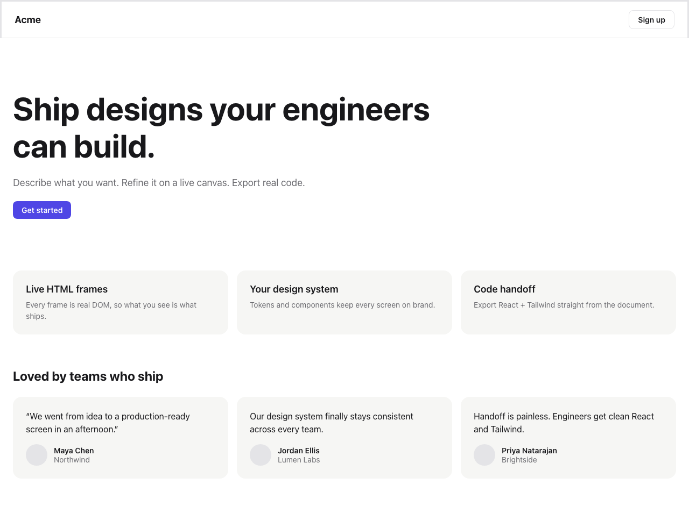 | 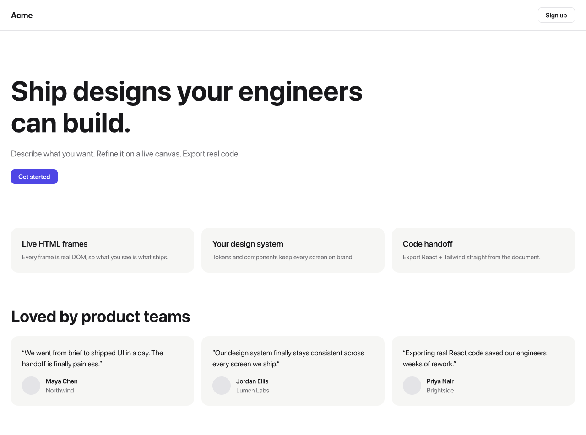 | 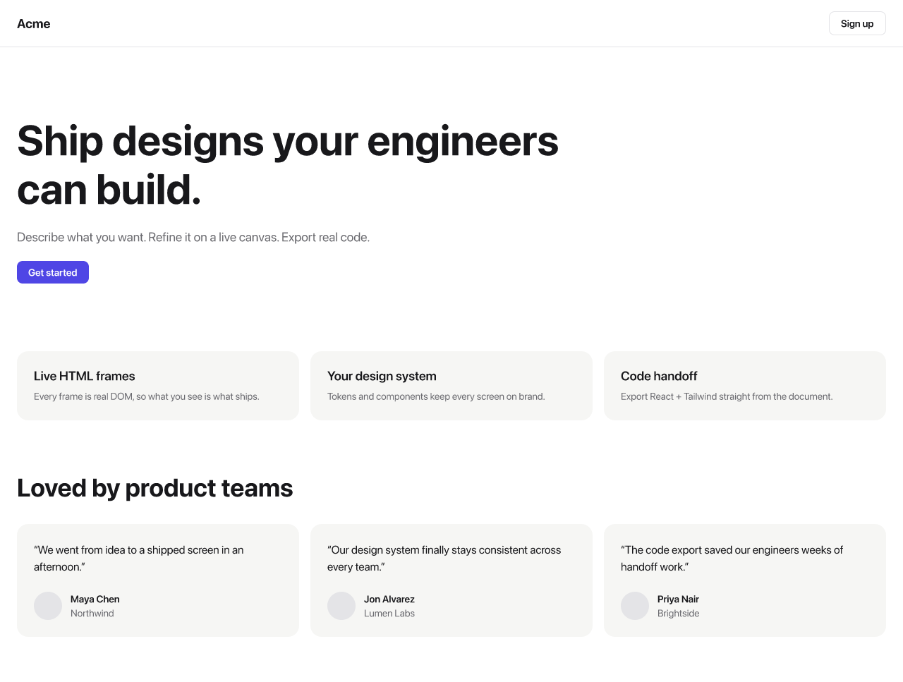 |

<details><summary>FigCraft <code>v1</code>: reply and commands</summary>

```json
{
 "reply": "I added a testimonials section after the features. It has a \"Loved by product teams\" heading and three quote cards in a row. The render shows it lining up with the feature cards above it.\n\nEach card has a quote, a round grey avatar placeholder, a name and a company. I wrote the quotes, names and companies as placeholders: Maya Chen at Northwind, Jordan Ellis at Lumen Labs and Priya Nair at Brightside. Replace them with real customers when you have them.\n\nThe cards copy the feature cards' style: same surface fill, 16px corners, 24px padding and page margins. All the layers have names starting `n_testi`.",
 "commands": [
  {
   "command": "node.create",
   "as": "sec",
   "params": {
    "type": "frame",
    "parent": 2,
    "name": "n_testimonials",
    "props": {
     "layout": "vertical",
     "gap": 24,
     "padding": [
      0,
      24,
      64,
      24
     ],
     "sizingH": "fill",
     "sizingV": "hug",
     "fill": "none"
    }
   }
  },
  {
   "command": "node.create",
   "params": {
    "type": "text",
    "parent": {
     "$ref": "sec"
    },
    "name": "n_testi_heading",
    "text": "Loved by product teams",
    "props": {
     "fontFamily": "SF Pro",
     "fontStyle": "Bold",
     "fontSize": 36,
     "lineHeight": "115%",
     "fill": "#18181B"
    }
   }
  },
  {
   "command": "node.create",
   "as": "row",
   "params": {
    "type": "frame",
    "parent": {
     "$ref": "sec"
    },
    "name": "n_testi_row",
    "props": {
     "layout": "horizontal",
     "gap": 16,
     "sizingH": "fill",
     "sizingV": "hug",
     "fill": "none"
    }
   }
  },
  {
   "command": "node.create",
   "as": "c1",
   "params": {
    "type": "frame",
    "parent": {
     "$ref": "row"
    },
    "name": "n_testi1card",
    "props": {
     "layout": "vertical",
     "gap": 16,
     "padding": 24,
     "cornerRadius": 16,
     "fill": "#F6F6F4",
     "sizingH": "fill",
     "sizingV": "hug"
    }
   }
  },
  {
   "command": "node.create",
   "params": {
    "type": "text",
    "parent": {
     "$ref": "c1"
    },
    "name": "n_testi1quote",
    "text": "“We went from brief to shipped UI in a day. The handoff is finally painless.”",
    "props": {
     "fontFamily": "SF Pro",
     "fontStyle": "Regular",
     "fontSize": 16,
     "lineHeight": "150%",
     "fill": "#18181B",
     "sizingH": "fill",
     "textAutoResize": "height"
    }
   }
  },
  {
   "command": "node.create",
   "as": "p1",
   "params": {
    "type": "frame",
    "parent": {
     "$ref": "c1"
    },
    "name": "n_testi1person",
    "props": {
     "layout": "horizontal",
     "gap": 12,
     "crossAlign": "center",
     "sizingH": "fill",
     "sizingV": "hug",
     "fill": "none"
    }
   }
  },
  {
   "command": "node.create",
   "params": {
    "type": "ellipse",
    "parent": {
     "$ref": "p1"
    },
    "name": "n_testi1avatar",
    "width": 40,
    "height": 40,
    "props": {
     "fill": "#E4E4E7"
    }
   }
  },
  {
   "command": "node.create",
   "as": "i1",
   "params": {
    "type": "frame",
    "parent": {
     "$ref": "p1"
    },
    "name": "n_testi1info",
    "props": {
     "layout": "vertical",
     "gap": 4,
     "sizingH": "hug",
     "sizingV": "hug",
     "fill": "none"
    }
   }
  },
  {
   "command": "node.create",
   "params": {
    "type": "text",
    "parent": {
     "$ref": "i1"
    },
    "name": "n_testi1name",
    "text": "Maya Chen",
    "props": {
     "fontFamily": "SF Pro",
     "fontStyle": "Semibold",
     "fontSize": 14,
     "fill": "#18181B"
    }
   }
  },
  {
   "command": "node.create",
   "params": {
    "type": "text",
    "parent": {
     "$ref": "i1"
    },
    "name": "n_testi1company",
    "text": "Northwind",
    "props": {
     "fontFamily": "SF Pro",
     "fontStyle": "Regular",
     "fontSize": 14,
     "fill": "#6B6B70"
    }
   }
  },
  {
   "command": "node.create",
   "as": "c2",
   "params": {
    "type": "frame",
    "parent": {
     "$ref": "row"
    },
    "name": "n_testi2card",
    "props": {
     "layout": "vertical",
     "gap": 16,
     "padding": 24,
     "cornerRadius": 16,
     "fill": "#F6F6F4",
     "sizingH": "fill",
     "sizingV": "hug"
    }
   }
  },
  {
   "command": "node.create",
   "params": {
    "type": "text",
    "parent": {
     "$ref": "c2"
    },
    "name": "n_testi2quote",
    "text": "“Our design system finally stays consistent across every screen we ship.”",
    "props": {
     "fontFamily": "SF Pro",
     "fontStyle": "Regular",
     "fontSize": 16,
     "lineHeight": "150%",
     "fill": "#18181B",
     "sizingH": "fill",
     "textAutoResize": "height"
    }
   }
  },
  {
   "command": "node.create",
   "as": "p2",
   "params": {
    "type": "frame",
    "parent": {
     "$ref": "c2"
    },
    "name": "n_testi2person",
    "props": {
     "layout": "horizontal",
     "gap": 12,
     "crossAlign": "center",
     "sizingH": "fill",
     "sizingV": "hug",
     "fill": "none"
    }
   }
  },
  {
   "command": "node.create",
   "params": {
    "type": "ellipse",
    "parent": {
     "$ref": "p2"
    },
    "name": "n_testi2avatar",
    "width": 40,
    "height": 40,
    "props": {
     "fill": "#E4E4E7"
    }
   }
  },
  {
   "command": "node.create",
   "as": "i2",
   "params": {
    "type": "frame",
    "parent": {
     "$ref": "p2"
    },
    "name": "n_testi2info",
    "props": {
     "layout": "vertical",
     "gap": 4,
     "sizingH": "hug",
     "sizingV": "hug",
     "fill": "none"
    }
   }
  },
  {
   "command": "node.create",
   "params": {
    "type": "text",
    "parent": {
     "$ref": "i2"
    },
    "name": "n_testi2name",
    "text": "Jordan Ellis",
    "props": {
     "fontFamily": "SF Pro",
     "fontStyle": "Semibold",
     "fontSize": 14,
     "fill": "#18181B"
    }
   }
  },
  {
   "command": "node.create",
   "params": {
    "type": "text",
    "parent": {
     "$ref": "i2"
    },
    "name": "n_testi2company",
    "text": "Lumen Labs",
    "props": {
     "fontFamily": "SF Pro",
     "fontStyle": "Regular",
     "fontSize": 14,
     "fill": "#6B6B70"
    }
   }
  },
  {
   "command": "node.create",
   "as": "c3",
   "params": {
    "type": "frame",
    "parent": {
     "$ref": "row"
    },
    "name": "n_testi3card",
    "props": {
     "layout": "vertical",
     "gap": 16,
     "padding": 24,
     "cornerRadius": 16,
     "fill": "#F6F6F4",
     "sizingH": "fill",
     "sizingV": "hug"
    }
   }
  },
  {
   "command": "node.create",
   "params": {
    "type": "text",
    "parent": {
     "$ref": "c3"
    },
    "name": "n_testi3quote",
    "text": "“Exporting real React code saved our engineers weeks of rework.”",
    "props": {
     "fontFamily": "SF Pro",
     "fontStyle": "Regular",
     "fontSize": 16,
     "lineHeight": "150%",
     "fill": "#18181B",
     "sizingH": "fill",
     "textAutoResize": "height"
    }
   }
  },
  {
   "command": "node.create",
   "as": "p3",
   "params": {
    "type": "frame",
    "parent": {
     "$ref": "c3"
    },
    "name": "n_testi3person",
    "props": {
     "layout": "horizontal",
     "gap": 12,
     "crossAlign": "center",
     "sizingH": "fill",
     "sizingV": "hug",
     "fill": "none"
    }
   }
  },
  {
   "command": "node.create",
   "params": {
    "type": "ellipse",
    "parent": {
     "$ref": "p3"
    },
    "name": "n_testi3avatar",
    "width": 40,
    "height": 40,
    "props": {
     "fill": "#E4E4E7"
    }
   }
  },
  {
   "command": "node.create",
   "as": "i3",
   "params": {
    "type": "frame",
    "parent": {
     "$ref": "p3"
    },
    "name": "n_testi3info",
    "props": {
     "layout": "vertical",
     "gap": 4,
     "sizingH": "hug",
     "sizingV": "hug",
     "fill": "none"
    }
   }
  },
  {
   "command": "node.create",
   "params": {
    "type": "text",
    "parent": {
     "$ref": "i3"
    },
    "name": "n_testi3name",
    "text": "Priya Nair",
    "props": {
     "fontFamily": "SF Pro",
     "fontStyle": "Semibold",
     "fontSize": 14,
     "fill": "#18181B"
    }
   }
  },
  {
   "command": "node.create",
   "params": {
    "type": "text",
    "parent": {
     "$ref": "i3"
    },
    "name": "n_testi3company",
    "text": "Brightside",
    "props": {
     "fontFamily": "SF Pro",
     "fontStyle": "Regular",
     "fontSize": 14,
     "fill": "#6B6B70"
    }
   }
  }
 ]
}
```
</details>

<details><summary>FigCraft <code>v2</code>: reply and commands</summary>

```json
{
 "reply": "I added a testimonials section after the features. It has a \"Loved by product teams\" heading and three quote cards. Each card has a quote, a round grey avatar placeholder, a name and a company. I rendered it and it lines up with the existing page. The cards copy the feature cards' fill, radius and padding, and the section uses the same side margins.\n\nThe quotes, names and companies are placeholders I made up (Maya Chen at Northwind, Jon Alvarez at Lumen Labs, Priya Nair at Brightside), so swap in real ones.",
 "commands": [
  {
   "command": "node.create",
   "as": "sec",
   "params": {
    "type": "frame",
    "parent": 2,
    "name": "n_testimonials01",
    "props": {
     "layout": "vertical",
     "gap": 32,
     "padding": [
      0,
      24,
      64,
      24
     ],
     "sizingH": "fill",
     "sizingV": "hug",
     "fill": "none"
    }
   }
  },
  {
   "command": "node.create",
   "params": {
    "type": "text",
    "parent": {
     "$ref": "sec"
    },
    "name": "n_testiheading",
    "text": "Loved by product teams",
    "props": {
     "fontFamily": "SF Pro",
     "fontStyle": "Bold",
     "fontSize": 36,
     "fill": "#18181B",
     "lineHeight": "115%"
    }
   }
  },
  {
   "command": "node.create",
   "as": "row",
   "params": {
    "type": "frame",
    "parent": {
     "$ref": "sec"
    },
    "name": "n_testirow001",
    "props": {
     "layout": "horizontal",
     "gap": 16,
     "crossAlign": "min",
     "sizingH": "fill",
     "sizingV": "hug",
     "fill": "none"
    }
   }
  },
  {
   "command": "node.create",
   "as": "c1",
   "params": {
    "type": "frame",
    "parent": {
     "$ref": "row"
    },
    "name": "n_testi1card00",
    "props": {
     "layout": "vertical",
     "gap": 24,
     "padding": 24,
     "cornerRadius": 16,
     "fill": "#F6F6F4",
     "sizingH": "fill",
     "sizingV": "hug"
    }
   }
  },
  {
   "command": "node.create",
   "params": {
    "type": "text",
    "parent": {
     "$ref": "c1"
    },
    "name": "n_testi1quote0",
    "text": "“We went from idea to a shipped screen in an afternoon.”",
    "props": {
     "fontFamily": "SF Pro",
     "fontStyle": "Regular",
     "fontSize": 16,
     "fill": "#18181B",
     "lineHeight": "150%",
     "sizingH": "fill",
     "textAutoResize": "height"
    }
   }
  },
  {
   "command": "node.create",
   "as": "p1",
   "params": {
    "type": "frame",
    "parent": {
     "$ref": "c1"
    },
    "name": "n_testi1person",
    "props": {
     "layout": "horizontal",
     "gap": 12,
     "crossAlign": "center",
     "sizingH": "fill",
     "sizingV": "hug",
     "fill": "none"
    }
   }
  },
  {
   "command": "node.create",
   "params": {
    "type": "ellipse",
    "parent": {
     "$ref": "p1"
    },
    "name": "n_testi1avatar",
    "width": 40,
    "height": 40,
    "props": {
     "fill": "#E4E4E7"
    }
   }
  },
  {
   "command": "node.create",
   "as": "t1",
   "params": {
    "type": "frame",
    "parent": {
     "$ref": "p1"
    },
    "name": "n_testi1meta00",
    "props": {
     "layout": "vertical",
     "gap": 4,
     "sizingH": "hug",
     "sizingV": "hug",
     "fill": "none"
    }
   }
  },
  {
   "command": "node.create",
   "params": {
    "type": "text",
    "parent": {
     "$ref": "t1"
    },
    "name": "n_testi1name00",
    "text": "Maya Chen",
    "props": {
     "fontFamily": "SF Pro",
     "fontStyle": "Semibold",
     "fontSize": 14,
     "fill": "#18181B"
    }
   }
  },
  {
   "command": "node.create",
   "params": {
    "type": "text",
    "parent": {
     "$ref": "t1"
    },
    "name": "n_testi1comp00",
    "text": "Northwind",
    "props": {
     "fontFamily": "SF Pro",
     "fontStyle": "Regular",
     "fontSize": 14,
     "fill": "#6B6B70"
    }
   }
  },
  {
   "command": "node.create",
   "as": "c2",
   "params": {
    "type": "frame",
    "parent": {
     "$ref": "row"
    },
    "name": "n_testi2card00",
    "props": {
     "layout": "vertical",
     "gap": 24,
     "padding": 24,
     "cornerRadius": 16,
     "fill": "#F6F6F4",
     "sizingH": "fill",
     "sizingV": "hug"
    }
   }
  },
  {
   "command": "node.create",
   "params": {
    "type": "text",
    "parent": {
     "$ref": "c2"
    },
    "name": "n_testi2quote0",
    "text": "“Our design system finally stays consistent across every team.”",
    "props": {
     "fontFamily": "SF Pro",
     "fontStyle": "Regular",
     "fontSize": 16,
     "fill": "#18181B",
     "lineHeight": "150%",
     "sizingH": "fill",
     "textAutoResize": "height"
    }
   }
  },
  {
   "command": "node.create",
   "as": "p2",
   "params": {
    "type": "frame",
    "parent": {
     "$ref": "c2"
    },
    "name": "n_testi2person",
    "props": {
     "layout": "horizontal",
     "gap": 12,
     "crossAlign": "center",
     "sizingH": "fill",
     "sizingV": "hug",
     "fill": "none"
    }
   }
  },
  {
   "command": "node.create",
   "params": {
    "type": "ellipse",
    "parent": {
     "$ref": "p2"
    },
    "name": "n_testi2avatar",
    "width": 40,
    "height": 40,
    "props": {
     "fill": "#E4E4E7"
    }
   }
  },
  {
   "command": "node.create",
   "as": "t2",
   "params": {
    "type": "frame",
    "parent": {
     "$ref": "p2"
    },
    "name": "n_testi2meta00",
    "props": {
     "layout": "vertical",
     "gap": 4,
     "sizingH": "hug",
     "sizingV": "hug",
     "fill": "none"
    }
   }
  },
  {
   "command": "node.create",
   "params": {
    "type": "text",
    "parent": {
     "$ref": "t2"
    },
    "name": "n_testi2name00",
    "text": "Jon Alvarez",
    "props": {
     "fontFamily": "SF Pro",
     "fontStyle": "Semibold",
     "fontSize": 14,
     "fill": "#18181B"
    }
   }
  },
  {
   "command": "node.create",
   "params": {
    "type": "text",
    "parent": {
     "$ref": "t2"
    },
    "name": "n_testi2comp00",
    "text": "Lumen Labs",
    "props": {
     "fontFamily": "SF Pro",
     "fontStyle": "Regular",
     "fontSize": 14,
     "fill": "#6B6B70"
    }
   }
  },
  {
   "command": "node.create",
   "as": "c3",
   "params": {
    "type": "frame",
    "parent": {
     "$ref": "row"
    },
    "name": "n_testi3card00",
    "props": {
     "layout": "vertical",
     "gap": 24,
     "padding": 24,
     "cornerRadius": 16,
     "fill": "#F6F6F4",
     "sizingH": "fill",
     "sizingV": "hug"
    }
   }
  },
  {
   "command": "node.create",
   "params": {
    "type": "text",
    "parent": {
     "$ref": "c3"
    },
    "name": "n_testi3quote0",
    "text": "“The code export saved our engineers weeks of handoff work.”",
    "props": {
     "fontFamily": "SF Pro",
     "fontStyle": "Regular",
     "fontSize": 16,
     "fill": "#18181B",
     "lineHeight": "150%",
     "sizingH": "fill",
     "textAutoResize": "height"
    }
   }
  },
  {
   "command": "node.create",
   "as": "p3",
   "params": {
    "type": "frame",
    "parent": {
     "$ref": "c3"
    },
    "name": "n_testi3person",
    "props": {
     "layout": "horizontal",
     "gap": 12,
     "crossAlign": "center",
     "sizingH": "fill",
     "sizingV": "hug",
     "fill": "none"
    }
   }
  },
  {
   "command": "node.create",
   "params": {
    "type": "ellipse",
    "parent": {
     "$ref": "p3"
    },
    "name": "n_testi3avatar",
    "width": 40,
    "height": 40,
    "props": {
     "fill": "#E4E4E7"
    }
   }
  },
  {
   "command": "node.create",
   "as": "t3",
   "params": {
    "type": "frame",
    "parent": {
     "$ref": "p3"
    },
    "name": "n_testi3meta00",
    "props": {
     "layout": "vertical",
     "gap": 4,
     "sizingH": "hug",
     "sizingV": "hug",
     "fill": "none"
    }
   }
  },
  {
   "command": "node.create",
   "params": {
    "type": "text",
    "parent": {
     "$ref": "t3"
    },
    "name": "n_testi3name00",
    "text": "Priya Nair",
    "props": {
     "fontFamily": "SF Pro",
     "fontStyle": "Semibold",
     "fontSize": 14,
     "fill": "#18181B"
    }
   }
  },
  {
   "command": "node.create",
   "params": {
    "type": "text",
    "parent": {
     "$ref": "t3"
    },
    "name": "n_testi3comp00",
    "text": "Brightside",
    "props": {
     "fontFamily": "SF Pro",
     "fontStyle": "Regular",
     "fontSize": 14,
     "fill": "#6B6B70"
    }
   }
  }
 ]
}
```
</details>

<details><summary>HTML frame: reply and patches</summary>

```json
{
 "reply": "I added a testimonials section after Features. It has a heading, \"Loved by teams who ship\", and three quote cards. Each card has the quote, a round avatar placeholder, a name and a company. The cards use the same surface background, radius and spacing as the feature cards. They show three across on md and up, and stack on mobile. Lint found no issues.\n\nThe quotes, names and companies are placeholders I wrote, so swap in real ones when you have them.",
 "commits": [
  {
   "ops": [
    {
     "op": "insertSubtree",
     "parentId": "n_root000001",
     "index": 3,
     "nodes": [
      {
       "id": "n_testi00001",
       "name": "Testimonials",
       "parentId": "n_root000001",
       "children": [
        "n_testihead01",
        "n_testigrid01"
       ],
       "positioning": "flow",
       "style": {
        "base": {
         "display": "flex",
         "flexDirection": "column",
         "gap": {
          "token": "space.6"
         },
         "paddingRight": {
          "token": "space.6"
         },
         "paddingBottom": {
          "token": "space.16"
         },
         "paddingLeft": {
          "token": "space.6"
         }
        }
       },
       "type": "box",
       "tag": "section",
       "props": {}
      },
      {
       "id": "n_testihead01",
       "parentId": "n_testi00001",
       "children": [],
       "positioning": "flow",
       "style": {
        "base": {
         "fontSize": {
          "token": "text.2xl"
         },
         "fontWeight": {
          "token": "weight.bold"
         },
         "lineHeight": {
          "token": "leading.tight"
         },
         "color": {
          "token": "color.text"
         }
        }
       },
       "type": "text",
       "tag": "h2",
       "props": {
        "text": "Loved by teams who ship"
       }
      },
      {
       "id": "n_testigrid01",
       "name": "Quotes",
       "parentId": "n_testi00001",
       "children": [
        "n_testic00001",
        "n_testic00002",
        "n_testic00003"
       ],
       "positioning": "flow",
       "style": {
        "base": {
         "display": "grid",
         "gap": {
          "token": "space.4"
         },
         "gridTemplateColumns": "repeat(1, minmax(0, 1fr))"
        },
        "md": {
         "gridTemplateColumns": "repeat(3, minmax(0, 1fr))"
        }
       },
       "type": "box",
       "tag": "div",
       "props": {}
      },
      {
       "id": "n_testic00001",
       "name": "Testimonial 1",
       "parentId": "n_testigrid01",
       "children": [
        "n_testiq00001",
        "n_testip00001"
       ],
       "positioning": "flow",
       "style": {
        "base": {
         "display": "flex",
         "flexDirection": "column",
         "gap": {
          "token": "space.4"
         },
         "paddingTop": {
          "token": "space.6"
         },
         "paddingRight": {
          "token": "space.6"
         },
         "paddingBottom": {
          "token": "space.6"
         },
         "paddingLeft": {
          "token": "space.6"
         },
         "backgroundColor": {
          "token": "color.surface"
         },
         "borderRadius": {
          "token": "radius.lg"
         }
        }
       },
       "type": "box",
       "tag": "article",
       "props": {}
      },
      {
       "id": "n_testiq00001",
       "parentId": "n_testic00001",
       "children": [],
       "positioning": "flow",
       "style": {
        "base": {
         "fontSize": {
          "token": "text.base"
         },
         "lineHeight": {
          "token": "leading.normal"
         },
         "color": {
          "token": "color.text"
         }
        }
       },
       "type": "text",
       "tag": "blockquote",
       "props": {
        "text": "“We went from idea to a production-ready screen in an afternoon.”"
       }
      },
      {
       "id": "n_testip00001",
       "name": "Person",
       "parentId": "n_testic00001",
       "children": [
        "n_testia00001",
        "n_testit00001"
       ],
       "positioning": "flow",
       "style": {
        "base": {
         "display": "flex",
         "alignItems": "center",
         "gap": {
          "token": "space.3"
         }
        }
       },
       "type": "box",
       "tag": "div",
       "props": {}
      },
      {
       "id": "n_testia00001",
       "name": "Avatar",
       "parentId": "n_testip00001",
       "children": [],
       "positioning": "flow",
       "style": {
        "base": {
         "flexShrink": 0,
         "width": 40,
         "height": 40,
         "backgroundColor": {
          "token": "color.border"
         },
         "borderRadius": {
          "token": "radius.full"
         }
        }
       },
       "type": "box",
       "tag": "div",
       "props": {}
      },
      {
       "id": "n_testit00001",
       "name": "Details",
       "parentId": "n_testip00001",
       "children": [
        "n_testin00001",
        "n_testico0001"
       ],
       "positioning": "flow",
       "style": {
        "base": {
         "display": "flex",
         "flexDirection": "column"
        }
       },
       "type": "box",
       "tag": "div",
       "props": {}
      },
      {
       "id": "n_testin00001",
       "parentId": "n_testit00001",
       "children": [],
       "positioning": "flow",
       "style": {
        "base": {
         "fontSize": {
          "token": "text.sm"
         },
         "fontWeight": {
          "token": "weight.semibold"
         },
         "color": {
          "token": "color.text"
         }
        }
       },
       "type": "text",
       "tag": "strong",
       "props": {
        "text": "Maya Chen"
       }
      },
      {
       "id": "n_testico0001",
       "parentId": "n_testit00001",
       "children": [],
       "positioning": "flow",
       "style": {
        "base": {
         "fontSize": {
          "token": "text.sm"
         },
         "color": {
          "token": "color.muted"
         }
        }
       },
       "type": "text",
       "tag": "span",
       "props": {
        "text": "Northwind"
       }
      },
      {
       "id": "n_testic00002",
       "name": "Testimonial 2",
       "parentId": "n_testigrid01",
       "children": [
        "n_testiq00002",
        "n_testip00002"
       ],
       "positioning": "flow",
       "style": {
        "base": {
         "display": "flex",
         "flexDirection": "column",
         "gap": {
          "token": "space.4"
         },
         "paddingTop": {
          "token": "space.6"
         },
         "paddingRight": {
          "token": "space.6"
         },
         "paddingBottom": {
          "token": "space.6"
         },
         "paddingLeft": {
          "token": "space.6"
         },
         "backgroundColor": {
          "token": "color.surface"
         },
         "borderRadius": {
          "token": "radius.lg"
         }
        }
       },
       "type": "box",
       "tag": "article",
       "props": {}
      },
      {
       "id": "n_testiq00002",
       "parentId": "n_testic00002",
       "children": [],
       "positioning": "flow",
       "style": {
        "base": {
         "fontSize": {
          "token": "text.base"
         },
         "lineHeight": {
          "token": "leading.normal"
         },
         "color": {
          "token": "color.text"
         }
        }
       },
       "type": "text",
       "tag": "blockquote",
       "props": {
        "text": "Our design system finally stays consistent across every team."
       }
      },
      {
       "id": "n_testip00002",
       "name": "Person",
       "parentId": "n_testic00002",
       "children": [
        "n_testia00002",
        "n_testit00002"
       ],
       "positioning": "flow",
       "style": {
        "base": {
         "display": "flex",
         "alignItems": "center",
         "gap": {
          "token": "space.3"
         }
        }
       },
       "type": "box",
       "tag": "div",
       "props": {}
      },
      {
       "id": "n_testia00002",
       "name": "Avatar",
       "parentId": "n_testip00002",
       "children": [],
       "positioning": "flow",
       "style": {
        "base": {
         "flexShrink": 0,
         "width": 40,
         "height": 40,
         "backgroundColor": {
          "token": "color.border"
         },
         "borderRadius": {
          "token": "radius.full"
         }
        }
       },
       "type": "box",
       "tag": "div",
       "props": {}
      },
      {
       "id": "n_testit00002",
       "name": "Details",
       "parentId": "n_testip00002",
       "children": [
        "n_testin00002",
        "n_testico0002"
       ],
       "positioning": "flow",
       "style": {
        "base": {
         "display": "flex",
         "flexDirection": "column"
        }
       },
       "type": "box",
       "tag": "div",
       "props": {}
      },
      {
       "id": "n_testin00002",
       "parentId": "n_testit00002",
       "children": [],
       "positioning": "flow",
       "style": {
        "base": {
         "fontSize": {
          "token": "text.sm"
         },
         "fontWeight": {
          "token": "weight.semibold"
         },
         "color": {
          "token": "color.text"
         }
        }
       },
       "type": "text",
       "tag": "strong",
       "props": {
        "text": "Jordan Ellis"
       }
      },
      {
       "id": "n_testico0002",
       "parentId": "n_testit00002",
       "children": [],
       "positioning": "flow",
       "style": {
        "base": {
         "fontSize": {
          "token": "text.sm"
         },
         "color": {
          "token": "color.muted"
         }
        }
       },
       "type": "text",
       "tag": "span",
       "props": {
        "text": "Lumen Labs"
       }
      },
      {
       "id": "n_testic00003",
       "name": "Testimonial 3",
       "parentId": "n_testigrid01",
       "children": [
        "n_testiq00003",
        "n_testip00003"
       ],
       "positioning": "flow",
       "style": {
        "base": {
         "display": "flex",
         "flexDirection": "column",
         "gap": {
          "token": "space.4"
         },
         "paddingTop": {
          "token": "space.6"
         },
         "paddingRight": {
          "token": "space.6"
         },
         "paddingBottom": {
          "token": "space.6"
         },
         "paddingLeft": {
          "token": "space.6"
         },
         "backgroundColor": {
          "token": "color.surface"
         },
         "borderRadius": {
          "token": "radius.lg"
         }
        }
       },
       "type": "box",
       "tag": "article",
       "props": {}
      },
      {
       "id": "n_testiq00003",
       "parentId": "n_testic00003",
       "children": [],
       "positioning": "flow",
       "style": {
        "base": {
         "fontSize": {
          "token": "text.base"
         },
         "lineHeight": {
          "token": "leading.normal"
         },
         "color": {
          "token": "color.text"
         }
        }
       },
       "type": "text",
       "tag": "blockquote",
       "props": {
        "text": "Handoff is painless. Engineers get clean React and Tailwind."
       }
      },
      {
       "id": "n_testip00003",
       "name": "Person",
       "parentId": "n_testic00003",
       "children": [
        "n_testia00003",
        "n_testit00003"
       ],
       "positioning": "flow",
       "style": {
        "base": {
         "display": "flex",
         "alignItems": "center",
         "gap": {
          "token": "space.3"
         }
        }
       },
       "type": "box",
       "tag": "div",
       "props": {}
      },
      {
       "id": "n_testia00003",
       "name": "Avatar",
       "parentId": "n_testip00003",
       "children": [],
       "positioning": "flow",
       "style": {
        "base": {
         "flexShrink": 0,
         "width": 40,
         "height": 40,
         "backgroundColor": {
          "token": "color.border"
         },
         "borderRadius": {
          "token": "radius.full"
         }
        }
       },
       "type": "box",
       "tag": "div",
       "props": {}
      },
      {
       "id": "n_testit00003",
       "name": "Details",
       "parentId": "n_testip00003",
       "children": [
        "n_testin00003",
        "n_testico0003"
       ],
       "positioning": "flow",
       "style": {
        "base": {
         "display": "flex",
         "flexDirection": "column"
        }
       },
       "type": "box",
       "tag": "div",
       "props": {}
      },
      {
       "id": "n_testin00003",
       "parentId": "n_testit00003",
       "children": [],
       "positioning": "flow",
       "style": {
        "base": {
         "fontSize": {
          "token": "text.sm"
         },
         "fontWeight": {
          "token": "weight.semibold"
         },
         "color": {
          "token": "color.text"
         }
        }
       },
       "type": "text",
       "tag": "strong",
       "props": {
        "text": "Priya Natarajan"
       }
      },
      {
       "id": "n_testico0003",
       "parentId": "n_testit00003",
       "children": [],
       "positioning": "flow",
       "style": {
        "base": {
         "fontSize": {
          "token": "text.sm"
         },
         "color": {
          "token": "color.muted"
         }
        }
       },
       "type": "text",
       "tag": "span",
       "props": {
        "text": "Brightside"
       }
      }
     ]
    }
   ],
   "label": "Add testimonials section"
  }
 ]
}
```
</details>

